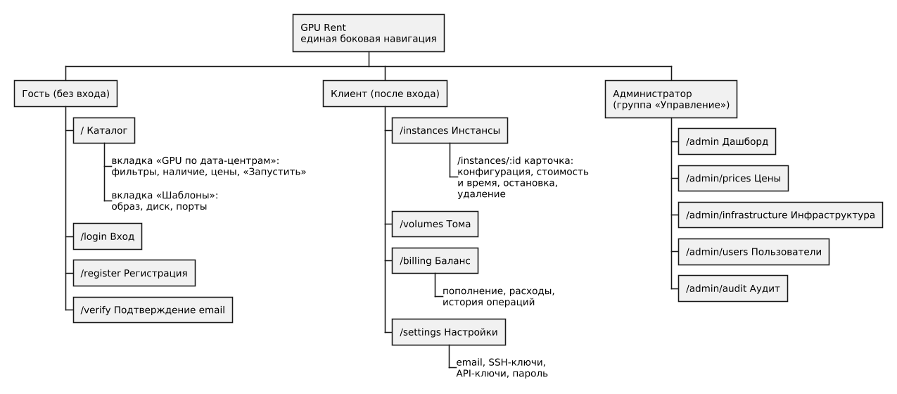
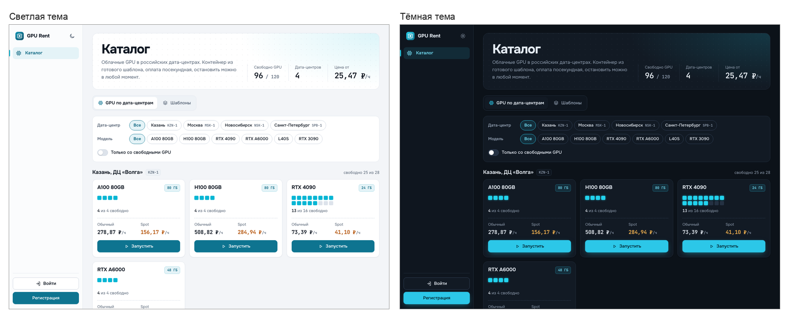
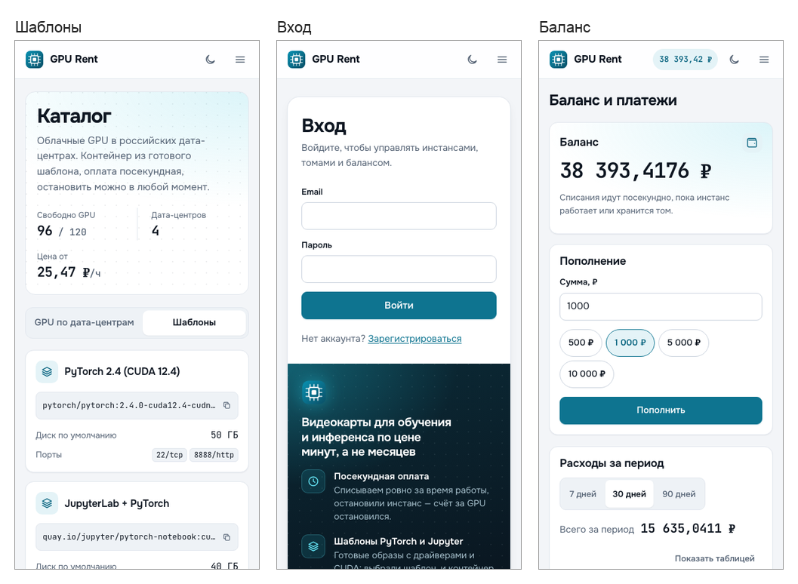
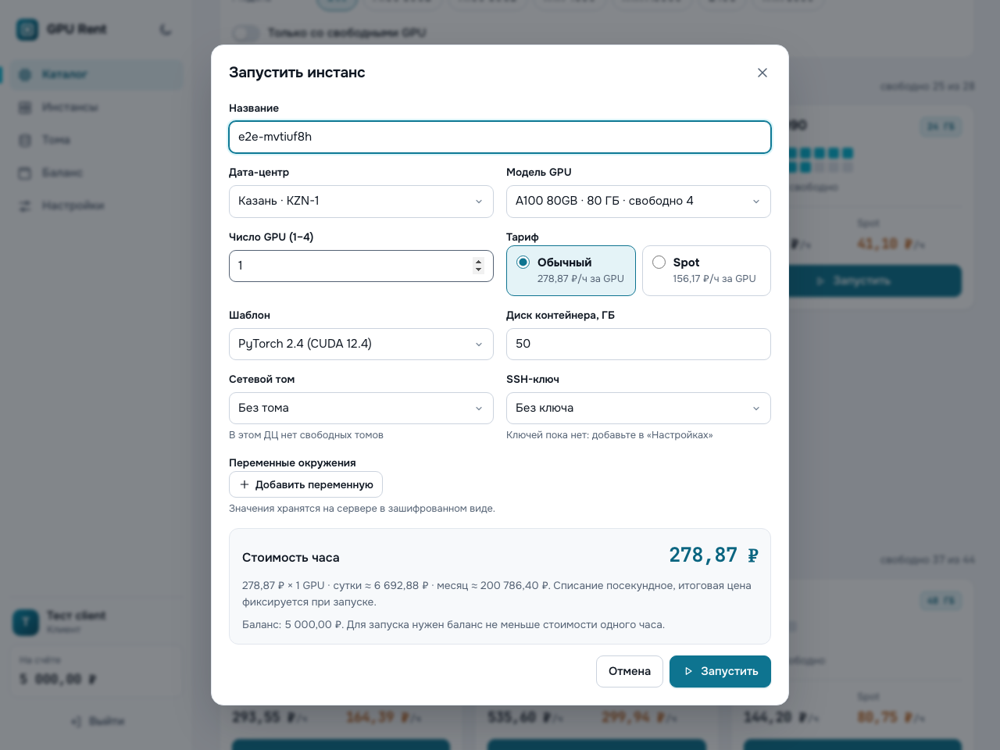

# Введение

## Цель работы

Описать, как спроектированы интерфейс и взаимодействие в GPU Rent: для кого сделан сервис, как устроены информация и навигация, какой визуальный язык выбран, что служит макетом и прототипом и как интерфейс проверен на удобство. Отдельно честно отметить, чего проверка не охватила.

## Задание

1. Исследовать аудиторию: определить целевых пользователей, их потребности и ожидания.
2. Спроектировать информационную архитектуру: структуру информации, карту сайта и меню.
3. Создать дизайн интерфейса с учётом бренда и целей приложения: визуальный язык, макеты страниц и компонентов.
4. Построить интерактивный прототип и протестировать интерфейс.

# Ход работы

Интерфейс GPU Rent разработан в обратном порядке по сравнению с учебной схемой: низкодетальных макетов в графическом редакторе не рисовалось, прототипом и макетом служит работающее приложение на React (П6), а дизайн уточнялся по снимкам экранов. Тестирования с живыми пользователями не было; вместо него выполнены эвристическая оценка и сценарные e2e-тесты, а проверка с людьми оформлена планом (раздел «Тестирование»). Продуктовые факты — на 07.11.2026, коммит `bb50546`. Порядок шагов соответствует циклу человеко-ориентированного проектирования [12]. Развёрнутая клиентская архитектура описана в П6 и здесь не повторяется.

## Исследование аудитории

Исходные данные — анализ аналогов (RunPod, Vast.ai, Immers.cloud, П1) и прото-персоны из П2 (студент, разработчик, специалист по рендерингу). Интервью и опросов не проводилось, поэтому потребности ниже — рабочие гипотезы, а не измеренный факт.

Таблица 1 — Аудитория, задачи и ожидания

| Группа | Главные задачи | Ожидания от интерфейса | Где решается |
|---|---|---|---|
| ML-инженер | Быстро получить GPU нужной модели с готовым окружением, подключиться, остановить, чтобы не платить; автоматизировать запуск | Цена и наличие видны до запуска; шаблон с PyTorch или Jupyter; API-ключи для скриптов | Каталог, диалог запуска, «Настройки», `/api/docs` |
| Студент | Недорого решить лабораторную или обучить модель для диплома, не потратив лишнего | Предсказуемый баланс, понятная ошибка при нехватке денег, минимум настроек, работа с телефона | Баланс, «Не хватает N ₽» в диалоге, мобильный вид |
| Исследователь | Серии долгих запусков, до 8 GPU на ноде, тома с данными, учёт расходов | Выбор дата-центра, сетевые тома, история операций и расходы за период | Фильтры каталога, «Тома», «Баланс» |
| Администратор площадки | Менять цены, следить за нодами и загрузкой, блокировать нарушителей, читать аудит | Опасные действия подтверждаются; видно историю изменений | `/admin/*` |

Из таблицы следуют три проектных решения: цена и наличие выносятся на карточку GPU, а не прячутся в диалог; роль администратора отделена в свою группу меню; все сценарии клиента должны работать на экране 360 px (NFR-07 из П2).

## Информационная архитектура и навигация

Структура строилась от целей пользователя, а не от таблиц БД: «выбрать GPU» → «запустить» → «следить» → «платить» → «настроить доступ». Отсюда пять разделов клиента и отдельная группа для администратора (рисунок 1).

Принципы меню ([Layout.tsx](../../web/src/components/Layout.tsx)):

- **Одно постоянное меню.** Слева боковая панель: «Каталог», после входа — «Инстансы», «Тома», «Баланс», «Настройки»; администратору добавляется группа «Управление» с ссылкой «Админка», внутри неё — вкладки (дашборд, цены, инфраструктура, пользователи, аудит). Меню не меняет порядок и не зависит от страницы.
- **Состояние аккаунта всегда на виду.** В подвале панели — имя, роль, баланс-ссылка «На счёте» и «Выйти»; у гостя вместо них «Войти» и «Регистрация». На телефоне вместо панели верхняя полоса с балансом-чипом, переключателем темы и меню-«гамбургером».
- **Каталог открыт без входа.** Гость сначала видит цены и наличие и лишь потом регистрируется; защищённые адреса ведут на `/login` и после входа возвращают обратно.
- **Адрес хранит состояние.** Платёж открывается по `/billing?payment=<id>`, карточка инстанса — по `/instances/:id`; ссылку можно отправить и открыть заново.
- **Подтверждение email не блокирует навигацию.** Пока адрес не подтверждён, над страницей стоит баннер со ссылкой «Подтвердить email»; запуск запрещён, остальное доступно.
- **Секреты не светятся.** API-ключ показывается один раз, в базе остаётся только его SHA-256 [1]; тексты ошибок не раскрывают устройство сервера [2].

Всего 14 страниц, плюс экран заблокированного аккаунта и страница «не найдено».

## Визуальный дизайн и система токенов

Фирменный цвет — циан на холодном графите (палитра «Coolant», [styles.css](../../web/src/styles.css)); янтарь закреплён за тарифом Spot, зелёный, жёлтый и красный — за состояниями. Шрифты — Onest для текста и JetBrains Mono для чисел, образов и кодов: цифры цен выровнены табличными знаками. Задачи сервиса отражены в форме: у карточки GPU есть «кристалл» — ячейка на каждую карту, заполненная для свободных; число «13 из 16 свободно» повторяет его текстом, поэтому смысл не держится на цвете.

Весь внешний вид собран на переменных CSS: в `:root` объявлено 53 токена (таблица 2).

Таблица 2 — Слои токенов

| Слой | Примеры | Роль |
|---|---|---|
| Поверхности и текст | `--bg`, `--surface`, `--surface-2/3`, `--text`, `--muted`, `--border` | Фон, карточки, иерархия текста |
| Акцент и бренд | `--accent`, `--accent-soft`, `--accent-ink`, `--on-accent`, `--focus` | Кнопки, ссылки, активный пункт, фокус |
| Семантика | `--spot*`, `--ok*`, `--warn*`, `--danger*` (основной, `-soft`, `-border`) | Тариф, статусы, ошибки |
| Форма и ритм | `--radius*`, `--font`, `--mono`, `--gutter`, `--sidebar-w`, `--ease` | Одинаковы в обеих темах |

В тёмной теме переопределены 45 цветовых и теневых токенов, остальные 8 общие; сами компоненты цвета не знают (в таблице стилей 362 обращения `var(--…)`). Тема выбирается так: без выбора — по `prefers-color-scheme`; выбор по кнопке пишется в `localStorage` (с `try/catch`) и ставит `data-theme` на `<html>` до рендера [10]. Блок тёмных значений поэтому записан дважды (медиазапрос и атрибут); их идентичность проверена скриптом. Рисунок 2 показывает одну страницу в обеих темах.

Контраст пар цветов пересчитан по формуле WCAG [8], [9] из значений токенов; порог для обычного текста — 4,5.

Таблица 3 — Контраст ключевых пар

| Пара | Светлая | Тёмная |
|---|---:|---:|
| Текст на фоне | 16,5 | 15,8 |
| Приглушённый текст на карточке | 6,3 | 6,8 |
| Текст кнопки на акценте | 5,4 | 8,4 |
| Акцентный текст на подложке | 5,8 | 8,7 |
| Spot на своей подложке | 4,6 | 7,6 |
| Успех / ошибка на своей подложке | 4,9 / 5,8 | 7,4 / 6,6 |

Подложки с прозрачностью в тёмной теме смешаны с цветом карточки. Самая слабая пара — Spot в светлой теме (4,57), запас минимален. Это расчёт, а не аудит инструментом вроде axe или Lighthouse: такого прогона не было.

Доступность в коде: ссылка «К содержимому», видимый `:focus-visible`, `aria-pressed` у чипов-фильтров, `aria-live` у уведомлений, диалоги на `<dialog>`, `prefers-reduced-motion`, подписи полей отделены от подсказок. Адаптивность — четыре точки останова (1080, 800, 480 и 400 px): панель превращается в верхнюю полосу, таблицы — в карточки.

## Макеты страниц и компонентов

Отдельного макета в Figma или на бумаге нет — об этом надо сказать прямо. Роль макета выполняют: список компонентов в [ui.tsx](../../web/src/components/ui.tsx) (`PageHead`, `Field`, `Empty`, `QueryState`, `StatusBadge`, `CopyChip`) и снимки экранов в [docs/screenshots](../screenshots/), снятые сценариями Playwright с демо-данными. Такой «макет по факту» не расходится со страницей, но не помогает обсуждать идею до кода.

Мобильные экраны (рисунок 3) проверялись отдельными снимками 390 px: вход, баланс, шаблоны. Карточка шаблона держит длинный образ в одной строке с многоточием, полное имя копируется кнопкой.

Ключевой составной компонент — диалог запуска (рисунок 4): шаблон и диск подставляются по умолчанию, имя инстанса предлагается (`pod-NNNN`), тариф выбирается карточками с ценой за GPU в час, число GPU ограничено свободными на ноде, а нехватка денег показывается до отправки.

## Интерактивный прототип

Прототипом служит само приложение: боевой адрес https://gpu-rent-lemon.vercel.app, где оплата и почта работают в демо-режиме (`DEMO_PAYMENTS`, `DEMO_MAIL`), а демо-ссылка подтверждения email приходит прямо в ответе. Тестировщик проходит весь путь «регистрация → подтверждение → пополнение → запуск → остановка» без реальных денег. Плюс такого прототипа — реальные задержки и ошибки сервера; минус — любое изменение стоит кода. Спорные места лучше проверять на эскизах до программирования.

## Тестирование интерфейса

### Эвристическая оценка

Интерфейс просмотрен по десяти эвристикам Нильсена [4]. Оценщик один — автор, поэтому оценка пристрастна: метод требует нескольких независимых оценщиков. Опирались на код и снимки; тяжесть замечаний не ранжировалась.

Таблица 4 — Эвристики Нильсена: что есть и что найдено

| Эвристика | Что реализовано | Найденная проблема и статус |
|---|---|---|
| 1. Видимость состояния | Бейдж статуса, баланс в панели, «≈ N ₽» у работающего инстанса растёт раз в секунду, опрос списка раз в 15 с, скелетоны, `aria-live` | Смена пароля умалчивала об отозванных API-ключах: уведомление теперь называет их число — исправлено. Баланс на странице «Баланс» — 4 знака после запятой, в чипе — 2: расхождение — не исправлено |
| 2. Соответствие реальному миру | Русские тексты, ₽/ч, города дата-центров | Термин «Spot» нигде не объяснён — не исправлено; знаком ML-инженеру, но не студенту |
| 3. Свобода и контроль | Esc закрывает диалог, остановленный инстанс можно запустить снова | Удаление необратимо, отмены нет: защита — подтверждение. Принято |
| 4. Единообразие | Общие `PageHead`, `Field`, `QueryState`, одни и те же чипы и бейджи | Подсказка «Не короче 8 символов» попадала в имя поля «Пароль» (внутри `<label>`) — исправлено |
| 5. Предотвращение ошибок | Диск 10–2000 ГБ, GPU не больше свободных на ноде, «Не хватает N ₽», кнопка запуска неактивна без наличия, баннер до подтверждения email | Пределы форм расходились с сервером (пополнение до 1 000 000 ₽ против 100 000, том 10 000 ГБ против 5000) — выровнены |
| 6. Узнавание вместо припоминания | Меню всегда видно; фильтры — чипы с текущим значением; имя, шаблон и диск подставляются | — |
| 7. Гибкость | Копирование образа в один клик, API-ключи, ссылка на платёж | Нет поиска по каталогу и горячих клавиш — не сделано |
| 8. Эстетика и минимализм | Шапка каталога с тремя числами, карточка с ценой и кнопкой | Риск «вылезающих» карточек шаблонов при длинных образах: `min-width: 0`, многоточие у образа, `overflow-wrap: anywhere` у заголовка; проверка 360 px в e2e охватывает `/`, `/login`, `/register`, вкладка «Шаблоны» — только снимок 390 px |
| 9. Помощь с ошибками | Единый `ErrorNote`, русский текст сервера, у 402 ссылка «Пополнить баланс», «Повторить» у списков | Заблокированный пользователь получал ошибку на каждый запрос — добавлен экран с кнопкой «Выйти» |
| 10. Справка и документация | Swagger UI на `/api/docs`, подписи у полей | Нет раздела «Справка», онбординга и пояснений терминов — не сделано |

Итого: 9 замечаний, 4 исправлены (пароль и ключи, подпись поля, пределы форм, экран блокировки), 4 открыты (4 знака баланса, Spot, поиск и горячие клавиши, справка), одно — риск, закрытый стилями. Три из четырёх исправлений найдены не оценкой, а при сквозном запуске клиента с сервером (П6).

### Сценарные e2e-тесты

В [web/e2e](../../web/e2e/) 21 сценарий Playwright [11] (проверено `npx playwright test --list`): 8 публичных и входа демо-пользователя, 10 сквозных клиентских, 3 администратора. Это проверка проходимости задач, а не удобства. Локально сценарии зелёные; против боевого сайта в режиме `E2E_READONLY=1` пройдено 6, пропущено 15 (данные там не меняются).

Таблица 5 — Задачи пользователя и покрывающие сценарии

| Задача | Сценарий |
|---|---|
| Увидеть цены без регистрации; переключиться на шаблоны | «каталог GPU виден без входа», «вкладка „Шаблоны“» |
| Зарегистрироваться, подтвердить email | «регистрация: клиентская валидация…», «подтверждение email» |
| Понять, почему не запустилось | «запуск без денег: ошибка 402 с понятным текстом» |
| Пополнить, запустить, остановить, удалить | «пополнение…», «запуск инстанса…», «остановка с подтверждением», «удаление инстанса и выход» |
| Завести ключи | «ключи: SSH-ключ и API-ключ…» |
| Пользоваться с телефона | «на экране 360 px нет горизонтальной прокрутки» |
| Администратор: цена, блокировка, защита маршрутов | три сценария `admin.spec.ts` |

### Чего не было, и план коридорного теста

Не проводились: тест с живыми пользователями, опрос, интервью, A/B, автоматический аудит доступности (axe, Lighthouse), проверка скринридером, проверка в Safari и Firefox. Всё перечисленное — открытые пункты. Ближайший шаг — коридорный тест на пяти людях: по оценке Нильсена [5] пять участников выявляют большую часть типовых проблем, а серию из пяти можно повторять после исправлений.

Таблица 6 — План коридорного теста

| Параметр | Решение |
|---|---|
| Участники (5) | 2 студента без опыта аренды GPU, 2 разработчика или ML-инженера (хотя бы один знает RunPod или Vast.ai), 1 в роли администратора |
| Среда | Боевой сайт в демо-режиме, новые учётные записи, ноутбук; один участник проходит часть сценариев с телефона |
| Метод | Думание вслух, наблюдатель молчит и не подсказывает; 15–20 минут на человека; запись экрана с согласия |
| Сценарии | 1. Найти самую дешёвую свободную карту и запустить инстанс. 2. Хватает ли денег на 5 часов, пополнить. 3. Остановить инстанс, объяснить, что будет со счётом. 4. Выпустить API-ключ для скрипта. 5. (админ) сменить цену и найти запись об этом в аудите |
| Метрики | Успех без подсказки по каждому сценарию (цель — не ниже 80 %); время; число ошибочных переходов и кликов; опросник SUS [6] после сессии (цель — не ниже 68, это проектный критерий, а не норма) |
| Что считать находкой | Любое место, где ≥ 2 из 5 застряли; фиксировать ранжирование тяжести 0–4 по Нильсену [7] |
| Результат | Таблица замечаний с приоритетом, правки, повторная серия на 3–5 людях |

Тест пока не проведён, дат и результатов нет.

# Ответы на контрольные вопросы

## Вопросы на оценку 2

### Какие шаги были предприняты для определения целевой аудитории приложения?

Использованы анализ аналогов (RunPod, Vast.ai, Immers.cloud) и прото-персоны из П2. Выделены четыре группы: ML-инженер, студент, исследователь и администратор площадки; для каждой записаны задачи и ожидания (таблица 1). Интервью и опросов не было, поэтому группы и их потребности — гипотезы.

### Какая информационная архитектура и структура навигации была разработана?

Структура строится от целей пользователя: каталог, инстансы, тома, баланс, настройки и отдельная группа «Управление» для администратора. Карта сайта — на рисунке 1: 14 страниц, боковая панель на десктопе и верхняя полоса на телефоне, каталог открыт без входа, защищённые адреса ведут на вход.

### Какие основные ошибки или недоразумения возникли при проектировании интерфейса и взаимодействия?

Найдены в основном при сквозном запуске: подсказка пароля вошла в имя поля, пределы форм разошлись с сервером, у заблокированного пользователя не было экрана, а уведомление о смене пароля не говорило про отозванные ключи. Эвристическая оценка добавила незакрытые замечания: Spot не объяснён, баланс показан с разной точностью, нет поиска и справки (таблица 4).

## Вопросы на оценку 3

### Какие методы использовались для исследования потребностей и предпочтений пользователей?

Анализ аналогов, прото-персоны, разбор документации и сценариев использования (П2). Прямых методов — интервью, опроса, наблюдения — не применялось. Предпочтения по оформлению не измерялись.

### Какие элементы дизайна интерфейса были разработаны?

Боковая навигация и мобильная полоса, шапка каталога, карточки GPU с индикатором наличия, чипы-фильтры, карточки шаблонов, диалоги и уведомления, бейджи статусов, таблицы, превращающиеся в карточки, график выручки, тёмная и светлая темы на токенах (таблица 2, рисунки 2–4).

### Какие тестовые сценарии и методы тестирования были применены для прототипирования и оценки интерфейса?

Эвристическая оценка по Нильсену (таблица 4), 21 сценарий Playwright, включая проверку отсутствия горизонтальной прокрутки на 360 px (таблица 5), и ручной просмотр снимков в обеих темах и на 390 px. Тестирование с пользователями запланировано, но не проведено (таблица 6).

## Вопросы на оценку 4

### Какой дизайн интерфейса был создан с учетом бренда и целей приложения?

Бренд — «техничный и спокойный»: холодный графит, циан как фирменный цвет, моноширинные цифры для цен и образов. Цели учтены так: цена и наличие на карточке (быстрый выбор), янтарный Spot отличим от обычного тарифа, баланс всегда в панели (контроль расходов), деструктивные действия подтверждаются. Темы и контраст — таблицы 2 и 3.

### Какие методы и инструменты использовались для создания интерактивных прототипов?

Прототипа отдельным инструментом не было: интерфейс сразу реализован на React 18, Vite и собственном CSS, а демо-режимы платежей и почты (`DEMO_PAYMENTS`, `DEMO_MAIL`) позволяют пройти весь путь без реальных денег на боевом сайте. Графических редакторов (Figma) не использовалось.

### Какие результаты были получены при тестировании и оптимизации пользовательского опыта?

Эвристическая оценка дала 9 замечаний: 4 исправлены, 4 открыты, одно закрыто стилями (таблица 4). Сценарии e2e подтверждают проходимость ключевых задач. Контраст пересчитан: все пары выше 4,5, минимум — Spot в светлой теме (4,57). Первая загрузка — 103,1 КиБ gzip. Удовлетворённость реальных пользователей не измерялась.

## Вопросы на оценку 5

### Можете ли вы подробно описать процесс исследования, проектирования и тестирования пользовательского интерфейса и взаимодействия?

Процесс был таким: гипотезы об аудитории из анализа аналогов → карта сайта от целей пользователя → реализация интерфейса компонентами → визуальное обновление (палитра, токены, темы, боковая навигация) → снимки сценариями Playwright → эвристическая оценка → план проверки с людьми. Прототипирование шло кодом, поэтому проблемы находились поздно, при интеграции с сервером. Недостающий шаг — тест с пользователями (таблица 6).

### Какие передовые методы и инструменты были использованы для проектирования и тестирования интерфейса?

Дизайн-токены на CSS-переменных с двумя темами и выбором по `prefers-color-scheme`, адаптивные таблицы-карточки, `<dialog>`, `aria-live`, `prefers-reduced-motion`. Проверка: эвристики Нильсена, e2e на Playwright, расчёт контраста по WCAG 2.2. Не использованы автоматический аудит доступности и сервисы тестов с пользователями.

### Какие меры были приняты для обеспечения высокого уровня удовлетворенности пользователей интерфейсом приложения?

Прозрачность денег (цена до запуска, оценка «≈ N ₽», «Не хватает N ₽», баланс в панели), защита от дорогих ошибок (подтверждения, лимиты форм), понятные русские сообщения об ошибках, работа с телефона и в тёмной теме, ключ API показывается один раз с предупреждением, потому что ошибки людей опаснее ошибок кода [3]. Уровень удовлетворённости не измерен: это задача SUS в плане коридорного теста.

# ЗАКЛЮЧЕНИЕ

GPU Rent спроектирован вокруг четырёх групп пользователей: ML-инженера, студента, исследователя и администратора. Навигация строится от их задач и закреплена в единой боковой панели, визуальный язык — токены с двумя темами, контраст пар пересчитан по WCAG. Макетом и прототипом служит работающее приложение, что быстро, но поздно вскрывает проблемы. Эвристическая оценка нашла 9 замечаний: 4 исправлены, 4 открыты, а 21 сценарий e2e подтверждает проходимость задач. Главный пробел — нет проверки с живыми пользователями; её план на пять человек с метриками успеха и SUS составлен, но не выполнен. Следующие шаги: коридорный тест, объяснение Spot и единая точность денег, автоматический аудит доступности.

## СПИСОК ИСПОЛЬЗОВАННЫХ ИСТОЧНИКОВ

1. Шнайер Б. Прикладная криптография. — Питер, 2008. — 784 с.
2. Гудро М. Тайны хакеров. Безопасность Web-приложений. — ДМК Пресс, 2019. — 480 с.
3. Митник К. Искусство обмана. Хакерские приемы и тактики. — Манн, Иванов и Фербер, 2019. — 488 с.
4. Nielsen J. 10 Usability Heuristics for User Interface Design. — Nielsen Norman Group. — https://www.nngroup.com/articles/ten-usability-heuristics/
5. Nielsen J. Why You Only Need to Test with 5 Users. — Nielsen Norman Group, 2000. — https://www.nngroup.com/articles/why-you-only-need-to-test-with-5-users/
6. Brooke J. SUS: A «quick and dirty» usability scale // Usability Evaluation in Industry. — London: Taylor & Francis, 1996. — P. 189–194.
7. Nielsen J. Severity Ratings for Usability Problems. — Nielsen Norman Group. — https://www.nngroup.com/articles/how-to-rate-the-severity-of-usability-problems/
8. Web Content Accessibility Guidelines (WCAG) 2.2. — W3C. — https://www.w3.org/TR/WCAG22/
9. Understanding SC 1.4.3: Contrast (Minimum). — W3C. — https://www.w3.org/WAI/WCAG22/Understanding/contrast-minimum.html
10. prefers-color-scheme. — MDN Web Docs. — https://developer.mozilla.org/en-US/docs/Web/CSS/@media/prefers-color-scheme
11. Playwright. Getting started. — https://playwright.dev/docs/intro
12. ГОСТ Р ИСО 9241-210-2016. Эргономика взаимодействия человек-система. Часть 210. Человеко-ориентированное проектирование интерактивных систем. — М.: Стандартинформ, 2016.

Дата обращения к электронным источникам: 25.11.2026.
