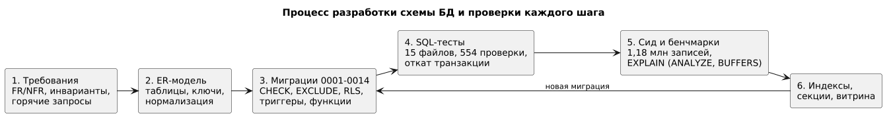
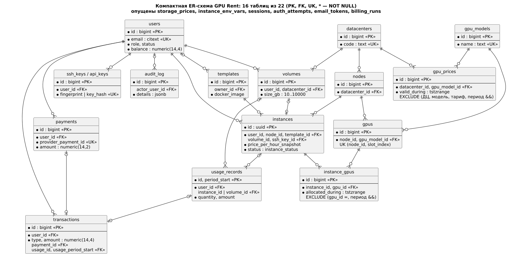

# Введение

## Цель работы

Пройти путь проектирования базы данных на примере GPU Rent: определить данные и требования к ним, построить схему с ключами и ограничениями, написать SQL-скрипты и запросы, проверить результат тестами и планами выполнения.

## Задание

1. Определить данные и требования к их хранению, обработке и доступу.
2. Спроектировать схему: таблицы, поля, связи, ключи, нормализация, оптимизация быстрого доступа.
3. Написать SQL-скрипты создания и запросы вставки, обновления, выборки и удаления.
4. Протестировать базу и проанализировать производительность запросов.

# Ход работы

Отчёт сквозной: от требований до замеров (рисунок 1); логическая и физическая модели подробно описаны в П3 и П4. Скрипты лежат в [db/migrations](../../db/migrations/), тесты — в [db/tests](../../db/tests/), замеры — в [db/bench](../../db/bench/).



## Данные и требования

GPU Rent — сервис аренды облачных GPU: клиент пополняет баланс, запускает инстанс на выбранной площадке и платит за время работы. Требования переведены в данные так (таблица 1).

Таблица 1 — От требований к данным

| Что нужно приложению | Какие данные и типы | Требование к доступу |
|---|---|---|
| Учётные записи, вход | email `citext`, bcrypt-хэш, роль и статус (`enum`), сессии, хэши ключей `bytea` | Email без учёта регистра; хэш пароля недоступен приложению |
| Каталог: площадки, ноды, GPU, цены | справочники, цена `numeric(14,4)`, период `tstzrange` | Читает любой посетитель; две цены на одну секунду невозможны |
| Аренда | инстанс (`uuid`), снимок цены, выделения GPU по времени, тома, секреты | Одна GPU — один инстанс в момент времени; чужой том подключить нельзя |
| Расчёты | платежи, потребление по интервалам, журнал проводок, баланс | Точные деньги; журнал только дополняется; платёж зачисляется один раз |
| Аналитика и аудит | выручка по дням, журнал действий `jsonb` | Быстрый дашборд; аудит читает администратор |

Горячие запросы: каталог, активные инстансы, баланс, расходы за месяц, история операций, выручка. Тестовый набор ([сид](../../db/seed/seed.sql), детерминированный): 5000 пользователей, 20 000 инстансов, 1 184 157 записей потребления, 1 208 510 проводок. Это тестовые данные, не нагрузка реальных клиентов.

## Схема базы данных

В схеме 22 предметные таблицы и таблица учёта миграций `schema_migrations`, 9 типов `enum`. Рисунок 2 показывает ядро из 16 таблиц; полные ER-модели — в П3.



Ключи и ограничения (подсчёт по системному каталогу собранной БД): 23 первичных ключа, 30 внешних, 17 уникальных, 39 CHECK и 3 исключающих ограничения EXCLUDE. Принцип: инвариант защищается на самом нижнем уровне, чтобы его не обошёл ни один путь записи: API, планировщик или ручной SQL [4] (таблица 2).

Таблица 2 — Как схема защищает инварианты

| Инвариант | Механизм |
|---|---|
| Идентификатор не угадать, ключи не пересекаются | PK `bigint GENERATED ALWAYS AS IDENTITY`; для инстанса `uuid`, он виден в URL |
| Чужой том, SSH-ключ или платёж подключить нельзя | Составной внешний ключ `(volume_id, user_id)` на `UNIQUE (id, user_id)` родителя |
| Пароль хранится только хэшем | `CHECK (password_hash ~ '^\$2[abxy]\$…')` |
| Сумма проводки соответствует типу | `CHECK`: пополнение больше нуля, списание меньше нуля |
| Одна GPU — один инстанс в момент времени | `EXCLUDE USING gist (gpu_id WITH =, allocated_during WITH &&)` |
| У товара одна цена в момент времени | `EXCLUDE` по площадке, модели, тарифу и периоду |
| Один том — один живой инстанс | Частичный `UNIQUE (volume_id) WHERE status IN (…)` |
| Платёж и списание учитываются один раз | Частичные `UNIQUE` по `payment_id` и `(usage_id, usage_period_start)` |
| Баланс равен сумме проводок | Триггер `fn_ledger_apply` после вставки проводки; прямой `UPDATE balance` отвергается |

Сочетание `EXCLUDE` и диапазонов — главное проектное решение [5, 6]: равенство скаляров внутри такого ограничения даёт расширение `btree_gist`. Диапазоны объявлены как `[)`, поэтому периоды `[a,b)` и `[b,c)` соседствуют без конфликта. CHECK запрещает пустой диапазон: пустой период ни с чем не пересекается, и строка с ним молча обошла бы ограничение.

**Нормализация.** Модель доведена до третьей нормальной формы [2]: пользователь, модель GPU, площадка и нода вынесены в отдельные таблицы, чтобы характеристики не дублировались в каждой строке аренды. Связь инстанса и GPU многие-ко-многим разрешена таблицей `instance_gpus`, потому что одна карта обслуживает разные инстансы в разные периоды. Единственное отступление от первой формы — список портов шаблона одной строкой: он передаётся целиком и в фильтрах не участвует.

**Осознанная денормализация** ради скорости чтения: `users.balance` (триггер согласует его с журналом), `usage_records.user_id` (запрос без соединений, владельца сверяют составные FK), готовые `amount` и `quantity`, `instances.gpu_model_id`, `last_billed_at`, витрина `mv_daily_revenue`. Цена — дополнительная запись и сверка копии с источником; сверки есть в SQL-тестах.

## SQL-скрипты создания

Схема собрана 14 версионируемыми миграциями; каждая выполняется в одной транзакции от имени `gpu_rent_owner`, версия записывается в `schema_migrations`.

Таблица 3 — Миграции

| Номера | Содержание |
|---|---|
| 0001–0002 | Роли, схема, расширения `pgcrypto`, `btree_gist`, `citext`; `enum` |
| 0003–0004 | Справочники и основные таблицы, PK, FK, CHECK, EXCLUDE |
| 0005–0007 | Триггеры защиты, секции `usage_records`, индексы |
| 0008–0009 | Функции запуска, остановки, биллинга, пополнения, шифрования; представления |
| 0010–0011 | Аудит; права и политики RLS |
| 0012–0014 | SSH-ключ инстанса; таблицы веб-слоя (сессии, попытки входа, токены email, журнал биллинга); баланс покрывает час и уже работающих инстансов |

Выдержка из `0004_core_tables.sql` — выделение GPU:

```sql
CREATE TABLE instance_gpus (
    id               bigint GENERATED ALWAYS AS IDENTITY,
    instance_id      uuid      NOT NULL,
    gpu_id           bigint    NOT NULL,
    allocated_during tstzrange NOT NULL,   -- открытый конец = GPU занята сейчас
    CONSTRAINT pk_instance_gpus PRIMARY KEY (id),
    CONSTRAINT fk_instance_gpus_instance FOREIGN KEY (instance_id) REFERENCES instances (id),
    CONSTRAINT fk_instance_gpus_gpu FOREIGN KEY (gpu_id) REFERENCES gpus (id),
    CONSTRAINT ck_instance_gpus_range CHECK (
        NOT isempty(allocated_during) AND lower_inc(allocated_during)
        AND NOT upper_inc(allocated_during) AND lower(allocated_during) IS NOT NULL),
    CONSTRAINT ex_instance_gpus_no_overlap EXCLUDE USING gist (gpu_id WITH =, allocated_during WITH &&)
);
```

Журнал проводок и секционированное потребление (`0004`, `0006`, `0007`):

```sql
CONSTRAINT ck_transactions_sign CHECK (amount <> 'NaN' AND CASE type
    WHEN 'topup' THEN amount > 0 WHEN 'bonus' THEN amount > 0
    WHEN 'charge' THEN amount < 0 WHEN 'refund' THEN amount < 0 ELSE amount <> 0 END),

CREATE TABLE usage_records (… PRIMARY KEY (id, period_start) …) PARTITION BY RANGE (period_start);
CREATE TABLE usage_records_2026_08 PARTITION OF usage_records
    FOR VALUES FROM ('2026-08-01 00:00:00+00') TO ('2026-09-01 00:00:00+00');

CREATE INDEX idx_instances_user_active ON instances (user_id) WHERE status <> 'terminated';
CREATE INDEX idx_usage_user_period ON usage_records (user_id, period_start);
CREATE INDEX idx_usage_period_brin ON usage_records USING brin (period_start);
CREATE INDEX idx_transactions_user_created ON transactions (user_id, created_at DESC, id DESC);
```

Партиции создаёт функция `fn_ensure_usage_partition`: октябрь 2025 – декабрь 2026 плюс страховочная `default`. Секционирование и BRIN описаны в документации PostgreSQL [7, 8]. Всего в схеме 77 индексов (без индексов партиций), из них один GIN и один BRIN. Права выданы по принципу минимума: роль приложения не владеет таблицами, баланс и журналы ей на запись закрыты, а изменения идут через функции `SECURITY DEFINER` с фиксированным `search_path` [10].

## Запросы вставки, обновления, выборки и удаления

Веб-слой выполняет запросы в транзакции, в начале которой ставит контекст `app.user_id` и `app.user_role` (`set_config(…, true)`). RLS по этому контексту отдаёт клиенту только его строки [10]:

```sql
CREATE POLICY p_volumes ON volumes FOR ALL TO gpu_rent_app
    USING (user_id = fn_app_user_id() OR fn_app_is_admin())
    WITH CHECK (user_id = fn_app_user_id() OR fn_app_is_admin());
```

Политик в схеме 15 на 11 таблицах. Ниже — цикл операций над томом под ролью `gpu_rent_app` и контекстом клиента.

```sql
SELECT set_config('app.user_id', '1', true), set_config('app.user_role', 'client', true);

INSERT INTO volumes (user_id, datacenter_id, name, size_gb)       -- вставка
VALUES (1, 1, 'data', 100) RETURNING id, name, size_gb, status;

SELECT id, name, size_gb FROM volumes WHERE status = 'active';    -- выборка

UPDATE volumes SET size_gb = 200                                  -- обновление
WHERE name = 'data' AND status = 'active' RETURNING id, size_gb;

UPDATE volumes SET status = 'deleted', deleted_at = clock_timestamp()   -- «удаление»
WHERE name = 'data' AND status = 'active';
```

Тома и инстансы физически не удаляются: история нужна биллингу, поэтому «удаление» — смена статуса, а журналы приложению не дают ни `UPDATE`, ни `DELETE`. Физически удаляются, например, SSH-ключи и шаблоны пользователя (`DELETE … WHERE id = $1 AND user_id = $2`). Запуск инстанса и пополнение выполняют функции: `fn_start_instance(user, площадка, модель, число GPU, тариф, шаблон, имя)` и `fn_topup(payment_id)`. Запросы и ответы базы я прогнал на чистой БД с миграциями 0001–0014 (таблица 4). Ограничения проверены от имени владельца схемы; операции над томами, запуск инстанса и `DELETE` — под ролью `gpu_rent_app` с контекстом клиента; `fn_topup` вызван в системном контексте.

Таблица 4 — Реакция БД на проверочные запросы

| Запрос | Результат |
|---|---|
| `INSERT` тома с `user_id` другого пользователя | ошибка: нарушена политика строк (`WITH CHECK`) |
| `SELECT` томов под другим пользователем | 0 строк |
| `UPDATE` чужого тома | `UPDATE 0` |
| Размер тома 100 → 200 / 100 → 50 | выполнено / `volume size can only grow` |
| Том размером 5 ГБ | нарушен `ck_volumes_size` (10–10 000) |
| Пользователь с паролем без bcrypt-формата | нарушен `ck_users_password_hash` |
| Вторая цена на тот же период | `ex_gpu_prices_no_overlap` (SQLSTATE 23P01) |
| `fn_topup` дважды для одного платежа | `true`, затем `false`; баланс 1000,0000 один раз |
| `fn_start_instance` на 2 GPU (60 ₽/ч за карту) | статус `running`, снимок цены 120,0000, занято 2 GPU |
| То же на 8 GPU при 4 свободных | `not enough free GPUs` |
| `DELETE FROM transactions`, `DELETE FROM instances` | `permission denied` |

## Тестирование и производительность

**SQL-тесты.** В [db/tests](../../db/tests/) 14 файлов `NN_*.sql` и конкурентный сценарий `concurrency.sh` — всего 15 файлов, 554 проверки. Файлы выполняются в транзакции с откатом на собственной фикстуре (кроме 12 — он проверяет сид); помощники `assert_true`, `assert_eq` и `assert_raises` (требует ошибку с заданным SQLSTATE) завершают psql ошибкой при первом провале. Права проверяются настоящим `SET LOCAL ROLE`.

Таблица 5 — SQL-тесты (результат прогона 25.11.2026)

| Файл | Что проверяет | Проверок |
|---|---|---:|
| 01 | EXCLUDE, CHECK на диапазонах: двойная аллокация, пересечение цен | 13 |
| 02 | Журнал: знак суммы, неизменяемость, баланс равен сумме проводок | 32 |
| 03 | Жизненный цикл инстанса: подбор GPU, отказы, остановка, тома | 79 |
| 04, 05 | Биллинг-проход; идемпотентность пополнения | 53, 18 |
| 06 | Согласованность владельца (составные FK), проверки строк | 21 |
| 07 | Роли, права по столбцам, RLS | 80 |
| 08, 09, 10, 11 | Шифрование env; секции; аудит; представления | 19, 27, 19, 15 |
| 12 | Целостность сида (миллионы строк) | 32 |
| 13, 14 | SSH-ключ инстанса; сессии, throttling входа, подтверждение email | 8, 124 |
| `concurrency` | Параллельные запуски на ограниченных GPU | 14 |

Число 554 и 15 файлов подтверждены повторным прогоном `db/scripts/test.sh` на отдельной PostgreSQL 16.15 с миграциями 0001–0014 и сидом: `PASS: 15 файлов, 554 проверок`. Конкурентный тест требует, чтобы удавалось ровно четыре запуска при 12 одновременных запусках на ноде с 4 GPU; гонку решает `FOR UPDATE SKIP LOCKED`, а EXCLUDE остаётся запасной защитой.

**Анализ производительности.** Сценарии [db/bench](../../db/bench/) выполняют `EXPLAIN (ANALYZE, BUFFERS)` [9] на сиде в трёх состояниях: без индекса, с индексом, с денормализацией; результаты сохранены в [db/bench/results](../../db/bench/results/) (PostgreSQL 16.15, один клиент, тёплый кэш, настройки по умолчанию, замеры 30.09.2026 до миграций 0013–0014, которые таблицы потребления и журнала не меняли).

Таблица 6 — Время выполнения запроса по файлам results, мс

| Сценарий | До | Промежуточно | После | Решение |
|---|---:|---:|---:|---|
| Активные инстансы пользователя | 1,592 | 0,072 (полный индекс) | 0,015 | Частичный индекс `WHERE status <> 'terminated'` (88 кБ вместо 296 кБ) |
| Расходы за месяц | 33,119 | 6,922 (только секция) | 0,016 | Секции и индекс `(user_id, period_start)` |
| Баланс | 35,543 | 2,918 (индекс и `SUM`) | 0,008 | `users.balance` |
| История операций, страница в середине | 27,844 | 0,834 (`OFFSET`) | 0,018 | Индекс и keyset-курсор |
| Выручка за месяц / за год | 19,227 / 145,569 | — | 0,122 / 0,981 | `mv_daily_revenue` |
| Каталог GPU | 2,405 | — | 0,282 | Частичный индекс открытых выделений |

Что стоит за цифрами. **Partition pruning:** при условии `date_trunc('month', period_start …) = …` планировщик не может отсечь секции и просматривает все 16; с условием по «сырому» `period_start` читается одна секция. На собранной БД это видно уже по плану без выполнения. Повторный запуск тех же запросов сразу после загрузки сида, без прогрева кэша, дал 28,4 мс против 0,47 мс: порядок выигрыша тот же (около 60 раз), абсолютные значения выше, чем в файле. **Тяжёлый пользователь** (615 записей за месяц) с индексом и отсечением укладывается в 0,185 мс. **BRIN** по `period_start` занимает 24 кБ против 3672 кБ у B-tree на той же секции; в запросе выручки он обслужил краевую секцию (95 буферов, лишние 4136 строк снял Recheck), потому что BRIN хранит только диапазоны значений блоков и даёт приблизительный ответ. **Баланс и keyset:** для баланса число страниц сократилось с 22 059 до 11; для истории курсор читает 43 буфера вместо 3647 при `OFFSET` [12]. **Цена витрины:** обновление `mv_daily_revenue` занимает 556 мс и выполняется заранее, а не при просмотре.

## Проблемы и ошибки при разработке

- В первой версии проверка «баланс не меньше цены часа» (0008) сравнивала баланс только с часом нового инстанса: при балансе на один час можно было запустить любое число инстансов, и баланс уходил в минус. Исправлено миграцией 0014, граница проверена в `03_instance_lifecycle`; сама 0008 не менялась, чтобы не искажать историю применённых миграций.
- В 0011 право `SELECT` на `users` открывало `password_hash` всем строкам, а `users` и `templates` не были закрыты RLS. 0013 ужесточила права и включила RLS; хэш приложению недоступен напрямую.
- Пустой диапазон ни с чем не пересекается, поэтому строка с пустым периодом обходила EXCLUDE: добавлен CHECK на непустой диапазон с обязательным началом (комментарий в `0003`).
- Ссылка проводки на потребление `(usage_id, usage_period_start)` не содержит `user_id`: владельца списания согласует функция биллинга, а не ключ. Это известное ограничение, оно описано в П3.
- Строка вне созданных секций попадает в `default` и мешает создать нужный месяц до переноса. Секцию на следующий месяц создаёт служебный маршрут биллинга (его вызывает Vercel Cron раз в сутки), поэтому пропуск прохода дольше месяца оставит записи в `default`.

# Ответы на контрольные вопросы

## Вопросы на оценку 2

### Какие типы данных и структуры данных были определены для вашей базы данных?

Деньги — `numeric(14,4)`, платёж — `numeric(14,2)`; время — `timestamptz`, периоды цен и выделений — `tstzrange`. Email — `citext`, идентификатор инстанса — `uuid`, хэши и шифртекст — `bytea`, состав аудита — `jsonb`, IP — `inet`. Статусы вынесены в 9 `enum`. Структуры: справочники, журналы только на добавление, диапазоны периодов, секционированная таблица потребления, материализованная витрина (таблица 1).

### Какие таблицы и поля были включены в схему базы данных?

22 предметные таблицы: пользователи и ключи, платежи и проводки, площадки, модели, ноды, GPU, цены GPU и хранения, шаблоны, тома, инстансы, выделения GPU, секреты окружения, потребление, аудит, сессии, попытки входа, токены email и журнал биллинга. Поля и связи — на рисунке 2 и в таблице 2.

### Какие основные проблемы или ошибки были обнаружены при разработке базы данных?

Перечислены в разделе «Проблемы и ошибки при разработке»: баланс не учитывал уже работающие инстансы, лишний доступ к хэшу пароля, пустой диапазон в EXCLUDE, ссылка проводки без владельца и страховочная `default`-секция.

## Вопросы на оценку 3

### Какие методы нормализации и оптимизации данных были применены при проектировании базы данных?

Нормализация до третьей формы с одним оговорённым отступлением (список портов) и осознанными денормализациями (баланс, владелец и суммы в потреблении, модель GPU инстанса, граница биллинга, витрина). Оптимизация — частичные, составные и BRIN-индексы, секции по месяцам, keyset-пагинация, материализованная витрина (таблицы 2 и 6).

### Какие SQL-скрипты были разработаны для создания и управления базой данных?

14 миграций (`migrate.sh` применяет недостающие по журналу `schema_migrations`), `reset.sh` пересоздаёт тестовую БД с сидом, `bench.sh` запускает замеры, `test.sh` — тесты, `create_login_role.sh` создаёт LOGIN-роль приложения. Примеры — в таблицах 3 и 4.

### Какие методы тестирования базы данных были использованы, и какие результаты они дали?

SQL-тесты с откатом (554 проверки, все пройдены), конкурентный тест гонки за GPU, проверка прав через `SET ROLE`, проверки целостности на сиде в 1,18 млн записей, замеры `EXPLAIN (ANALYZE, BUFFERS)`. Результаты — таблицы 5 и 6. Опросов пользователей и нагрузочного теста самой БД под реальным трафиком не было.

## Вопросы на оценку 4

### Какие инструменты и средства разработки баз данных были использованы при выполнении задания?

PostgreSQL 16 (на проде Neon, PostgreSQL 18.6), клиент `psql`, расширения `pgcrypto`, `btree_gist`, `citext`, PL/pgSQL, bash-скрипты миграций и тестов, `EXPLAIN (ANALYZE, BUFFERS)`, PlantUML для схем (рендер `tools/render_diagrams.py`), git для истории миграций.

### Какие методы и стратегии оптимизации производительности базы данных были применены?

Индексы под конкретные запросы с замером до и после (таблица 6): частичный индекс активных инстансов в 3,4 раза меньше полного; месячные секции с отсечением; BRIN для времени; keyset вместо `OFFSET`; хранимый баланс и материализованная выручка. Каждое решение подтверждено планом; промежуточные состояния (только секция, только индекс) тоже измерены.

### Как была обеспечена согласованность и целостность данных в вашей базе данных?

Транзакции с блокировками (`FOR UPDATE`, `SKIP LOCKED`), ограничения PK, FK (в том числе составные на владельца), CHECK и EXCLUDE, частичные `UNIQUE` для идемпотентности платежей и списаний, триггеры (баланс из журнала, переходы статусов, неизменяемые поля, журналы только на добавление). Согласованность денормализованных копий проверяют тесты 02, 04 и 12.

## Вопросы на оценку 5

### Можете ли вы подробно описать процесс разработки схемы и структуры вашей базы данных?

Из требований выписаны данные и инварианты (таблица 1). По ним построена ER-модель (рисунок 2): кардинальность и обязательность связей, точные типы для денег и времени. Модель нормализована, затем введены оправданные отступления. Каждая версия схемы оформляется миграцией, покрывается тестами и проверяется на сиде в миллион записей. Замеры показывают, какие индексы нужны, и возвращают процесс к миграциям (рисунок 1); 0012–0014 добавлены по требованиям веб-слоя и найденной ошибке.

### Какие передовые методы и инструменты использовались для проектирования и оптимизации базы данных?

Исключающие ограничения на диапазонах вместо проверок в приложении, составные внешние ключи для владельца, декларативное секционирование, BRIN и частичные индексы, материализованное представление с `REFRESH CONCURRENTLY`, keyset-пагинация, RLS, `SECURITY DEFINER`-функции, шифрование секретов `pgp_sym_encrypt`, планы `EXPLAIN (ANALYZE, BUFFERS)` вместо оценки на глаз.

### Какие меры были приняты для обеспечения высокой производительности и безопасности вашей базы данных?

Производительность: индексы и секции по замерам; бюджет 30 мс на запрос — проектное допущение, а не измеренный p95 приложения. Безопасность: три роли без LOGIN и отдельная LOGIN-роль веб-приложения без прав владельца и `BYPASSRLS`; права по столбцам; 15 политик RLS на 11 таблицах; в БД только хэши (bcrypt пароля, SHA-256 токенов и ключей) [1]; секреты окружения зашифрованы `pgp_sym_encrypt`, ключ в БД не хранится [11]; журналы только на добавление, а аудит фиксирует автора действия — основу расследования после инцидента с социальной инженерией [3]; аналитик видит маскированное представление. Остаётся граница доверия: скомпрометированная роль приложения может подменить контекст RLS и вызвать системные функции [2]. TLS, шифрование дисков и резервное копирование лежат вне схемы, настраиваются на уровне хостинга и в этой работе не проверялись.

# ЗАКЛЮЧЕНИЕ

База данных GPU Rent описана от требований до проверки: 22 предметные таблицы, 14 миграций, ограничения целостности вплоть до EXCLUDE на диапазонах, цикл запросов с RLS и 554 SQL-проверки, подтверждённые повторным прогоном. Замеры на 1,18 млн записей показали выигрыш индексов, секций и денормализации от 8 раз до нескольких тысяч (значения в десятки микросекунд шумят, надёжнее число прочитанных страниц). Что не сделано: нагрузочное тестирование БД под трафиком реальных пользователей и повторный полный прогон замеров после миграций 0013–0014.

## СПИСОК ИСПОЛЬЗОВАННЫХ ИСТОЧНИКОВ

1. Шнайер Б. Прикладная криптография. — Питер, 2008. — 784 с.
2. Гудро М. Тайны хакеров. Безопасность Web-приложений. — ДМК Пресс, 2019. — 480 с.
3. Митник К. Искусство обмана. Хакерские приемы и тактики. — Манн, Иванов и Фербер, 2019. — 488 с.
4. PostgreSQL 16. Constraints. — https://www.postgresql.org/docs/16/ddl-constraints.html
5. PostgreSQL 16. CREATE TABLE (EXCLUDE). — https://www.postgresql.org/docs/16/sql-createtable.html
6. PostgreSQL 16. Range Types. — https://www.postgresql.org/docs/16/rangetypes.html
7. PostgreSQL 16. Table Partitioning. — https://www.postgresql.org/docs/16/ddl-partitioning.html
8. PostgreSQL 16. BRIN Indexes. — https://www.postgresql.org/docs/16/brin.html
9. PostgreSQL 16. Using EXPLAIN. — https://www.postgresql.org/docs/16/using-explain.html
10. PostgreSQL 16. Row Security Policies. — https://www.postgresql.org/docs/16/ddl-rowsecurity.html
11. PostgreSQL 16. pgcrypto. — https://www.postgresql.org/docs/16/pgcrypto.html
12. Winand M. We need tool support for keyset pagination. — https://use-the-index-luke.com/no-offset

Дата обращения к электронным источникам: 25.11.2026.
