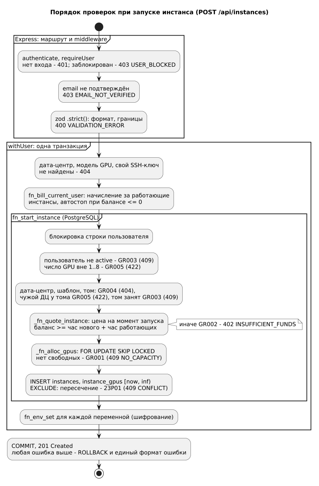
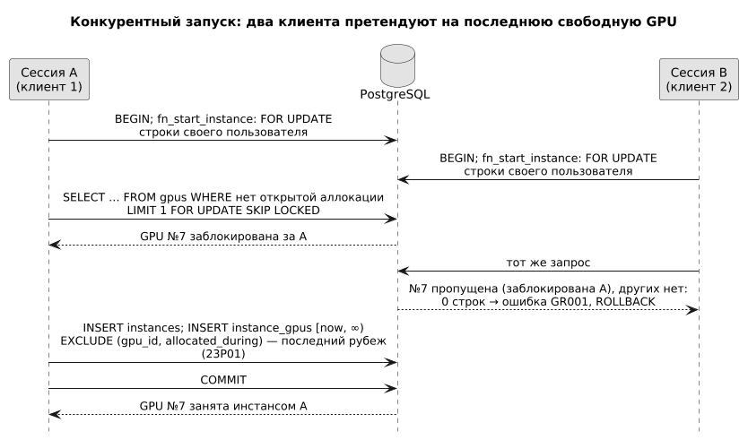
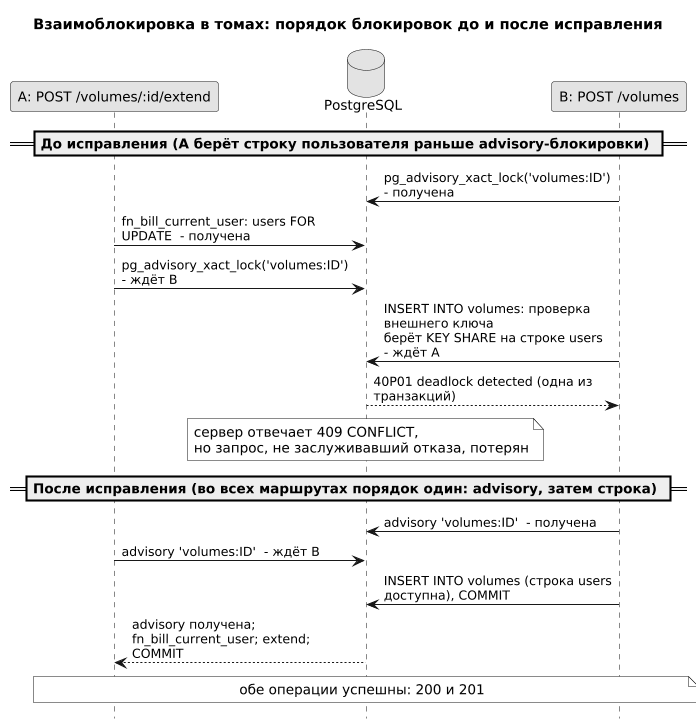

# Введение

## Цель работы

Описать, какие бизнес-правила определены в GPU Rent, где каждое исполняется, как защищено от обхода, чем проверено и какие ошибки найдены при отладке.

## Задание

1. Определить бизнес-правила приложения.
2. Запрограммировать серверную логику: обработку запросов, работу с базой данных, бизнес-операции.
3. Обеспечить безопасность: права доступа, аутентификацию, защиту от атак.
4. Протестировать серверную логику на соответствие правилам, отладить найденные ошибки.

# Ход работы

Архитектура сервера, REST API и аутентификация описаны в П5, физическая реализация БД — в П4; здесь они только фон. Состояние на 07.11.2026, коммит bb50546.

## Определение бизнес-правил

Правила взяты из требований П2 (FR-07, учёт потребления, пополнение, администрирование); часть появилась как исправление найденной ошибки. Принцип размещения: правило, нарушение которого портит деньги или данные, исполняет PostgreSQL — оно тогда действует при любом пути записи (API, планировщик, SQL-тест); правила о формате, правах и лимитах — маршрут Express.

Таблица 1 — Каталог бизнес-правил

| Правило | Где исполняется | Ошибка | Чем проверено |
|---|---|---|---|
| Баланс не меньше часа нового инстанса плюс часа всех работающих (миграция 0014) | БД: `_fn_quote_instance` | GR002, 402 | `instances.test.ts` (граница баланса, 0014); `03_instance_lifecycle.sql` |
| Одну GPU нельзя выдать дважды | БД: `_fn_alloc_gpus` (`SKIP LOCKED`, повторная проверка), последний рубеж — `EXCLUDE ex_instance_gpus_no_overlap` | GR001, 409; 23P01, 409 | `instances.test.ts` (борьба за последние GPU); `concurrency.sh`; `01_exclusion_constraints.sql` |
| Цена фиксируется при запуске | БД: `price_per_hour_snapshot` | — | `admin.test.ts` |
| Автостоп при балансе не больше нуля | БД: `fn_bill_current_user`, для cron — `fn_bill_usage`; запись в аудит | — | `billing.test.ts` (остановка видна в том же списке) |
| Биллинг при обращении: начисление за интервалы длиннее минуты | БД: `fn_bill_current_user`, её вызывают маршруты баланса, инстансов, запуска, расширения тома | — | `billing.test.ts` (параллельные обращения — одно начисление) |
| Платёж зачисляется один раз | Маршрут: HMAC по сырому телу; БД: `fn_payment_confirm`, `fn_topup`, сверка суммы | 401; GR005, 422; GR003, 409 | `payments.test.ts` (шесть одновременных уведомлений — одно зачисление) |
| Запуск только с подтверждённым email | Маршрут `POST /instances`; токен одноразовый, 24 часа | 403 `EMAIL_NOT_VERIFIED` | `instances.test.ts` («без подтверждённого email…») |
| Заблокированный теряет доступ сразу | Маршрут: `requireUser` (сессия и ключ); БД: `fn_start_instance` | 403 `USER_BLOCKED`; GR003 | `auth.test.ts`, `14_web_auth.sql` |
| Цены меняются без пересечений и разрывов | Маршрут `POST /admin/prices`: блокировка, закрытие периода и вставка в одной транзакции; БД: `EXCLUDE` | 23P01 как страховка | `admin.test.ts` (два одновременных изменения) |
| Один том — один живой инстанс; том только своего дата-центра | БД: `fn_start_instance` | GR003, 409; GR005, 422 | `volumes.test.ts` |
| Лимиты на аккаунт: 20 SSH-ключей, 10 API-ключей, 20 шаблонов, 10 томов и 5000 ГБ, 10 неоплаченных платежей за сутки | Маршрут, `pg_advisory_xact_lock` | `LIMIT_REACHED`, 409 | `keys.test.ts`, `volumes.test.ts`, `payments.test.ts` (и параллельные запросы) |
| Период отчётов — реальные даты, не больше 366 суток | Маршруты расходов и дашборда | 400 | `billing.test.ts` («границы периода»), `admin.test.ts` |

Две оговорки. Проверка email живёт только в маршруте: сама `fn_start_instance` её не делает. Автостоп срабатывает при обращении или проходе cron, поэтому баланс между проходами может уйти в небольшой минус (тест фиксирует `balance < 0` после десяти часов работы и остановку в том же ответе): на serverless постоянного процесса нет, и это отступление от «раз в минуту» из П2.

## Программирование серверной логики

Стек — Express 4 и TypeScript (strict), `pg` без ORM, zod для входа. Маршрут тонкий: проверить права и вход, открыть транзакцию, вызвать функции БД, собрать ответ. Проверки идут от дешёвых к дорогим (рисунок 1): отказ по формату не доходит до базы, отказ по балансу не занимает GPU.

`withUser` в [db.ts](../../server/src/db.ts) открывает транзакцию на одном соединении, кладёт в `set_config(..., true)` идентификатор, роль и IP, вызывает обработчик; при исключении делает `ROLLBACK`, оборванное соединение выбрасывает из пула. Одна транзакция — одна бизнес-операция: запуск создаёт инстанс, выделяет GPU и шифрует переменные окружения либо не делает ничего.

Против гонок применены три приёма:

- `SELECT ... FOR UPDATE SKIP LOCKED` в `_fn_alloc_gpus`: конкурент пропускает занятую GPU, а не ждёт; повторная проверка после блокировки и `EXCLUDE` закрывают остаток (рисунок 2);
- `FOR UPDATE` на строке пользователя в запуске и начислении сериализует операции одного человека, остальным не мешая;
- `pg_advisory_xact_lock(hashtextextended('вид:id', 0))` перед подсчётом лимита: без неё два запроса оба видят 19 ключей из 20 и оба создают ключ.

Функции БД бросают `RAISE EXCEPTION ... USING ERRCODE = 'GR00x'`, а [errors.ts](../../server/src/errors.ts) переводит код в ответ формата `{"error":{"code","message"}}` с русским текстом; текст PostgreSQL клиенту не отдаётся (в нём бывают имена таблиц).

Таблица 2 — Коды правил БД и ответы API

| Код | HTTP и `code` | Когда возникает |
|---|---|---|
| GR001 | 409 `NO_CAPACITY` | нет нужного числа свободных GPU на одной ноде |
| GR002 | 402 `INSUFFICIENT_FUNDS` | баланс не покрывает час нового и работающих инстансов |
| GR003 | 409 `INVALID_STATE` | заблокирован, том занят, повторная операция |
| GR004 | 404 `NOT_FOUND` | объект или цена не найдены (или чужие) |
| GR005 | 422 `CONSISTENCY` | GPU вне 1–8, том из другого ДЦ, сумма не совпала |
| GR006 | 500 `CONFIG` | не задан ключ шифрования `app.enc_key` |
| 23505, 23P01, 40001, 40P01 | 409 `CONFLICT` | дубль, пересечение периодов, конфликт транзакций |

Коды HTTP выбраны по смыслу [10]: 402 — нужна оплата, 409 — конфликт состояния, 422 — вход не согласован.

## Безопасность бизнес-правил

Правило безопасно, если его нельзя обойти сменой пути или подменой данных [8]. Общие механизмы (сессии, CSRF, throttling, CSP) описаны в П5 и П8, меры для правил — в таблице 3.

Таблица 3 — Как правила защищены от обхода

| Попытка обхода | Защита | Проверка |
|---|---|---|
| Передать чужой `userId`, роль, баланс или цену | zod `.strict()`; владелец из сессии; цена и баланс считаются в БД | `isolation.test.ts`, `payments.test.ts` («userId в теле игнорируется») |
| Обратиться к чужому объекту | Владелец в `WHERE`, RLS как вторая линия; чужой и несуществующий неразличимы (404) | `isolation.test.ts`, `keys.test.ts` |
| Подделать уведомление шлюза | HMAC-SHA256 по сырым байтам; сумма сверяется с платежом в БД; пользователя определяет платёж | `payments.test.ts` |
| Повторить уведомление | Блокировка строк, уникальная запись `topup` на платёж (`ON CONFLICT DO NOTHING`) | `payments.test.ts` |
| Опасная операция ключом скрипта | Смена пароля, выпуск ключей, изменяющие админские операции — только по сессии | `keys.test.ts` |
| Вызов функции БД с чужим контекстом | `SECURITY DEFINER`, фиксированный `search_path`, `_fn_assert_actor`: действовать можно за себя либо в системном или админском контексте | `03_instance_lifecycle.sql` (чужой и пустой контекст — 42501), `07_rls_and_roles.sql` |

Права проверяются дважды: маршрутом (`requireUser`, `requireAdmin`, `requireSession`) и политиками БД. Прямой `UPDATE` таблицы `users` у роли приложения отозван, поэтому баланс, роль и статус меняются только функциями БД. Двухфакторного входа и CAPTCHA нет, платежи и почта — демо.

## Тестирование и отладка

Три уровня: модульные тесты схем, ошибок и подписи; интеграционные через HTTP под ролью `gpu_rent_web` (без обхода RLS); SQL-тесты функций БД. На 07.11.2026: 571 серверный тест в 30 файлах (195 модульных, 376 интеграционных), 554 SQL-проверки в 15 файлах, 21 сценарий Playwright — локально пройдены. Для отчёта запущен только `errors.test.ts` (39 тестов, пройдено); наборы целиком не перезапускались.

Тесты берут границы (ровно час стоимости проходит, на копейку меньше — отказ; 366 суток допустимы, 367 нет), гонки воспроизводят через `Promise.all` с повтором раундов.

Таблица 4 — Ошибки, найденные и исправленные при отладке

| Ошибка | Как проявлялась | Исправление и тест |
|---|---|---|
| Проверка баланса при запуске шла по устаревшей сумме (`ec5c71e`) | Инстанс «должен» за 10 часов, но баланс в таблице этого не отражал: запуск проходил | Начисление перед запуском и возобновлением; тест «начисляют за работающие инстансы до проверки баланса» |
| Баланс сравнивался только с часом нового инстанса (0014, `bb50546`) | При балансе на час можно было запустить сколько угодно инстансов | `_fn_quote_instance` суммирует `price_per_hour_snapshot` работающих; тесты в БД и API |
| Взаимоблокировка в томах (`31189f5`) | Параллельные расширение и создание тома падали с `40P01` | Единый порядок: advisory, затем строка пользователя (рисунок 3); тест ждёт 200, 201, 201 три раунда |
| 500 на символ NUL и на битом gzip (`ec5c71e`) | PostgreSQL не принимает `\u0000` (22021, 22P05); `zlib` даёт ошибку `Z_*` без статуса | Оба случая переведены в 400; тест «NUL в тексте и битый gzip — 400, а не 500» |
| Границы периодов (`31189f5`) | `2026-02-31` или год `0000` давали исключение вместо 400 | Проверка даты до арифметики; «плохие» периоды в тестах обоих маршрутов |
| Лимиты ключей и шаблонов перешагивались (`31189f5`) | Два параллельных запроса оба видели «19 из 20» | Advisory-блокировка; параллельные тесты |
| Лимит 200 в списке скрывал работающий инстанс (`ec5c71e`) | Среди сотен завершённых активный не попадал в ответ | Сортировка «активные первыми»; тест с 205 завершёнными |
| Расширение тома обходило лимит 5000 ГБ (`ec66165`) | Том создавали маленьким и растягивали | Лимит и при расширении; тест |

Отладка шла по тестам и журналу pino (запрос с `reqId`, без тел и cookie; после `ec5c71e` с полным путём): ошибку сначала воспроизводил тест, затем правилась функция или маршрут. Живых пользователей не было.

## Производительность, надёжность, гибкость

`fn_bill_current_user` сначала без блокировок проверяет, есть ли что начислять, и в большинстве обращений на этом заканчивается. Блокировки заданы на пользователя, клиенты друг друга не ждут. Вебхук, начисление и повтор цены идемпотентны. Недоступная БД даёт 503.

Сервер без состояния: сессии и счётчики попыток в PostgreSQL, число экземпляров функции не важно. Шлюз по замыслу заменяется своим `provider` без правки правил зачисления (реальный не подключался); цены — данные в БД, лимиты — константы в одном месте. Высокая нагрузка не проверялась.

# Ответы на контрольные вопросы

## Вопросы на оценку 2

**Какие бизнес-правила и логику были определены для вашего веб-приложения?**

Двенадцать правил таблицы 1: баланс не меньше часа нового и работающих инстансов, запрет двойной выдачи GPU, фиксация цены, автостоп при нулевом балансе, биллинг при обращении, однократное зачисление платежа, подтверждение email, блокировка, смена цен без пересечений, связность томов, лимиты на аккаунт, корректные периоды отчётов.

**Какие задачи и операции были реализованы в серверной логике, и как они взаимодействуют между собой?**

Регистрация и вход, жизненный цикл инстансов, тома, начисление, пополнение через платёж и вебхук, администрирование цен, пользователей и инфраструктуры, аудит. Операции связывает общая транзакция `withUser` и функции БД: запуск сначала начисляет долг, потом проверяет баланс и занимает GPU (рисунок 1).

**Какие основные ошибки или недоразумения возникли при реализации серверной логики?**

Проверка баланса по устаревшей сумме и без работающих инстансов, взаимоблокировка в томах, 500 на NUL и битом gzip, неверные границы периодов, обход лимитов параллельными запросами (таблица 4).

## Вопросы на оценку 3

**Какие методы и средства программирования были использованы для разработки серверной логики?**

TypeScript и Express, `pg` с явными транзакциями, zod для входа, PL/pgSQL для правил с деньгами и GPU, `EXCLUDE` и `CHECK` как последний рубеж, advisory-блокировки и `SKIP LOCKED` против гонок, pino, vitest и supertest.

**Какие бизнес-правила были успешно реализованы, и как они влияют на функциональность приложения?**

Все из таблицы 1: они решают, кто и когда запускает инстанс (баланс, email, блокировка), как делятся GPU, как списываются и пополняются деньги. Оговорка: автостоп и начисление срабатывают при обращении, а не по таймеру.

**Какие методы тестирования и отладки были применены, и какие результаты были получены?**

Модульные, интеграционные и SQL-тесты, границы, параллельные запросы: на 07.11.2026 571 серверный тест, 554 SQL-проверки, 21 сценарий Playwright, локально без падений. Отладка дала восемь исправлений (таблица 4).

## Вопросы на оценку 4

**Какие меры безопасности были внедрены в серверной логике вашего приложения?**

Строгие схемы входа, владелец и цена только из сессии и БД, RLS, `SECURITY DEFINER` с проверкой контекста, HMAC вебхука и сверка суммы, опасные операции только по сессии, единый 404 (таблица 3).

**Какой процесс тестирования и отладки был проведен, и какие дополнительные инструменты были использованы?**

Правило, тест на границе и в гонке, исправление. Дополнительно `psql`, `concurrency.sh` с несколькими сессиями, Playwright и независимое автоматическое ревью в несколько раундов (двух подряд чистых нет). Покрытие не измерялось.

**Как были обеспечены высокая производительность и надежность серверной логики?**

Ранний выход начисления без блокировок, блокировки на пользователя, `SKIP LOCKED`, идемпотентные повторы, транзакция как единица операции, 503 при недоступной БД. Надёжность подтверждена тестами гонок; нагрузочные прогоны локальные (П6).

## Вопросы на оценку 5

**Можете ли вы подробно описать процесс разработки серверной логики и бизнес-правил для вашего приложения?**

Правила записаны как требования и ограничения БД (П3, П4), затем реализованы функциями с кодами GR001–GR006 и SQL-тестами, затем маршрутами Express и интеграционными тестами. Найденные ошибки возвращались в правила: так появились миграция 0014 и порядок блокировок.

**Какие передовые методы и инструменты использовались для обеспечения безопасности и производительности серверной логики?**

`EXCLUDE`, RLS и `SECURITY DEFINER`, HMAC по сырому телу, advisory-блокировки, `SKIP LOCKED`, идемпотентное зачисление, throttling входа в PostgreSQL, keyset-пагинация, шифрование секретов `pgp_sym_encrypt`.

**Какие меры были предприняты для обеспечения высокой степени гибкости и масштабируемости серверной логики?**

Сервер без состояния, один код для локального запуска, Vercel и тестов, замена платёжного провайдера без правки правил зачисления. Предел — бесплатные ресурсы Neon и Vercel, выше него нагрузку не проверял.

# ЗАКЛЮЧЕНИЕ

В GPU Rent определены двенадцать бизнес-правил: деньги и GPU защищает PostgreSQL (функции, `EXCLUDE`, блокировки), права, формат и контекст транзакции — маршруты Express. Ошибки правил имеют коды GR001–GR006 и стабильные ответы API. Правила проверены интеграционными и SQL-тестами, найденные восемь ошибок исправлены и закреплены тестами. Ограничения: автостоп срабатывает при обращении или проходе cron, проверка email только в маршруте, тестирования с живыми пользователями не было.

## СПИСОК ИСПОЛЬЗОВАННЫХ ИСТОЧНИКОВ

1. Шнайер Б. Прикладная криптография. — Питер, 2008. — 784 с.
2. Гудро М. Тайны хакеров. Безопасность Web-приложений. — ДМК Пресс, 2019. — 480 с.
3. Митник К. Искусство обмана. Хакерские приемы и тактики. — Манн, Иванов и Фербер, 2019. — 488 с.
4. Express. Error handling. — https://expressjs.com/en/guide/error-handling.html
5. node-postgres. Transactions. — https://node-postgres.com/features/transactions
6. PostgreSQL 16. Explicit Locking. — https://www.postgresql.org/docs/16/explicit-locking.html
7. PostgreSQL 16. SELECT: The Locking Clause. — https://www.postgresql.org/docs/16/sql-select.html
8. OWASP. Business Logic Vulnerability. — https://owasp.org/www-community/vulnerabilities/Business_logic_vulnerability
9. PostgreSQL 16. PostgreSQL Error Codes. — https://www.postgresql.org/docs/16/errcodes-appendix.html
10. RFC 9110. HTTP Semantics. — https://www.rfc-editor.org/rfc/rfc9110
11. OWASP API Security Top 10 2023. — https://owasp.org/API-Security/editions/2023/en/0x11-t10/
12. Zod. Документация. — https://zod.dev

Дата обращения к электронным источникам: 25.11.2026.
