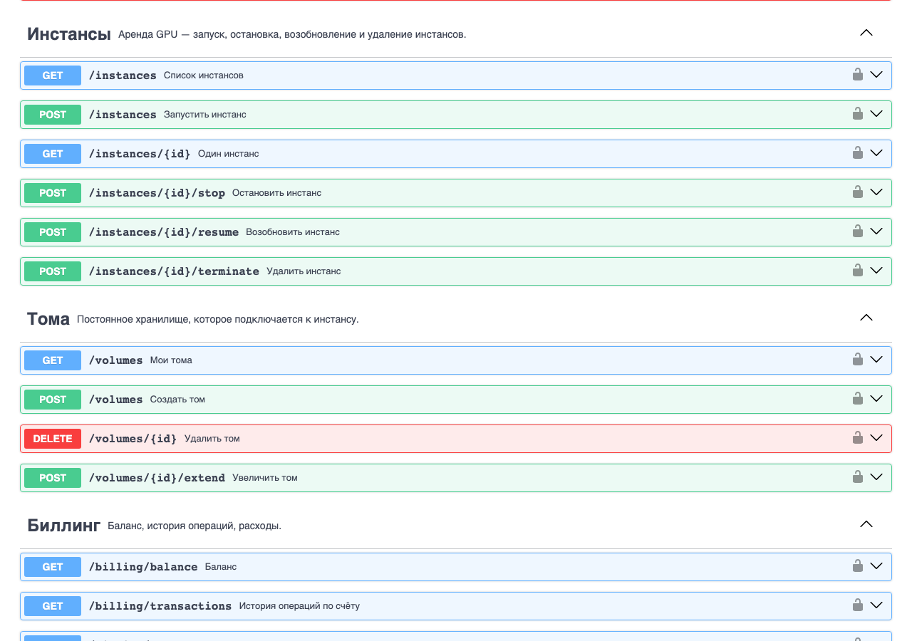
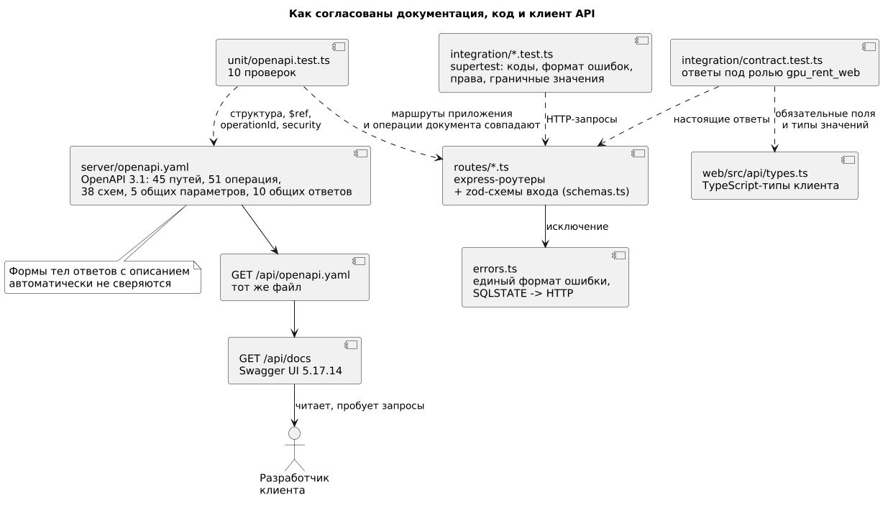

# Введение

## Цель работы

Спроектировать, реализовать и задокументировать REST API сервиса GPU Rent так, чтобы клиент (собственный интерфейс или скрипт с API-ключом) мог работать с ним по документации, не читая код сервера, и проверить, что документация не расходится с реализацией.

## Задание

1. Определить точки доступа (эндпоинты) и методы HTTP с учётом потребностей клиентов.
2. Разработать API на выбранном языке с подходящими библиотеками; реализовать обработку запросов и работу с базой данных.
3. Создать документацию: эндпоинты, методы, параметры, форматы данных; применить автоматизацию там, где это возможно.
4. Протестировать API: соответствие спецификации и корректность работы; по возможности — с клиентами.

# Ход работы

API уже работает в составе сервера (П5). Здесь он рассматривается как продукт для клиента: что предлагается, по каким правилам устроено, как описано и чем проверено. Выбор — REST поверх JSON, без GraphQL (раздел «Почему REST, а не GraphQL»). Единственный клиент — собственный интерфейс на React (П6); внешних пользователей и опросов не было, поэтому «удобство для клиентов» проверено только сценариями собственного клиента и просмотром в Swagger UI.

## Определение эндпоинтов и методов

Ресурсы выделены по понятиям предметной области: GPU в каталоге, инстансы, тома, ключи, платежи, баланс. Потребности клиента взяты из требований П2: посмотреть доступные GPU и цены, запустить и остановить инстанс, пополнить баланс, управлять доступом по ключам; отдельно — администратор (цены, инфраструктура, пользователи, аудит). Адреса — существительные во множественном числе под единым префиксом `/api`, методы — по смыслу HTTP [3]: `GET` читает, `POST` создаёт или запускает действие, `DELETE` удаляет. `PUT` и `PATCH` не используются: изменяемых «документов целиком» в модели нет. Смена состояния — не правка поля, а операция с проверками (баланс, свободные GPU), поэтому она оформлена как `POST` на подресурс-действие: `/instances/{id}/stop`, `/resume`, `/terminate`, `/volumes/{id}/extend`. Это компромисс: строгий REST описал бы смену статуса через `PATCH`, но проверки пришлось бы прятать за общим телом запроса.

Таблица 1 — Операции API по тегам спецификации (всего 45 путей, 51 операция: 22 `GET`, 25 `POST`, 4 `DELETE`)

| Тег | Операций | Эндпоинты |
|---|---:|---|
| Аутентификация | 7 | `POST /auth/register`, `/auth/login`, `/auth/logout`, `/auth/password`, `/auth/verify`, `/auth/resend`; `GET /auth/me` |
| Каталог | 2 | `GET /catalog/gpus`, `/catalog/templates` |
| Ключи и шаблоны | 9 | `GET/POST /ssh-keys`, `DELETE /ssh-keys/{id}`; то же для `/api-keys` и `/templates` (список личных — `GET /templates/mine`) |
| Инстансы | 6 | `GET/POST /instances`, `GET /instances/{id}`, `POST /instances/{id}/stop`, `/resume`, `/terminate` |
| Тома | 4 | `GET/POST /volumes`, `DELETE /volumes/{id}`, `POST /volumes/{id}/extend` |
| Биллинг | 3 | `GET /billing/balance`, `/billing/transactions`, `/billing/spend` |
| Платежи | 3 | `POST /payments`, `/payments/{id}/demo-pay`, `/webhooks/payments` |
| Администрирование | 12 | `GET /admin/dashboard`, `/prices`, `/prices/storage`, `/infrastructure`, `/users`, `/audit`; `POST` на цену, включение и отключение GPU, статус ноды, блокировку и разблокировку пользователя |
| Служебные | 5 | `GET /health`, `/openapi.yaml`, `/docs`; `GET` и `POST /internal/billing` |

Доступ описан в самой спецификации. 9 операций публичны (регистрация, вход, подтверждение email, каталог, `health`, документация, вебхук платежей — он защищён подписью), 30 принимают и cookie, и API-ключ, 9 — только cookie (выпуск и отзыв ключей, смена пароля, изменяющие операции администратора: украденный ключ не должен выпускать новые ключи и менять цены), две служебные — секрет планировщика; `logout` допускает пустую аутентификацию.

## Принципы построения API

Таблица 2 — Правила, общие для всех эндпоинтов

| Принцип | Как выполнено |
|---|---|
| Ресурсы и вложенность | Плоские адреса, владелец берётся из сессии, а не из пути; идентификаторы — число или UUID (инстансы), формат проверяет zod |
| Коды ответов | `200` чтение и действия, `201` создание, `204` удаление без тела, `400` ошибка формата, `401` нет входа, `402` нет денег, `403` запрещено, `404` нет объекта (в том числе чужого), `409` конфликт состояния, `422` нарушена связность, `429` лимит попыток, `503` БД недоступна |
| Единая ошибка | `{"error":{"code","message","details?"}}`; `code` — стабильная строка для программы, `message` — по-русски; тексты PostgreSQL клиенту не уходят |
| Деньги | Десятичные строки с четырьмя знаками: `"278.8700"`; на сервере арифметика на целых, не на `float` |
| Время | ISO 8601 в UTC |
| Пагинация | Курсорная (keyset) там, где список растёт: `/billing/transactions`, `/admin/audit` — `?limit=&cursor=`, ответ `{items, nextCursor}`, курсор непрозрачный |
| Строгие входные данные | Лишнее поле в теле — `400 VALIDATION_ERROR`; тело не больше 32 КБ; роль, статус и баланс клиент передать не может |
| Кэширование | Публичный каталог: `public, s-maxage=30, stale-while-revalidate=60`; всё личное — `private, no-store` |
| Версия | Префикс `/api`, версия документа — `info.version: 1.0.0` |

Три пояснения. Деньги строкой, потому что число JSON у клиента превратится в `double` и накопит ошибку округления. Курсор вместо номера страницы: список меняется, и страницы со смещением пропускали бы или дублировали строки; ключ — пара `(created_at, id)`, подделанный курсор даёт `400 INVALID_CURSOR`, а не `500`. Чужой объект отвечает `404`, а не `403`, чтобы по коду нельзя было узнать, что объект существует. Номера версии в адресе нет: при несовместимом изменении я бы добавил `/api/v2` рядом, но этого не делалось и не проверялось; сейчас версия отражена только в документе.

Код в теле (`NO_CAPACITY`, `INSUFFICIENT_FUNDS`) нужен клиенту больше статуса: на `409` приходится несколько ситуаций. Формат собственный, по духу близкий к RFC 9457 [4], но с `application/problem+json` не совместимый.

## Программирование API

Стек: Node.js, Express 4.22.3 [9], TypeScript (strict), `pg` 8.16.3, zod 3.25.76 [10]. Роутеры лежат в [server/src/routes](../../server/src/routes/) — по файлу на группу тегов, приложение собирает функция `createApp()` в [app.ts](../../server/src/app.ts). Одна и та же функция работает как локальный процесс, как функция Vercel и в тестах. Обработчик устроен одинаково: проверка входа, разбор данных по zod-схеме, вызов функции PostgreSQL в транзакции `withUser`, преобразование строки БД в ответ. Бизнес-правила в обработчик не попадают: баланс, выделение GPU и фиксацию цены исполняет база (П4).

```ts
// server/src/schemas.ts — схема тела POST /instances (сокращено)
export const createInstanceBody = z.object({
  name: z.string().trim().min(1).max(64),
  datacenterCode: z.string().trim().regex(/^[A-Za-z0-9-]{2,16}$/),
  gpuModel: z.string().trim().min(1).max(64),
  gpuCount: z.number().int().min(1).max(8),
  pricingType: z.enum(['on_demand', 'spot']),
  templateId: idSchema,
  // ... containerDiskGb, volumeId, sshKeyId, env
}).strict();

// server/src/routes/instances.ts — обработчик
router.post('/instances', wrap(async (req, res) => {
  const b = parse(createInstanceBody, req.body);          // 400 VALIDATION_ERROR
  const row = await withUser(userCtx(req), async (c) => { // BEGIN ... COMMIT
    /* fn_start_instance(...): баланс, GPU, цена */
  });
  res.status(201).json(toInstance(row!, false));
}));
```

Ошибки любого происхождения проходят через один обработчик в конце `app.ts`: исключения приложения (`AppError`), ошибки zod, ошибки PostgreSQL по SQLSTATE (`GR001` → `409 NO_CAPACITY`, `GR002` → `402 INSUFFICIENT_FUNDS`, `23505` → `409 CONFLICT`) и обрыв соединения (`503 DB_UNAVAILABLE`). Неизвестная ошибка даёт `500` без стектрейса; полная запись уходит в лог.

## Документирование: OpenAPI 3.1 и Swagger UI

Спецификация — один файл [server/openapi.yaml](../../server/openapi.yaml) (OpenAPI 3.1 [2], 2396 строк, написан вручную). Он содержит 45 путей, 51 операцию, 38 схем, 5 общих параметров и 10 общих ответов; у каждой операции есть `operationId`, тег, `summary`, описание, схема безопасности (для публичных — явный `security: []`), список ответов, у части — примеры. Вводный раздел `info.description` описывает то, что нельзя выразить схемами: формат денег и времени, два способа входа, защиту от CSRF, перечень ошибок, кэширование, особенности биллинга без постоянного процесса.

Документ отдаёт сам сервер: `GET /api/openapi.yaml` — файл, `GET /api/docs` — страница Swagger UI 5.17.14 [5] со скриптами с CDN jsDelivr под проверкой целостности (SRI). Страница задаёт собственную политику CSP: только этот CDN и один встроенный скрипт, разрешённый по хэшу; остальной API отдаёт строгую политику без CDN. В запросы «Try it out» для небезопасных методов автоматически добавляется `X-Requested-With: fetch`, иначе защита от CSRF их отклонила бы.



Важная оговорка по заданию про «автоматическую генерацию». Документ не генерируется из кода: ни из zod-схем, ни из аннотаций. Автоматизированы два другие шага — интерактивная страница строится из YAML самим Swagger UI, а согласованность документа и кода проверяется тестом (следующий раздел). Ручная спецификация читается как контракт, с описаниями и примерами на русском. Цена решения — двойное описание (схема zod и схема OpenAPI), и тест её полностью не закрывает.

## Тестирование API и сверка со спецификацией

Таблица 3 — Что и чем проверяется

| Проверка | Инструмент | Что ловит |
|---|---|---|
| Спецификация как документ | [openapi.test.ts](../../server/test/unit/openapi.test.ts), 10 проверок, без БД | Версия 3.1, все `$ref` разрешаются, у операции уникальный `operationId`, тег из списка, явная `security`, есть успешный ответ, параметры пути объявлены |
| Документ и код | Тот же файл | Обходит стек Express, собирает все смонтированные маршруты и сравнивает с операциями YAML в обе стороны: недокументированный маршрут и неосуществлённая операция — ошибка |
| Страница документации | Тот же файл | Файл отдаётся как есть, заголовки кэша, CSP без `unsafe-inline`, SRI у внешних ресурсов |
| Ответы и клиент | [contract.test.ts](../../server/test/integration/contract.test.ts), supertest | Реальные ответы сервера содержат все обязательные поля и типы из `web/src/api/types.ts` |
| Поведение | 20 интеграционных файлов, supertest: 376 проверок под ролью `gpu_rent_web` | Коды ответов, формат ошибок, права, изоляция, CSRF, кэш, платежи, конкурентные запуски |
| Сквозные сценарии | Playwright, 21 сценарий | Те же эндпоинты глазами клиента (П6) |
| Нагрузка | autocannon, [server/test/load](../../server/test/load/) | Ошибок нет; цифры в разделе про производительность |

Я запустил [openapi.test.ts](../../server/test/unit/openapi.test.ts) отдельно: 10 проверок из 10 пройдены. Состав остальных тестов (30 файлов, 571 проверка на 07.11.2026) взят из прогона П5; для этого отчёта они не перезапускались. Рисунок 2 показывает, что с чем сверяется.



Чего тесты не делают, честно: формы тел ответов, описанные в OpenAPI, автоматически с реальными ответами не сравниваются — это делает только контрольная проверка по типам клиента. Если сервер вернёт поле, которого нет в спецификации, ни один тест не упадёт. Внешний валидатор или линтер спецификации (Redocly, Spectral) не запускался, фаззинг по схеме (Schemathesis и подобные) не применялся, покрытие кода не измерялось.

## Примеры запросов к боевому API

Запросы выполнены 25.11.2026 к https://gpu-rent-lemon.vercel.app без входа в систему, ответы приведены как получены (каталог сокращён до первого элемента из 18).

```bash
$ curl -s https://gpu-rent-lemon.vercel.app/api/catalog/gpus
[{"datacenter":{"code":"KZN-1","name":"Казань, ДЦ «Волга»","city":"Казань"},
  "model":{"name":"A100 80GB","vramGb":80},"total":4,"free":4,
  "priceOnDemand":"278.8700","priceSpot":"156.1700"}, ...]

$ curl -s https://gpu-rent-lemon.vercel.app/api/health
{"status":"ok","version":"bb50546","time":"2026-11-25T09:39:06.660Z"}

$ curl -s https://gpu-rent-lemon.vercel.app/api/instances
{"error":{"code":"UNAUTHORIZED","message":"Требуется вход в систему"}}

$ curl -s -H 'Authorization: Bearer gr_wrong' https://gpu-rent-lemon.vercel.app/api/instances
{"error":{"code":"INVALID_API_KEY","message":"Неверный API-ключ"}}

$ curl -s https://gpu-rent-lemon.vercel.app/api/nope
{"error":{"code":"ROUTE_NOT_FOUND","message":"Такого адреса в API нет"}}

$ curl -s -X POST https://gpu-rent-lemon.vercel.app/api/auth/login \
    -H 'Content-Type: application/json' -d '{"email":"x@y.zz","password":"p"}'
{"error":{"code":"CSRF","message":"Нужен заголовок X-Requested-With: fetch"}}

$ curl -s -X POST https://gpu-rent-lemon.vercel.app/api/auth/login \
    -H 'Content-Type: application/json' -H 'X-Requested-With: fetch' \
    -H 'Origin: https://gpu-rent-lemon.vercel.app' \
    -d '{"email":"bad","password":"p","extra":1}'
{"error":{"code":"VALIDATION_ERROR","message":"Некорректные данные запроса",
 "details":[{"path":"email","message":"Неверный формат email"},
            {"path":"","message":"Лишние поля в запросе"}]}}
```

Заголовки каталога показывают работу кэша: первый ответ — `x-vercel-cache: MISS`, повторный запрос позже — `x-vercel-cache: STALE` с `age: 45` (30 секунд свежести истекли, ответ отдан из `stale-while-revalidate`). Клиентам Vercel отдаёт `cache-control: public`, значение `s-maxage` он забирает себе.

Запрос с ключом к ресурсу, который меняет данные, в рамках отчёта против боевого сайта не выполнялся, чтобы не создавать записи в демо-базе. Его вид соответствует схеме `CreateInstanceRequest` (значения дата-центра, модели и шаблона существуют в каталоге), результат не проверялся:

```bash
curl -X POST https://gpu-rent-lemon.vercel.app/api/instances \
  -H 'Authorization: Bearer gr_...' -H 'Content-Type: application/json' \
  -d '{"name":"train-1","datacenterCode":"KZN-1","gpuModel":"A100 80GB",
       "gpuCount":1,"pricingType":"on_demand","templateId":1}'
```

## Почему REST, а не GraphQL

Предусмотрено два вида клиентов (интерфейс и скрипты), набор запросов фиксирован, а действия вроде запуска инстанса — команды с побочными эффектами, не выборки графа. REST хорошо ложится на кэш CDN (публичный каталог кэшируется по адресу), на права по ресурсам и на готовые инструменты OpenAPI. У GraphQL [6] единая точка входа и POST на всё: кэш на CDN и ограничение сложности запроса пришлось бы строить самому, а выигрыш — гибкая выборка полей — при трёх десятках небольших ответов не нужен. Это оценка, а не замер: версия на GraphQL не делалась.

# Ответы на контрольные вопросы

## Вопросы на оценку 2

### Какие точки доступа и методы HTTP были определены для вашего API?

45 путей и 51 операция под префиксом `/api`: 22 `GET`, 25 `POST`, 4 `DELETE` (таблица 1). Группы: аутентификация, каталог, SSH- и API-ключи и шаблоны, инстансы, тома, биллинг, платежи, администрирование, служебные. `PUT` и `PATCH` не применяются; смена состояния — `POST` на подресурс (`/instances/{id}/stop`).

### Какой уровень документации был предоставлен для вашего API?

Справочная: OpenAPI 3.1 с описанием каждой операции, параметров, схем тел и ответов, ошибок и способов входа, плюс интерактивная страница Swagger UI на `/api/docs`. Руководства для новичков, SDK и журнала изменений нет.

### Какие основные ошибки или недоразумения возникли при разработке API?

Из того, что осталось следом в коде и отчётах. Express 4 не ловит отклонённые промисы, поэтому асинхронные обработчики обёрнуты в `wrap`. Роутеры монтируются на общий `/api`, и общий `router.use` перехватил бы чужие адреса, поэтому защита подключена только к `/instances`. Vercel Cron шлёт только `GET`, поэтому адрес биллинга принимает и `GET`, и `POST`. Значение `s-maxage` Vercel скрывает от клиента, виден лишь `cache-control: public`, а работу кэша подтверждает `x-vercel-cache`. Главный риск при ручной спецификации — расхождение YAML и кода; от него защищает тест соответствия.

## Вопросы на оценку 3

### Какие инструменты и библиотеки были использованы для разработки вашего API?

Node.js, Express 4.22.3, TypeScript strict, `pg` 8.16.3 с параметризованными запросами, zod 3.25.76 для разбора входа, helmet 8.1.0, pino 9.14.0, bcryptjs для паролей. Документация — OpenAPI 3.1 (YAML) и Swagger UI 5.17.14; тесты — vitest 3.2.4 и supertest 7.1.4 [7], нагрузка — autocannon 8.0.0; пакет `yaml` читает спецификацию в тестах. ORM нет: правила живут в функциях PostgreSQL.

### Какой уровень документации был предоставлен, и какие основные элементы были включены?

Элементы: вводный раздел (формат данных, аутентификация, CSRF, ошибки, кэширование, биллинг); для операции — тег, `operationId`, `summary`, описание, параметры, схема тела, коды ответов с общими ссылками на ошибки, требуемая схема безопасности; в компонентах — 38 схем, 5 параметров, 10 ответов; примеры значений. Файл и страница доступны по `/api/openapi.yaml` и `/api/docs`.

### Какие методы тестирования и проверки работы API были применены?

Проверка спецификации и её сверка с маршрутами (10 проверок), контрактная проверка ответов по типам клиента, 376 интеграционных проверок supertest, 21 сценарий Playwright, прогон autocannon, ручные запросы curl к боевому сайту. Не применялись: тесты с внешними клиентами, фаззинг по схеме, линтер OpenAPI.

## Вопросы на оценку 4

### Какие меры безопасности были внедрены в вашем API?

Два способа входа: cookie-сессия (в БД только SHA-256 токена) и API-ключ `gr_…`; при заголовке `Authorization` cookie игнорируется. Операции управления доступом — только по cookie. Защита от CSRF: `X-Requested-With: fetch` и свой `Origin`. Строгая проверка входа (`.strict()`, zod), лимит тела 32 КБ, параметризованный SQL, `404` вместо `403` для чужих объектов, RLS и проверки в функциях БД, лимиты попыток входа в БД с ответом `429` и `Retry-After`, подпись HMAC у вебхука, заголовки helmet, ошибки без внутренних подробностей. Типовые угрозы веб-приложений учтены по [11], список проверок — в П5 и П8. Ограничения: общего лимита частоты запросов на ключ нет, только на вход и регистрацию.

### Какие инструменты и методы использовались для автоматической генерации документации?

Автоматической генерации документации из кода нет, и это сознательное решение (раздел «Документирование»). Автоматизированы: показ интерактивной документации (Swagger UI читает YAML), раздача спецификации самим сервером и проверка её соответствия коду тестом. Сам YAML пишется вручную.

### Как была обеспечена производительность и масштабируемость вашего API?

Каталог кэшируется CDN (`s-maxage=30`, `stale-while-revalidate=60`; `MISS` и `STALE` видны на боевом сайте), всё личное не кэшируется. История листается курсором по индексу, а не смещением. Сервер не хранит состояния между запросами (сессии, счётчики и журнал в PostgreSQL), поэтому Vercel может запускать сколько угодно экземпляров функции; пул — 2 соединения на экземпляр при лимите 20 у роли. `/api/health` не обращается к БД. Локальный прогон 28.10.2026 (10 соединений, 15 с, БД на той же машине): каталог 2365 запросов в секунду, `/api/auth/me` 5305, список инстансов с начислением 270 (p97,5 = 40 мс), ошибок нет. Это проверка работоспособности, а не доказательство целевых показателей (p95 меньше 300 мс при 1000 запросов в секунду): нагрузка на боевом сервисе не измерялась. Список инстансов ограничен 200 записями, без курсора.

## Вопросы на оценку 5

### Можете ли вы подробно описать процесс разработки API, включая выбор методов и инструментов?

Порядок работ: сущности и требования (П2, П3) → правила в БД (П4) → эндпоинты по ресурсам и операциям → zod-схемы входа и роутеры → спецификация OpenAPI → тесты → Swagger UI → развёртывание (П7). Спецификация ведётся вручную рядом с кодом, а тест соответствия не даёт им разойтись незаметно. REST и Express выбраны по размеру задачи: монолит, один деплой, готовые инструменты. zod — одна схема даёт и проверку входа, и типы TypeScript. Ручной YAML и его цена описаны выше.

### Какие передовые методы и стандарты были использованы при разработке и документировании API?

OpenAPI 3.1 (схемы по JSON Schema 2020-12: `type: [string, 'null']`, `examples`) [2]; семантика кодов и методов HTTP по RFC 9110 [3]; `Retry-After` для `429`; время ISO 8601; курсорная пагинация; единый машиночитаемый формат ошибок со стабильными кодами (по духу RFC 9457 [4], без его формата); деньги десятичной строкой; явная схема безопасности у каждой операции; страница документации с CSP и SRI; соответствие рекомендациям OWASP API Security [8]. Строгого REST уровня HATEOAS [1] нет: ссылки на связанные операции в ответах не возвращаются.

### Какие меры были предприняты для обеспечения высокой доступности и надежности вашего API?

Функции Vercel и БД Neon — управляемые, на бесплатных тарифах, один регион (fra1), резервирования и SLA нет. Надёжность обеспечена на уровне кода: операции, меняющие деньги и GPU, идут одной транзакцией в БД; оплата идемпотентна (повторные уведомления шлюза не зачисляют деньги дважды); конкурентный запуск не выдаёт одну GPU дважды; недоступная БД даёт `503 DB_UNAVAILABLE`, а не `500`; `statement_timeout` роли — 15 с; `/api/health` отвечает без БД. Повторять небезопасные запросы с ключом идемпотентности, как у платёжных API, клиент не может: заголовка `Idempotency-Key` нет. Мониторинг (uptime) и резервное копирование описаны в репозитории как задания GitHub Actions, но не опубликованы и не запускались, поэтому доступность в процентах не измерялась.

# ЗАКЛЮЧЕНИЕ

REST API GPU Rent включает 45 путей и 51 операцию в 9 группах, построен на общих правилах (единый формат ошибок, деньги строками, курсорная пагинация, строгие входные данные, явная защита каждой операции) и описан спецификацией OpenAPI 3.1 с интерактивной страницей Swagger UI. Документ и код сверяются автоматически: проверка структуры и совпадения маршрутов с операциями (10 проверок, пройдены), контрактный тест ответов по типам клиента и 376 интеграционных проверок. Слабые места названы: спецификация ручная и не сравнивается с телами ответов, версии в адресе нет, внешнего линтера и тестов с настоящими клиентами не было, общего лимита частоты запросов и ключа идемпотентности нет, доступность и производительность на боевом сервисе не измерялись.

## СПИСОК ИСПОЛЬЗОВАННЫХ ИСТОЧНИКОВ

1. Fielding R. T. Architectural Styles and the Design of Network-based Software Architectures. Chapter 5: Representational State Transfer (REST). — https://ics.uci.edu/~fielding/pubs/dissertation/rest_arch_style.htm
2. OpenAPI Specification v3.1.0. — https://spec.openapis.org/oas/v3.1.0
3. RFC 9110. HTTP Semantics. — https://www.rfc-editor.org/rfc/rfc9110
4. RFC 9457. Problem Details for HTTP APIs. — https://www.rfc-editor.org/rfc/rfc9457
5. Swagger UI. Documentation. — https://swagger.io/docs/open-source-tools/swagger-ui/
6. GraphQL Specification. — https://spec.graphql.org/
7. supertest. — https://www.npmjs.com/package/supertest
8. OWASP API Security Top 10 2023. — https://owasp.org/API-Security/editions/2023/en/0x11-t10/
9. Express. Error handling. — https://expressjs.com/en/guide/error-handling.html
10. Zod. Documentation. — https://zod.dev
11. Гудро М. Тайны хакеров. Безопасность Web-приложений. — ДМК Пресс, 2019. — 480 с.

Дата обращения к электронным источникам: 25.11.2026.
