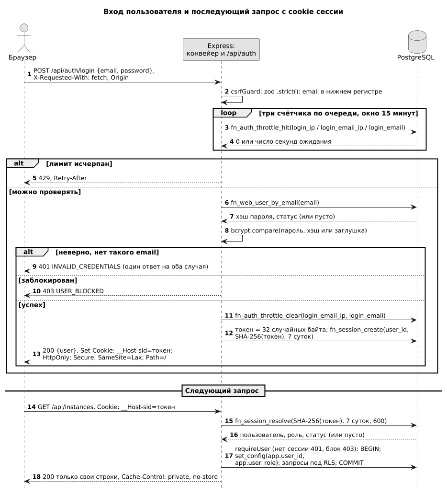
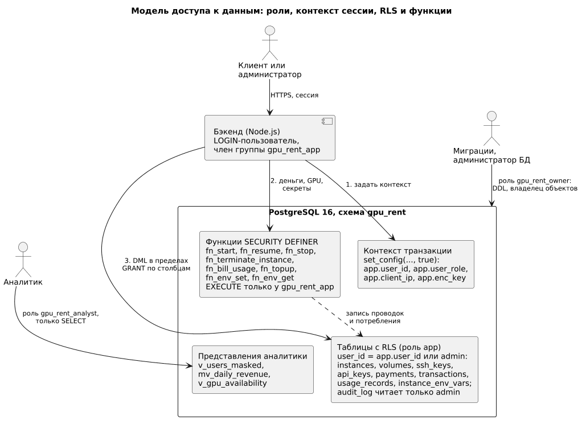

# Введение

## Цель работы

Выбрать и реализовать для GPU Rent механизм входа и разграничения прав так, чтобы защитить данные и ресурсы пользователей, и подтвердить его работу тестами.

## Задание

1. Выбрать метод аутентификации с учётом безопасности и удобства.
2. Реализовать аутентификацию и защитить её от типовых атак.
3. Разработать авторизацию: права по ролям и ограничения доступа к функциям.
4. Протестировать и отладить оба механизма.

# Ход работы

Код — в [server/src/auth](../../server/src/auth/) и [server/src/routes/auth.ts](../../server/src/routes/auth.ts), таблицы и функции — миграция [0013_web_auth.sql](../../db/migrations/0013_web_auth.sql), политики RLS — [0011_security.sql](../../db/migrations/0011_security.sql). Описаны решения и обоснование, код не пересказывается.

## Выбор метода аутентификации

Требования: у пользователя на счёте деньги, поэтому доступ должен отзываться сразу (блокировка администратором, смена пароля); сервис работает на serverless, где память процесса не хранит состояние; внешнего провайдера удостоверений и почтового сервиса нет; у скриптов и CI должен быть доступ без браузера.

Таблица 1 — Сравнение методов для GPU Rent

| Критерий | Серверные сессии (выбрано) | JWT [7] | OpenID Connect [8] |
|---|---|---|---|
| Мгновенный отзыв | Да: удалить строку или сменить статус | Нет до истечения срока; нужен список отзыва, то есть то же хранилище | Зависит от провайдера |
| Состояние на сервере | Таблица `sessions` в PostgreSQL | Не нужно | Сессия всё равно нужна |
| Внешние зависимости | Нет | Нет | Внешний провайдер, регистрация приложения |
| Утечка токена из браузера | Токен в HttpOnly-cookie, JavaScript его не читает | Обычно в `localStorage`, доступен при XSS | Как у выбранного хранения |
| Подходит скриптам | Нет | Да | Нет |

Решение: для браузера — случайный непрозрачный токен в cookie, проверяемый по таблице в БД; для программного доступа — долгоживущие API-ключи. JWT здесь выигрывает только отсутствием запроса в БД, а он всё равно нужен для блокировки и баланса. OpenID Connect откладывается: без провайдера вход «через внешний аккаунт» не от чего проверять, а логин и пароль остаются нужны как основной способ.

## Реализация аутентификации

**Регистрация.** Тело запроса проверяет zod со `.strict()`: email приводится к нижнему регистру, пароль от 8 символов и не более 72 байт (bcrypt обрабатывает только 72 байта, длинный пароль отвергается, а не обрезается). Хэш bcrypt cost 12 [1][4] считается на сервере, пароль в БД и логи не попадает. Аккаунт создаётся функцией `fn_web_register` с ролью `client` и нулевым балансом: роль из тела запроса не читается.

**Вход** (рисунок 1). До проверки пароля учитываются три счётчика попыток в PostgreSQL — по IP (60 за 15 минут), по паре «email и IP» (5) и по email (20); счётчик и запись попытки атомарны за счёт advisory-блокировки ключа. Затем сравнивается bcrypt-хэш; для несуществующего email сравнение идёт с заглушкой, поэтому и текст ответа, и время не выдают, есть ли такой адрес. При успехе сервер создаёт новый токен (256 бит из `crypto.randomBytes`), кладёт в БД только его SHA-256 и устанавливает cookie. Токен выдаётся заново при каждом входе, поэтому фиксация сессии невозможна.

**Cookie.** В production она называется `__Host-sid` и помечена `HttpOnly`, `Secure`, `SameSite=Lax`, `Path=/` [9]. Префикс `__Host-` запрещает атрибут `Domain`, поэтому cookie не подменить с соседнего поддомена. Срок — 7 суток, скользящий: срок продлевается не чаще раза в 10 минут, иначе каждый GET превратился бы в запись в БД. Выход удаляет строку, и украденный токен перестаёт работать.

**API-ключи.** Формат `gr_` и 32 случайных байта; в БД хранятся SHA-256 и первые 8 символов для опознания в списке, полный ключ виден один раз при создании. У ключа может быть срок действия, не более 10 ключей на пользователя, выпуск и отзыв — в аудит-журнал. Если передан заголовок `Authorization`, cookie игнорируется целиком: неверный ключ не «подхватит» чужую сессию. Выпускать и отзывать ключи, менять пароль можно только по сессии: ключ, выпущенный украденным ключом, был бы бесконечной лазейкой.

**Подтверждение email.** Ссылка одноразовая, действует 24 часа, в БД лежит её SHA-256; повторная отправка отменяет прежнюю ссылку. Без подтверждения нельзя запускать инстансы (`EMAIL_NOT_VERIFIED`), остальное доступно. Почтового провайдера нет, поэтому в демо-режиме (`DEMO_MAIL=1`) ссылка возвращается в ответе — это осознанный обход, не защита.

**Смена пароля.** Нужен текущий пароль (попытки ограничены: 5 за 15 минут на пользователя). Функция `fn_web_set_password` в одной транзакции записывает новый хэш, удаляет все сессии, отзывает API-ключи и создаёт новую сессию для текущего браузера. Ключи отзываются потому, что их мог выпустить злоумышленник из украденной сессии; число отозванных ключей показывается пользователю и попадает в аудит.

**CSRF.** Каждый изменяющий запрос с cookie обязан нести заголовок `X-Requested-With: fetch` и `Origin` своего сайта; то же требование действует для входа и регистрации (login-CSRF). Вместе с `SameSite=Lax` это закрывает подделку запроса [5].

Таблица 2 — Угроза и мера

| Угроза | Мера |
|---|---|
| Утечка дампа БД | Пароли — bcrypt; токены сессий, ключей и ссылок — SHA-256, хэш пароля приложению недоступен напрямую |
| Подбор пароля | Три счётчика в БД; пара «email и IP» ограничена жёстче, чтобы чужой не мог запереть владельца |
| Перечисление адресов | Одинаковый ответ и время при входе; регистрация отвечает 409 (см. остаточные риски) |
| Кража токена | HttpOnly, `__Host-`, смена пароля и выход удаляют сессии |
| CSRF | `SameSite=Lax`, заголовок и `Origin` |
| Блокировка пользователя | Статус читается при каждом запросе: доступ пропадает сразу |

## Реализация авторизации

Ролей две: `client` и `admin`. Права проверяются на трёх рубежах, каждый из которых достаточен сам по себе для главных запретов.

1. **Маршрут.** Промежуточные обработчики: `authenticate` определяет пользователя, `requireUser` отвечает 401 без входа и 403 заблокированному, `requireAdmin` пускает только администратора, `requireSession` запрещает действие по API-ключу. На весь `/api/admin` навешены `requireUser` и `requireAdmin`.
2. **Владение ресурсом.** Запросы содержат владельца в `WHERE`; чужой ресурс отвечает 404, как и несуществующий, чтобы по коду нельзя было узнать, что он есть. Для инстансов проверка стоит до вызова функции БД, иначе та ответила бы 403.
3. **БД.** Сервер подключается ролью `gpu_rent_web` без права владельца и без обхода RLS. Каждая транзакция начинается с `set_config('app.user_id', …, true)`, политики вида `user_id = fn_app_user_id() OR fn_app_is_admin()` действуют на инстансы, тома, ключи, платежи, транзакции и записи потребления; пользователей видит только их владелец и администратор. Права на `users` сужены: хэш пароля и роль приложению недоступны, их меняют функции `SECURITY DEFINER`.

Таблица 3 — Матрица доступа

| Роль и способ входа | Публичный каталог | Свои ресурсы | Ключи и пароль | Чужие данные | `/api/admin`: чтение | `/api/admin`: изменение |
|---|---|---|---|---|---|---|
| Аноним | Да | 401 | 401 | 401 | 401 | 401 |
| Клиент, cookie | Да | Да | Да | 404 | 403 | 403 |
| Клиент, API-ключ | Да | Да | 403 | 404 | 403 | 403 |
| Заблокированный | Да | 403 | 403 | 403 | 403 | 403 |
| Администратор, cookie | Да | Да | Да | Просмотр и остановка инстансов | Да | Да |
| Администратор, API-ключ | Да | Да | 403 | Просмотр и остановка инстансов | Да | 403 |

Клиент без подтверждённого email не может запускать инстансы; администратор не может заблокировать себя (проверка в функции БД); администратор видит чужие инстансы в списке только с `?all=1`, по id — всегда. Параметры `userId`, заголовки `X-User-Id` и cookie `role=admin` ни на что не влияют: владелец берётся только из сессии.

# Тестирование и отладка

Таблица 4 — Что и чем проверено (число блоков `it` в файле; параметризованные `it.each` раскрываются в большее число тестов)

| Уровень | Файл | Блоков `it` | Что подтверждает |
|---|---|---:|---|
| Интеграционные | [auth.test.ts](../../server/test/integration/auth.test.ts) | 42 | Регистрация, подтверждение email, cookie (в т. ч. `__Host-` и HSTS), вход и выход, скользящая сессия, лимиты, смена пароля, блокировка |
| Интеграционные | [csrf.test.ts](../../server/test/integration/csrf.test.ts) | 11 | Заголовок и `Origin` на изменяющих запросах |
| Интеграционные | [isolation.test.ts](../../server/test/integration/isolation.test.ts) | 15 | Проверки IDOR: чужие инстансы, тома, ключи, шаблоны, платежи |
| Интеграционные | [security-roles.test.ts](../../server/test/integration/security-roles.test.ts) | 19 | Роль БД, RLS, лишние поля в теле, инъекции, прототипное загрязнение |
| Интеграционные | [keys.test.ts](../../server/test/integration/keys.test.ts), [admin.test.ts](../../server/test/integration/admin.test.ts) | 28 и 19 | API-ключи, доступ к админ-маршрутам |
| Модульные | `password`, `tokens`, `middleware` | 6, 6, 18 | Сравнение с заглушкой, формат ключа, `csrfGuard` и разбор cookie |
| SQL | [14_web_auth.sql](../../db/tests/14_web_auth.sql) | 123 утверждения | Закрытые таблицы, функции входа, лимиты, права под ролью `gpu_rent_app` |

Тесты ходят в приложение под настоящей ролью `gpu_rent_web`, без обхода RLS. Примеры сценариев: после 5 неверных попыток верный пароль даёт 429; неверные попытки с чужого IP не мешают владельцу; счётчик общий для двух экземпляров приложения; после выхода украденная cookie даёт 401; смена пароля удаляет остальные сессии и отзывает ключи; чужой инстанс, том или платёж по прямому id отвечает как несуществующий; перебор соседних id ничего чужого не открывает.

Результат на 07.11.2026: весь набор сервера — 571 тест, SQL — 554 проверки, все пройдены. Для этого отчёта повторно запущены только три модульных файла: 30 тестов прошли; интеграционные и SQL-тесты не перезапускались (общая тестовая БД занята другими работами), числа взяты из последнего полного прогона.

Отладка: настройка лимитов показала ошибку простой схемы. Счётчик только по email позволял любому, кто знает чужой адрес, запереть владельца, а счётчик только по IP — подбирать пароли с большого числа адресов. Поэтому счётчиков три, а пара «email и IP» строже общего. Другой случай: функция БД на чужой инстанс отвечала бы 403 и тем самым подтверждала бы его существование — проверка владения вынесена в маршрут, ответ 404. Проверок вживую с посторонними пользователями, внешнего пентеста и сканеров уязвимостей не проводилось.

# Ответы на контрольные вопросы

## Вопросы на оценку 2

### Какой метод аутентификации был выбран для вашего приложения, и как он был реализован?

Логин и пароль плюс серверная сессия: непрозрачный токен в cookie `__Host-sid`, в БД только его SHA-256, срок 7 суток скользящий. Для скриптов — API-ключи `gr_…`, тоже хранятся хэшем. Пароли — bcrypt cost 12. Выбор и сравнение с JWT и OpenID Connect — таблица 1, поток входа — рисунок 1.

### Какие основные уязвимости или угрозы безопасности могут возникнуть при использовании выбранного метода?

Главные угрозы сессий: кража токена (XSS, перехват, чужой компьютер), фиксация сессии, CSRF, подбор и повторное использование паролей, перечисление адресов, утечка БД. Закрыто так: HttpOnly и Secure, новый токен при каждом входе, `SameSite=Lax` с заголовком и `Origin`, лимиты и bcrypt, хранение только хэшей (таблица 2). Остаточные риски: нет двухфакторного входа, проверки по базам утёкших паролей и CAPTCHA; регистрация отвечает 409 на занятый email, то есть адреса перечислить можно (смягчено лимитом 10 регистраций в час на IP); сессия не привязана к IP и браузеру; лимит по IP за общим NAT делится на всех (60 входов за 15 минут).

## Вопросы на оценку 3

### Какие меры безопасности были предприняты при реализации механизмов аутентификации и авторизации?

Хранение хэшей вместо секретов, выравнивание ответа входа, три счётчика попыток в БД, одноразовые ссылки подтверждения и ключи без восстановления (человеческий фактор [3]), отзыв сессий и ключей при смене пароля, защита от CSRF, ограничение размера тела (32 КБ) и `.strict()` схем против лишних полей (роль или статус из запроса не принимаются), HSTS и CSP, три рубежа авторизации, 404 вместо 403, журнал аудита выпуска и отзыва ключей.

### Какие особенности системы авторизации были разработаны, и как они связаны с ролями пользователей?

Роль хранится только в БД и не меняется приложением. Клиент видит и меняет только своё; администратор по тем же политикам RLS видит всё, но блокировка, цены и инфраструктура доступны ему лишь по сессии, не по API-ключу. Пользователь «заблокирован» — отдельный статус, который проверяется на каждом запросе. Полная картина — таблица 3.

### Какие методы тестирования безопасности были применены, и какие результаты были получены?

Интеграционные тесты под ролью приложения, IDOR-проверки (подмена владельца параметрами и заголовками, перебор id), SQL-тесты под `gpu_rent_app`, модульные тесты и автоматизированное код-ревью в несколько раундов: подтверждённые находки исправлены и закрыты тестами, двух подряд полностью чистых раундов нет. Итог на 07.11.2026: 571 тест и 554 SQL-проверки пройдены. Пентеста и сканера уязвимостей не было.

## Вопросы на оценку 4

### Какие передовые методы и инструменты были использованы при разработке механизмов аутентификации и авторизации?

`__Host-` cookie, хранение только хэшей токенов, RLS как второй рубеж [10] с контекстом `app.user_id` в транзакции, функции `SECURITY DEFINER` с фиксированным `search_path` и `EXECUTE` только у роли приложения, ограничение частоты через advisory-блокировки в PostgreSQL, zod `.strict()`, helmet, vitest и supertest. Практики сверены с рекомендациями OWASP [4][5] и книгой [2].

### Как была обеспечена производительность и масштабируемость системы аутентификации и авторизации?

Сервер без состояния: сессии и счётчики лежат в PostgreSQL, поэтому любой экземпляр serverless-функции видит их одинаково. Проверка сессии — один запрос по уникальному индексу `token_hash`; запись продления не чаще раза в 10 минут, `last_used_at` ключа — не чаще раза в минуту. Дорогой bcrypt (на этой машине около 290 мс на хэш при cost 12) запускается только после счётчиков попыток, что защищает и процессор. Локальный замер (10 соединений, 15 с, пул БД из 2 соединений) для `GET /api/auth/me` с проверкой сессии: 5305 запросов в секунду, p97,5 = 3 мс. Это проверка работоспособности, не целевого требования NFR-01. Цена такой схемы — нагрузка на одну БД: кэша сессий в памяти и Redis нет намеренно, чтобы отзыв действовал сразу.

### Какие меры были предприняты для обеспечения высокой безопасности данных и ресурсов приложения?

Приложение работает ролью без права владельца и обхода RLS, таблицы сессий, попыток и ссылок закрыты от неё полностью, права на `users` сужены до безопасных столбцов, секреты окружения инстансов шифруются `pgp_sym_encrypt`, ответы с персональными данными идут с `private, no-store`, чтобы их не сохранял CDN. Журналы транзакций и аудита менять нельзя.

## Вопросы на оценку 5

### Можете ли вы подробно описать процесс разработки механизмов аутентификации и авторизации, включая выбор методов и решения?

Сначала зафиксированы требования: мгновенный отзыв, отсутствие состояния в процессе, нет внешнего провайдера. Они исключили JWT и OIDC (таблица 1). Затем безопасность разложена на уровни: токены и хэши в БД, функции входа в миграции 0013, маршруты, RLS. Для лимитов, смены пароля и блокировки есть тесты, которые падают при удалении правила; решения, принятые по ходу, описаны в разделе «Тестирование и отладка».

### Какие передовые стандарты и методологии были применены для обеспечения безопасности и эффективности механизмов аутентификации и авторизации?

Ориентиры: OWASP Password Storage, CSRF Prevention и API Security Top 10 (прежде всего нарушенный контроль доступа к объектам, он же IDOR, и сломанная аутентификация) [4][5][11], рекомендации NIST SP 800-63B по паролям [6]. Принцип наименьших привилегий — отдельные роли БД; защита в глубину — три рубежа. Из NIST выполнены: нет обязательных «сложных» правил состава и есть ограничение попыток; не выполнена проверка по спискам утёкших паролей. Формальная проверка по ASVS не проводилась.

### Какие меры были предприняты для защиты от известных угроз безопасности и обеспечения соответствия нормативным требованиям?

От известных угроз — меры в таблице 2 и тесты в таблице 4. Нормативные требования: в системе хранятся email и имя, то есть персональные данные по 152-ФЗ [12]; пароли не хранятся в открытом виде, доступ к чужим данным закрыт тремя рубежами. Но соответствие 152-ФЗ (согласие, оператор, локализация данных: Neon и Vercel стоят за пределами РФ) не оценивалось, платежи и почта работают в демо-режиме. Заявлять о соответствии нельзя.

# ЗАКЛЮЧЕНИЕ

Для GPU Rent выбраны серверные сессии в PostgreSQL и API-ключи: они дают мгновенный отзыв без внешних сервисов. Вход, регистрация, подтверждение email, смена пароля с отзывом сессий и ключей и лимиты попыток реализованы и защищены от подбора, кражи токена и CSRF. Авторизация построена на трёх рубежах (маршруты, владение ресурсом, RLS), чужой ресурс отвечает 404. Тестами подтверждены поведение под реальной ролью БД и изоляция пользователей (последний полный прогон 07.11.2026: 571 тест и 554 SQL-проверки). Не сделаны: двухфакторный вход, проверка утёкших паролей, OpenID Connect, пентест; почта и платежи работают в демо-режиме, соответствие 152-ФЗ не оценивалось.

## СПИСОК ИСПОЛЬЗОВАННЫХ ИСТОЧНИКОВ

1. Шнайер Б. Прикладная криптография. — Питер, 2008. — 784 с.
2. Гудро М. Тайны хакеров. Безопасность Web-приложений. — ДМК Пресс, 2019. — 480 с.
3. Митник К. Искусство обмана. Хакерские приемы и тактики. — Манн, Иванов и Фербер, 2019. — 488 с.
4. OWASP Cheat Sheet Series. Password Storage. — https://cheatsheetseries.owasp.org/cheatsheets/Password_Storage_Cheat_Sheet.html
5. OWASP Cheat Sheet Series. Cross-Site Request Forgery Prevention. — https://cheatsheetseries.owasp.org/cheatsheets/Cross-Site_Request_Forgery_Prevention_Cheat_Sheet.html
6. NIST SP 800-63B. Digital Identity Guidelines: Authentication and Lifecycle Management. — https://pages.nist.gov/800-63-3/sp800-63b.html
7. RFC 7519. JSON Web Token (JWT). — https://www.rfc-editor.org/rfc/rfc7519
8. OpenID Connect Core 1.0. — https://openid.net/specs/openid-connect-core-1_0.html
9. MDN Web Docs. Set-Cookie (префиксы `__Host-` и `__Secure-`). — https://developer.mozilla.org/en-US/docs/Web/HTTP/Headers/Set-Cookie
10. PostgreSQL 16. Row Security Policies. — https://www.postgresql.org/docs/16/ddl-rowsecurity.html
11. OWASP API Security Top 10 2023. — https://owasp.org/API-Security/editions/2023/en/0x11-t10/
12. Федеральный закон от 27.07.2006 № 152-ФЗ «О персональных данных».

Дата обращения к электронным источникам: 25.11.2026.
