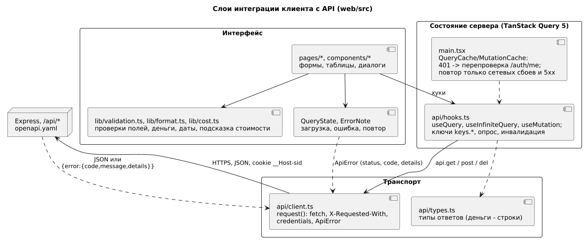
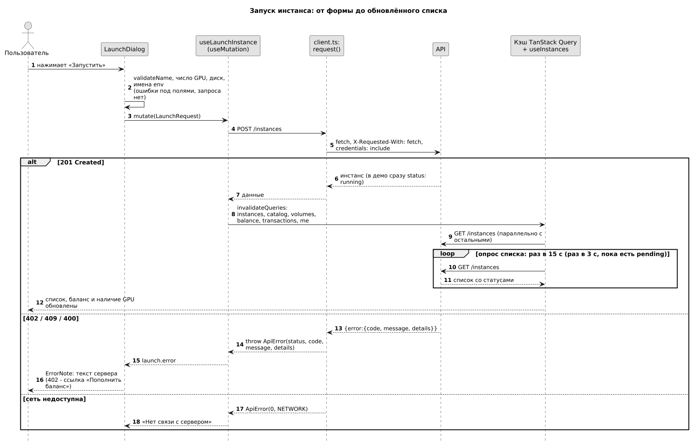

# Введение

## Цель работы

Освоить интеграцию клиента с серверным API на примере GPU Rent: определить, какие эндпоинты нужны каждой странице, написать запросы и обработку ответов, организовать состояние данных, полученных с сервера, и проверить стык тестами.

## Задание

1. Определить точки интеграции: эндпоинты и методы API, данные, которые ходят между клиентом и сервером.
2. Разработать запросы клиента и обработку ответов, адаптировать данные для интерфейса.
3. Протестировать интеграцию, найти и исправить ошибки.
4. Разработать управление состоянием с учётом асинхронности и ошибок.

# Ход работы

Клиент — React 18 и Vite, серверные данные ведёт TanStack Query 5, маршруты — React Router 7 (каталог [web/src](../../web/src/)). Сервер описан в OpenAPI 3.1 [6]: 45 путей, 51 операция. Интерфейс разобран в П6, сервер — в П5; здесь только стык между ними. Живых пользователей и опросов не было: стык проверен тестами и запросами к боевому адресу.

## Точки интеграции

Фронтенд и API работают по одному адресу: Vercel отдаёт статику, а `/api/*` перенаправляет в функцию Express. Запросы идут на тот же источник, поэтому CORS не нужен, а CSP клиента разрешает `connect-src 'self'` ([vercel.json](../../vercel.json)). Из 51 операции клиент использует 42. Девять остались за рамками интерфейса: вебхук платежей, `health`, две операции биллинга по расписанию, выдача спецификации и Swagger UI (их вызывают шлюз, планировщик и браузер), цены хранения в админке, а также создание и удаление собственных шаблонов (интерфейс только показывает их; управление — запросами к API).

Таблица 1 — Страницы клиента и их запросы

| Страница | Чтение | Изменение |
|---|---|---|
| Все (каркас) | `GET /auth/me`, `GET /billing/balance` | `POST /auth/logout` |
| Вход, регистрация, `/verify` | `GET /auth/me` | `POST /auth/login`, `/auth/register`, `/auth/verify` |
| Каталог | `GET /catalog/gpus`, `/catalog/templates`, `/templates/mine` | — |
| Диалог запуска | `GET /volumes`, `/ssh-keys`, `/instances` | `POST /instances` |
| Инстансы, карточка | `GET /instances` (`?all=1` для админа), `GET /instances/:id` | `POST /instances/:id/stop`, `/resume`, `/terminate` |
| Тома | `GET /volumes`, `/catalog/gpus` | `POST /volumes`, `POST /volumes/:id/extend`, `DELETE /volumes/:id` |
| Баланс | `GET /billing/balance`, `/billing/transactions`, `/billing/spend` | `POST /payments`, `POST /payments/:id/demo-pay` |
| Настройки | `GET /ssh-keys`, `/api-keys` | `POST`/`DELETE` ключей, `POST /auth/password`, `/auth/resend` |
| Администратор | `GET /admin/dashboard`, `/prices`, `/infrastructure`, `/users`, `/audit` | `POST /admin/prices`, `/gpus/:id/enable|disable`, `/nodes/:id/status`, `/users/:id/block|unblock` |

Число 42 получено сверкой адресов в [hooks.ts](../../web/src/api/hooks.ts) со списком операций из `openapi.yaml`; автоматической проверки «клиент использует только описанное» нет.



## API-клиент и типы

Все запросы проходят через одну функцию `request()` в [client.ts](../../web/src/api/client.ts) (106 строк) на встроенном `fetch` [5]. Страницы и хуки не вызывают `fetch` напрямую, поэтому правила транспорта задаются в одном месте:

- к пути добавляется `/api`, пустые параметры строки запроса отбрасываются;
- каждый запрос несёт `X-Requested-With: fetch` — сервер требует его вместе с проверкой `Origin` для небезопасных методов с cookie (защита от CSRF [9]), `Content-Type` ставится только при наличии тела, `credentials: 'include'` отправляет cookie сессии;
- ответ 204 даёт `undefined`, тело разбирается устойчиво: не-JSON не роняет разбор;
- любой не-2xx превращается в `ApiError(status, code, message, details)`; если сервер ответил не JSON-ошибкой (502 от платформы), текст берётся из таблицы запасных сообщений по статусу;
- сетевой сбой — `ApiError(0, 'NETWORK')` с понятным текстом; `AbortError` пробрасывается, чтобы отмена запроса не выглядела ошибкой.

Типы ответов — [types.ts](../../web/src/api/types.ts) (225 строк), источник истины — `openapi.yaml`. Сверка автоматическая: [contract.test.ts](../../server/test/integration/contract.test.ts) читает `types.ts`, берёт обязательные поля интерфейсов и проверяет настоящие ответы сервера. Если поле переименуют на сервере, упадёт тест, а не страница.

## Адаптация данных

- **Деньги** приходят строками (`"1234.5600"`): число с плавающей запятой теряет копейки. Для показа строка превращается в число в `formatMoney` (`Intl.NumberFormat`, рубли, 2 знака) и `formatMoneyPrecise` (до 4 знаков, как `numeric(…, 4)` в БД). Арифметика — только для подсказок. Стоимость часа в [cost.ts](../../web/src/lib/cost.ts) считается в десятитысячных долях рубля: `74.93 * 100` в JavaScript даёт `7493.000000000001` и лишнюю копейку после округления вверх.
- **Даты** приходят в ISO 8601 и выводятся через `Intl.DateTimeFormat('ru-RU')` [7]. Значение «2026-10-28» без времени разбирается вручную: `new Date('2026-10-28')` — это UTC, и в западных поясах день сдвинулся бы.
- **Сутки периода** сервер считает по Москве (`AT TIME ZONE 'Europe/Moscow'` в [billing.ts](../../server/src/routes/billing.ts)). Клиент поэтому берёт «сегодня» тоже по Москве (`todayMoscow()` в [BillingPage.tsx](../../web/src/pages/BillingPage.tsx)), строит диапазон из дат в UTC и дополняет нулями дни без расходов — ось графика непрерывна. Иначе у границы суток последний столбец был бы пустым.

## Управление состоянием

Серверные данные живут только в кэше TanStack Query, локального состояния «копии сервера» нет. В `useState` остаются поля форм, открытые диалоги и выбранный период. Ключи собраны в объекте `keys` в [hooks.ts](../../web/src/api/hooks.ts), поэтому видно, что именно сбрасывается после изменений.

Таблица 2 — Политика свежести данных

| Данные | Ключ | Свежесть и опрос |
|---|---|---|
| Пользователь | `me` | 5 минут; 401 — это «гость», а не ошибка; без повторов |
| Каталог GPU | `catalog/gpus` | 30 с (как `s-maxage` на CDN), перезапрос раз в минуту |
| Баланс | `balance` | 15 с, раз в минуту |
| Инстансы | `instances` | раз в 15 с, раз в 3 с при `pending` |
| Остальное | — | 10 с по умолчанию (в TanStack Query по умолчанию 0 [13]) |

Опрос по `refetchInterval` вкладку в фоне не нагружает: `refetchIntervalInBackground` по умолчанию выключен. Одинаковые ключи в разных компонентах делят один запрос: `useMe` вызывается в каркасе, охранниках маршрутов и диалоге, а на сервер уходит один `GET /auth/me`. Оговорка про `pending`: функция запуска в БД сразу ставит `running` (комментарий в миграции 0008), поэтому ускоренный опрос сегодня не срабатывает; он заложен под реальный запуск и не проверялся.

Мутации (`useMutation`) после успеха инвалидируют все затронутые ключи [3]. Запуск, остановка, возобновление и удаление инстанса сбрасывают шесть ключей: инстансы, каталог (изменилось число свободных GPU), тома, баланс, историю и пользователя. Демо-оплата — баланс, историю и пользователя; смена цены — цены, каталог и журнал; смена пароля — список API-ключей, потому что сервер их отозвал. Вход и выход делают `queryClient.clear()` (кэш прежнего пользователя не должен показаться следующему).

Пагинация истории операций и журнала — `useInfiniteQuery`: страница по 20 записей, курсор `nextCursor` от сервера [4], кнопка «Показать ещё». Поиск пользователей в админке идёт на сервер с `keepPreviousData`, список не мигает при вводе.

Оптимистичных обновлений нет, и это решение, а не пропуск [11]. Баланс и наличие GPU решает сервер, и ответ может быть 402 или 409 после гонки с другим запросом; показать успех заранее значит потом его откатывать. Вместо этого интерфейс ждёт ответ, блокирует кнопку (`isPending`, «Запускаем…») и перезапрашивает затронутые данные.



## Асинхронность и ошибки

Общий компонент `QueryState` показывает заготовку-скелетон при загрузке и блок ошибки с кнопкой «Повторить»; данные из кэша остаются на экране, пока идёт перезапрос. `ErrorNote` строит текст из `ApiError`: сообщение сервера плюс первая причина из `details`, а для 402 и `EMAIL_NOT_VERIFIED` добавляет ссылку на пополнение или подтверждение. Любая необработанная ошибка показывается общей фразой без технических подробностей. Реальные ответы боевого сервера на запросы без заголовка и с пустым телом (25.11.2026):

```
POST /api/auth/login без X-Requested-With:
{"error":{"code":"CSRF","message":"Нужен заголовок X-Requested-With: fetch"}}
POST /api/auth/login, тело {}:
{"error":{"code":"VALIDATION_ERROR","message":"Некорректные данные запроса",
 "details":[{"path":"email","message":"Обязательное поле"},{"path":"password","message":"Обязательное поле"}]}}
```

В [main.tsx](../../web/src/main.tsx) заданы общие правила. Повторяются только сетевые сбои и ответы 5xx, не больше двух раз: ошибку 4xx повтор не исправит [10]. Для вошедшего пользователя любой 401 в запросе или мутации запускает перепроверку `/auth/me`: если и она вернула 401, пользователь становится гостем, и охранник маршрута ведёт его на вход. Слепо выходить нельзя: 401 даёт и неверный текущий пароль при его смене, хотя сессия жива.

## Согласование проверок форм с сервером

Клиентские проверки дают быструю обратную связь, но правду определяет сервер (схемы zod). Сверка клиентских проверок с серверными нашла расхождения, при которых клиент пропускал значение, а сервер отвечал отказом, либо наоборот.

Таблица 3 — Найденные расхождения и исправления

| Что | Клиент был | Сервер | Исправление |
|---|---|---|---|
| Сумма пополнения | до 1 000 000 ₽ | от 10 до 100 000 ₽ | Верхний предел 100 000 ₽ ([validation.ts](../../web/src/lib/validation.ts)), 02.11.2026 |
| Длина пароля | `password.length > 72` (символы) | не больше 72 байт UTF-8 | Подсчёт через `TextEncoder` [8]: 40 русских букв — 80 байт, раньше проходили проверку и получали 400 |
| Выбор числа GPU | «свободно N» на дата-центр | все GPU на одной ноде, иначе 409 `NO_CAPACITY` | Подсказка у поля и пояснение к этой ошибке; точнее нельзя: каталог отдаёт сумму по дата-центру, а не по нодам |
| Размер тома | до 10 000 ГБ | на аккаунт суммарно не больше 5 000 ГБ (409 `LIMIT_REACHED`) | Предел 5000 и подсказка «суммарно на аккаунт», 07.11.2026 |
| Баланс для запуска | час нового инстанса | час нового плюс час работающих (миграция 0014) | Подсказка в диалоге складывает час всех инстансов со статусом `running` |
| Имя при регистрации | от 1 символа | от 2 | `validateName(…, 2)` |

Пока осталось одно известное несоответствие: схема сервера допускает том до 10 000 ГБ, а ограничивает его бизнес-правило с общим лимитом 5 000 ГБ, поэтому клиент опирается на правило, а не на схему. Контрактный тест проверяет формы ответов, но не пределы полей: расхождения из таблицы 3 он бы не поймал. Единый источник пределов (общая схема для клиента и сервера) в проекте не заведён.

## Тестирование интеграции

Таблица 4 — Что проверяет стык клиента и сервера

| Уровень | Объём | Что проверяет |
|---|---|---|
| Контракт [contract.test.ts](../../server/test/integration/contract.test.ts) | 7 тестов | Поля и типы `types.ts` в настоящих ответах: пользователь, каталог, инстансы, тома, ключи, деньги, админка; формат `{error:{code,message}}` с русским текстом |
| Соответствие OpenAPI | [openapi.test.ts](../../server/test/unit/openapi.test.ts) | Каждый маршрут описан, каждая операция реализована |
| Схемы входа | [schemas.test.ts](../../server/test/unit/schemas.test.ts) | 71 проверка границ сервера (пароль в байтах, сумма, email) |
| E2E Playwright [12] | 21 сценарий: клиент 10, админ 3, публичная часть 8 | Настоящий браузер на настоящем сервере: регистрация, 402, пополнение, запуск, остановка, ключи, смена цены, блокировка, 360 px |

На 07.11.2026 сервер: 571 тест, e2e локально зелёные. Против боевого адреса в режиме `E2E_READONLY=1` проходят 6 сценариев, 15 изменяющих данные пропускаются. При подготовке отчёта я заново запустил `schemas.test.ts` (71 проверка, зелёные), получил список сценариев `npx playwright test --list` (21) и выполнил два запроса к боевому серверу. Полный e2e и интеграционный набор не перезапускал. Покрытие кода не измерялось, модульных тестов хуков и компонентов нет.

# Ответы на контрольные вопросы

## Вопросы на оценку 2

**Какие эндпоинты и методы серверного API были выбраны для интеграции?**

Клиент использует 42 из 51 операции API (таблица 1). Чтение — `GET` каталога, инстансов, томов, ключей, баланса, истории и админских разделов. Изменения — `POST` для запуска, остановки, возобновления и удаления инстанса, пополнения, создания и расширения томов, добавления ключей, входа и регистрации, админских операций, `DELETE` для томов и ключей. `PUT` и `PATCH` не нужны: изменение состояния оформлено как действие над ресурсом, например `POST /instances/:id/stop`. Публичные — только каталог GPU и шаблонов.

**Какие основные ошибки или проблемы возникли при разработке интеграции фронтенда с серверным API?**

Главные — расхождения клиентских проверок с серверными (таблица 3). Вторая группа — деньги и время: округление `74.93 * 100`, сдвиг дня при разборе даты без времени, граница суток по Москве против пояса браузера. Все, кроме ограничения «одна нода» (его можно только объяснить пользователю), исправлены.

## Вопросы на оценку 3

**Какие технологии и инструменты были использованы при разработке интеграции?**

Встроенный `fetch` без HTTP-библиотек, TanStack Query 5 для кэша и состояния запросов, TypeScript (типы ответов в `types.ts`), React Router 7 для охранников маршрутов, `Intl` для денег и дат, OpenAPI 3.1 и Swagger UI для контракта; для проверки — vitest с supertest, Playwright, `curl`.

**Какой процесс обработки ответов от сервера был реализован, и как обрабатываются ошибки?**

`request()` читает тело, при 204 возвращает `undefined`, при 2xx отдаёт данные как типизированный объект. Любой не-2xx становится `ApiError` со статусом, кодом, русским текстом и подробностями. Дальше ошибка попадает в `error` запроса или мутации, и компонент показывает её через `QueryState` или `ErrorNote` (скелетон, текст, «Повторить», ссылка по 402). Глобально настроены повторы только для сетевых сбоев и 5xx и перепроверка сессии при 401.

**Какой уровень тестирования был проведен для интеграции, и какие результаты были получены?**

Три уровня: контрактный тест (7 проверок форм ответов), 71 проверка границ входных схем и 21 e2e-сценарий в настоящем браузере. На 07.11.2026 они проходили локально; боевой адрес проверен в режиме «только чтение» (6 из 21, остальные пропускаются по замыслу). Пределы полей из таблицы 3 найдены сверкой клиента со схемами сервера, на стороне сервера их закрывают тесты схем. Не проверялось: нагрузка со стороны браузера и покрытие кода.

## Вопросы на оценку 4

**Как были учтены асинхронные операции и управление состоянием при интеграции?**

Каждая асинхронная операция — это запрос или мутация TanStack Query с тремя состояниями (загрузка, данные, ошибка), которые отрисовывают `QueryState` и `ErrorNote`. Запрос получает `AbortSignal` и отменяется при уходе со страницы. Мутации блокируют кнопки на время выполнения и после успеха инвалидируют затронутые ключи, чтобы баланс, каталог и список инстансов не расходились. Статусы обновляются опросом (15 с, 3 с при `pending`). Локальное состояние остаётся только у форм.

**Как была обеспечена производительность и эффективность интеграции фронтенда и серверного API?**

Одинаковые ключи делят один запрос, свежесть разведена по данным (каталог 30 секунд, пользователь 5 минут). Публичный каталог кэшируется ещё и на CDN (`s-maxage=30`), личные ответы — `private, no-store`. Списки идут страницами по 20 записей с курсором, поиск выполняет сервер. Страницы админки грузятся отдельными кусками, первая загрузка — 103,1 КиБ gzip. Фоновые вкладки не опрашиваются, повторов на 4xx нет. Минус: после каждого действия над инстансом перезапрашиваются активные из шести списков — осознанная плата за согласованность.

**Какие методы и паттерны программирования были использованы для облегчения интеграции и поддержания кода?**

Единая точка входа `request()` и класс `ApiError` (шлюз к API). Хуки на ресурс: страница не знает адресов и ключей кэша. Реестр ключей `keys` — единственное место, где они записаны. Фабрики мутаций (`useVolumeMutation`, `useInfraMutation`, `useInvalidateAfterInstanceChange`) убирают повторы. Типы повторяют контракт, а контрактный тест проверяет, что они не отстали. Проверки полей вынесены в `lib/validation.ts` и подписаны, где они зеркалят правило сервера.

## Вопросы на оценку 5

**Можете ли вы подробно описать процесс интеграции фронтенда с серверным API, включая передачу данных и управление состоянием?**

Пример — запуск инстанса (рисунок 2). Диалог проверяет поля локально: название, число GPU в пределах свободных, диск 10–2000 ГБ, имена переменных; ошибки стоят под полями, запроса нет. Затем `useLaunchInstance` вызывает `POST /instances` через `request()`: заголовок `X-Requested-With`, cookie сессии, тело JSON. Сервер проверяет данные по zod, выделяет GPU в одной транзакции и отвечает 201 с инстансом, а цену фиксирует снимком. Мутация инвалидирует шесть ключей, кэш перезапрашивает их параллельно, и диалог закрывается; список, баланс и число свободных GPU обновляются сами. При 402, 409 или 400 приходит `{error:{code,message,details}}`, которую показывает `ErrorNote`; состояние кэша не меняется.

**Какие передовые методы и инструменты использовались для обеспечения высокой производительности и надежности интеграции?**

Производительность — как в ответе выше. Надёжность: контрактный тест, который связывает `types.ts` с настоящими ответами; тест соответствия `openapi.yaml` коду; 21 e2e в браузере; единый формат ошибок; безопасные повторы (только сеть и 5xx). Не применялись: офлайн-режим, оптимистичные обновления (причина выше), мониторинг ошибок клиента.

**Какие меры были предприняты для обеспечения безопасности при передаче данных между клиентом и сервером?**

Транспорт — только HTTPS (HSTS в `vercel.json`), запросы на тот же источник, CSP `connect-src 'self'` не даёт странице обращаться к чужим адресам. Сессия — cookie `__Host-sid` с HttpOnly, Secure, SameSite=Lax: скрипт страницы токен не видит, а в `localStorage` лежит только тема. От CSRF [9] защищает заголовок `X-Requested-With` плюс проверка `Origin`: боевой сервер отверг запрос без заголовка кодом 403 `CSRF`. Клиентские проверки только удобство: сервер проверяет всё повторно (zod `.strict()`, лишние поля отвергаются). Ошибки не раскрывают текст БД, секрет API-ключа показывается один раз, кэш очищается при входе и выходе, React экранирует вывод (`dangerouslySetInnerHTML` в проекте не используется). Не сделано: подпись или шифрование поверх HTTPS не нужны, двухфакторного входа и CAPTCHA нет.

# ЗАКЛЮЧЕНИЕ

Интеграция GPU Rent построена вокруг единого клиента `request()`, типов ответов, сверяемых с сервером контрактным тестом, и кэша TanStack Query с явными ключами и инвалидацией после мутаций. Данные адаптируются для интерфейса: деньги остаются строками до показа, сутки считаются по Москве, как на сервере. Сверка клиентских проверок с серверными нашла шесть расхождений (таблица 3); пять исправлены, шестое, про размещение на одной ноде, объяснено пользователю в интерфейсе. Слабые места: ускоренный опрос статуса `pending` не срабатывает, пока запуск мгновенный; пределы полей контрактным тестом не покрыты; модульных тестов хуков нет. Следующий шаг — генерировать типы из `openapi.yaml`, а не поддерживать их вручную.

## СПИСОК ИСПОЛЬЗОВАННЫХ ИСТОЧНИКОВ

1. Шнайер Б. Прикладная криптография. — Питер, 2008. — 784 с.
2. Гудро М. Тайны хакеров. Безопасность Web-приложений. — ДМК Пресс, 2019. — 480 с.
3. TanStack Query v5. Query Invalidation. — https://tanstack.com/query/v5/docs/framework/react/guides/query-invalidation
4. TanStack Query v5. Infinite Queries. — https://tanstack.com/query/v5/docs/framework/react/guides/infinite-queries
5. MDN Web Docs. Using the Fetch API. — https://developer.mozilla.org/en-US/docs/Web/API/Fetch_API/Using_Fetch
6. OpenAPI Initiative. OpenAPI Specification v3.1.0. — https://spec.openapis.org/oas/v3.1.0
7. MDN Web Docs. Intl.DateTimeFormat. — https://developer.mozilla.org/en-US/docs/Web/JavaScript/Reference/Global_Objects/Intl/DateTimeFormat
8. MDN Web Docs. TextEncoder. — https://developer.mozilla.org/en-US/docs/Web/API/TextEncoder
9. OWASP. Cross-Site Request Forgery Prevention Cheat Sheet. — https://cheatsheetseries.owasp.org/cheatsheets/Cross-Site_Request_Forgery_Prevention_Cheat_Sheet.html
10. TanStack Query v5. Query Retries. — https://tanstack.com/query/v5/docs/framework/react/guides/query-retries
11. TanStack Query v5. Optimistic Updates. — https://tanstack.com/query/v5/docs/framework/react/guides/optimistic-updates
12. Playwright. Best Practices. — https://playwright.dev/docs/best-practices
13. TanStack Query v5. Important Defaults. — https://tanstack.com/query/v5/docs/framework/react/guides/important-defaults

Дата обращения к электронным источникам: 25.11.2026.
