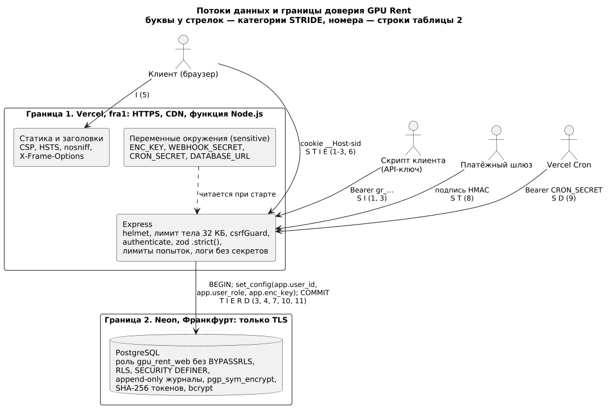
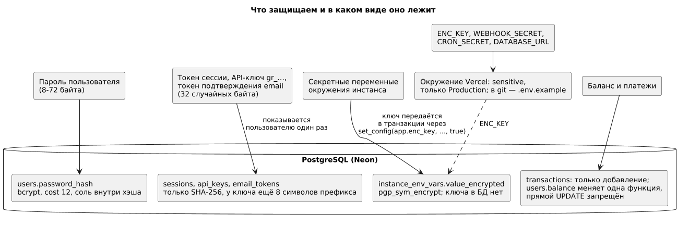
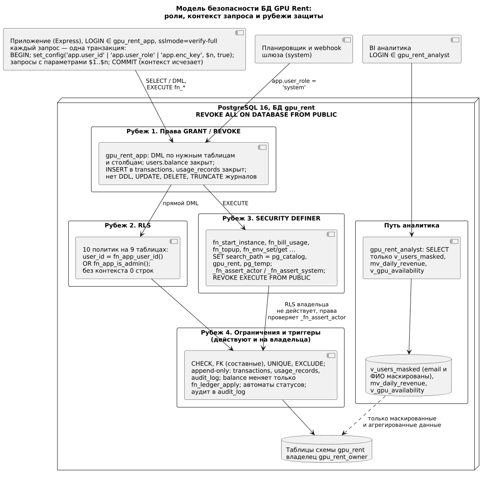

# Введение

## Цель работы

Описать угрозы сервису аренды GPU, перечислить, что в нём нужно защищать, показать реализованные меры и проверить их тестами и запросами к боевому сайту. Отдельно назвать то, что не защищено или не проверено, и честно сказать, что обучения и сбора отзывов о безопасности не было.

## Задание

Проанализировать угрозы, определить защищаемые данные и ресурсы; реализовать аутентификацию, авторизацию, контроль доступа и шифрование, надёжно хранить пароли и секреты; провести тестирование безопасности инструментами; обучить команду и пользователей и собрать обратную связь.

# Ход работы

Проект выполняет один человек, команды нет. Меры реализованы в П4, П5 и П8; здесь они сведены в модель угроз и проверены 25.11.2026: `curl` к https://gpu-rent-lemon.vercel.app (деплой `bb50546`), `npm audit`, четыре unit-файла vitest (38 проверок), `psql` к локальной копии схемы (PostgreSQL 15.14), чтение кода. Полный набор тестов не запускался: числа 571 и 554 — из прогона 07.11.2026.

## Что защищаем и от кого

Нарушитель — анонимный посетитель, клиент против другого клиента, владелец украденного ключа, посторонний у вебхука или cron-адреса. Администратор, Vercel и Neon считаются доверенными: это допущение, а не проверенный факт.

Таблица 1 — Защищаемые данные и ресурсы

| Актив | Чем грозит потеря | Как хранится |
|---|---|---|
| Пароль | Захват аккаунта | bcrypt cost 12, хэш недоступен роли приложения |
| Сессия, API-ключ, токен подтверждения email | Действия от имени пользователя | В БД только SHA-256 токена, сам токен — 256 случайных бит |
| Секретные переменные окружения инстансов | Доступ к чужим сервисам клиента | `pgp_sym_encrypt`, ключ `ENC_KEY` вне БД |
| Баланс и платежи | Деньги пользователя и сервиса | Баланс меняет одна функция, журнал только добавляется |
| Персональные данные (email, ФИО) | Утечка, спам, фишинг | Строки под RLS, аналитику доступна маска |
| Секреты окружения сервиса | Полный доступ к БД, подделка вебхука | Vercel (sensitive), не в git |

## Модель угроз

Использован STRIDE [5]: потоки данных и две границы доверия (рисунок 1), затем угрозы по каждому потоку. Таблица 2 связывает угрозу, меру и проверку; номера совпадают с рисунком.

Таблица 2 — Угрозы STRIDE, меры и проверки

| № | Угроза | Мера | Проверка |
|---|---|---|---|
| 1 | S: подбор или кража пароля, подмена сессии | bcrypt, лимиты 5/20/60 попыток за 15 минут (email+IP, email, IP), `__Host-sid` HttpOnly Secure SameSite=Lax, один ответ на неверный email и пароль, выравнивание времени | [auth.test.ts](../../server/test/integration/auth.test.ts), [password.test.ts](../../server/test/unit/password.test.ts) |
| 2 | T: CSRF и login-CSRF | `X-Requested-With: fetch` и свой `Origin` для небезопасных методов [8] | [csrf.test.ts](../../server/test/integration/csrf.test.ts), `curl` |
| 3 | E, I: чужие ресурсы, повышение прав | Владелец в `WHERE`, RLS, 404 вместо 403, `.strict()`, нет права UPDATE на роль и баланс | [isolation.test.ts](../../server/test/integration/isolation.test.ts), [security-roles.test.ts](../../server/test/integration/security-roles.test.ts) |
| 4 | T: SQL-инъекции | Параметры `$n`, id и тела проверяет zod, у роли нет DDL | [robustness.test.ts](../../server/test/integration/robustness.test.ts) |
| 5 | I, T: XSS, встраивание в чужую страницу | CSP `script-src 'self'`, `frame-ancestors 'none'`, `nosniff`, HttpOnly [11] | `curl -I` |
| 6 | I: чужие данные из кэша CDN | Публично кэшируется только каталог, остальное `private, no-store` | [cache.test.ts](../../server/test/integration/cache.test.ts) |
| 7 | R: отрицание действий | `audit_log` пишет смену роли и статуса, цен, ключей, платежей | [10_audit.sql](../../db/tests/10_audit.sql) |
| 8 | S, T: поддельный вебхук оплаты | HMAC-SHA256 по сырому телу, сравнение за постоянное время | [webhook.test.ts](../../server/test/unit/webhook.test.ts), `curl` |
| 9 | S, D: чужой вызов биллинга | `Bearer CRON_SECRET` | `curl` |
| 10 | D: большое тело, долгие запросы, массовая регистрация | Тело 32 КБ (413), `statement_timeout` 15 с, потолки на пользователя, 10 регистраций в час с адреса | `curl`, [keys.test.ts](../../server/test/integration/keys.test.ts) |
| 11 | I: утечка секретов | Шифрование env, API отдаёт имена, а не значения; логи без тел и cookie; секреты вне git | [08_env_encryption.sql](../../db/tests/08_env_encryption.sql), `git grep` |

## Реализованные меры

**Аутентификация и авторизация.** Браузер входит по cookie-сессии на 7 дней, скрипт — по ключу `gr_…`; вебхук и cron подписаны своими секретами. Роли две, администратор по API-ключу изменяющих операций не выполняет (П5). Человеческий фактор учтён: ключ нельзя восстановить, ссылки подтверждения одноразовы, в памятке разобрана социальная инженерия [3].

**Шифрование и хранение.** Пароли хэшируются bcrypt: стойкость к перебору задаёт стоимость хэша, а не секретность алгоритма [7]. Основы — [1], классы атак на веб-приложения — [2]. Токены случайны и имеют 256 бит, поэтому хватает SHA-256 без соли: подбирать нечего. Секретные переменные инстанса шифрует `pgp_sym_encrypt` [9]; ключ приходит из окружения Vercel и на время транзакции передаётся через `set_config('app.enc_key', …, true)`, в БД не хранится. Приложение значения не читает: `fn_env_get` в `server/src` не вызывается, наружу идут только имена. [08_env_encryption.sql](../../db/tests/08_env_encryption.sql) проверяет: верный ключ расшифровывает, неверный и пустой — нет.

**Транспорт и браузер.** HTTPS, HTTP/2 и TLS 1.3 даёт Vercel (проверено `curl -v`: сертификат `*.vercel.app`, действует до 29.01.2027). Neon по документации принимает только TLS; в строке подключения `sslmode=require`. По коду `pg-connection-string` 2.14.1 без `uselibpqcompat` такой режим проверяет сертификат сервера, но на Neon это не проверялось. HSTS 2 года, CSP, `X-Frame-Options`, `Permissions-Policy`, `Referrer-Policy` заданы в [vercel.json](../../vercel.json) и через `helmet`.

**Контроль доступа в БД.** Приложение подключается ролью `gpu_rent_web`: без суперпользователя и `BYPASSRLS`, без DDL, с `statement_timeout` 15 с. На локальной копии схемы 25.11 (`psql`): RLS включена на 11 таблицах, 15 политик, 35 функций `SECURITY DEFINER`, и у всех задан `search_path`. Контекст пользователя живёт до конца транзакции, и соединение из пула не уносит чужую личность. Рубежи — рисунок 3.

**Секреты вне репозитория.** В git отслеживается только `.env.example` с локальным паролем разработки. На 25.11 `git grep` по строкам подключения с паролем, ключам `gr_…` и закрытым ключам нашёл лишь этот файл, заглушки тестов и пример в `openapi.yaml`. Боевые `ENC_KEY`, `WEBHOOK_SECRET`, `CRON_SECRET` и `DATABASE_URL` в Vercel помечены sensitive: значение после сохранения не показывается [10]. Принцип наименьших привилегий: у роли аналитика есть только маскированные представления.

## Тестирование безопасности

Автоматические проверки (по данным 07.11): 195 unit-тестов, 376 интеграционных под той же ролью без обхода RLS, что и приложение, 554 SQL-проверки. Отрицательные сценарии: чужой ресурс — 404, «присвоить себе admin» отвергается, CSRF без заголовка — 403, вебхук с чужой подписью отклоняется. 25.11 прогнаны четыре unit-файла (пароли, подпись, `csrfGuard`, токены): 38 проверок пройдены.

`npm audit --omit=dev` (сервер): одна уязвимость high — `zod` 3.25.76, расход памяти при проверке огромных коллекций (GHSA-mrhx-c7xc-m3w5); у клиента 0. Риск принят: тело запроса не больше 32 КБ, а единственная коллекция — словарь переменных окружения инстанса. Исправление требует zod 4, это ломающее изменение; в план оно не вошло.

Таблица 3 — Ручные проверки боевого сайта, `curl`, 25.11.2026

| Запрос | Ожидание | Результат |
|---|---|---|
| `GET /api/auth/me`, `/api/instances`, `/api/admin/dashboard` без входа | 401 | 401 |
| `POST /api/auth/login` без `X-Requested-With` | 403 CSRF | 403 `CSRF` |
| То же с `Origin: https://evil.example` | 403 CSRF | 403 `CSRF` |
| `Authorization: Bearer gr_bad` | 401 | 401 `INVALID_API_KEY` |
| `POST /api/webhooks/payments` без подписи | 401 | 401 `INVALID_SIGNATURE` |
| `GET /api/internal/billing` без секрета | 401 | 401 `INVALID_CRON_SECRET` |
| `POST /api/auth/login`, тело 40 КБ | 413 | 413 `PAYLOAD_TOO_LARGE` |
| `POST /api/auth/register` с лишним полем `role` | 400 | 400, «Лишние поля в запросе» |
| `GET /`, `GET /api/health`: заголовки | CSP, HSTS, `nosniff`, рамки запрещены | Есть; `X-Frame-Options` DENY и SAMEORIGIN (у API умолчание `helmet`, встраивание запрещает CSP) |

Не выполнялось: сканирование OWASP ZAP или аналогом, статический анализ исходников, проверка лимитов входа на боевом сайте (риск заблокировать учётную запись), внешний пентест. Двух подряд чистых раундов автоматизированного ревью кода нет; подтверждённые находки исправлены и закрыты тестами.

## Соответствие OWASP Top 10:2021 и нормативам

Таблица 4 — Покрытие OWASP Top 10:2021 [4]

| Категория | Состояние |
|---|---|
| A01 Нарушение контроля доступа | Закрыто: RLS, владелец в запросе, 404 |
| A02 Криптографические сбои | Закрыто: bcrypt, SHA-256, `pgp_sym_encrypt`, TLS, HSTS |
| A03 Инъекции | Закрыто: параметры, zod, роль без DDL |
| A04 Небезопасный дизайн | Частично: правила (баланс, двойная выдача) держит БД; модель угроз оформлена только в этой работе |
| A05 Неверная конфигурация | Частично: минимальные права и заголовки есть; 16 переменных `NEON_*` (среди них пароль владельца БД) читаемы участникам проекта Vercel |
| A06 Уязвимые компоненты | Частично: ручной `npm audit`, одна high принята; Dependabot и аудит в CI нет |
| A07 Сбои аутентификации | Частично: лимиты, отзыв ключей при смене пароля; нет 2FA, проверки утёкших паролей и восстановления пароля |
| A08 Целостность ПО и данных | Частично: lock-файлы и `npm ci`, подпись вебхука; CI в GitHub не опубликован |
| A09 Журналирование и мониторинг | Частично: pino и `audit_log`; оповещений нет, журнал функций хранится час |
| A10 SSRF | Не применимо: сервер не запрашивает адреса, заданные пользователем |

Нормативные требования проект не проходил. Платежи демонстрационные (`DEMO_PAYMENTS`), данные банковских карт не обрабатываются, поэтому PCI DSS не применим. Email и ФИО — персональные данные: при реальном запуске для граждан РФ потребовались бы согласие, уведомление Роскомнадзора и первичная запись данных в БД на территории РФ [12], а БД находится во Франкфурте. Это не оценивалось юристом; формального соответствия проект не заявляет. Ориентиром служил ASVS [6].

## Обучение и обратная связь

Команды нет, обучать было некого; пользователей тоже нет, сервис учебный. Сделана [памятка пользователю](../security-memo.md) на одну страницу: пароль, API- и SSH-ключи, фишинг, действия при утечке. В интерфейс она не встроена: её нужно выдавать с доступом или поставить ссылкой в «Настройки». Отзывов о безопасности никто не давал, опросов не было. Предлагаемый канал — Issues репозитория (метка `security`, секреты в обращении не присылать) и почта владельца; реальным обращением он не проверялся. Приватные security advisories GitHub для уязвимостей не включены.

# Ответы на контрольные вопросы

## Вопросы на оценку 2

### Какие угрозы безопасности были рассмотрены при анализе вашего приложения, и какие из них были учтены?

Рассмотрены одиннадцать угроз по STRIDE (таблица 2): подбор паролей и кража сессий, CSRF, чужие ресурсы и повышение прав, инъекции, XSS и встраивание, утечка через кэш CDN, подделка вебхука и cron-адреса, отрицание действий, исчерпание ресурсов, утечка секретов. Учтены все, но с разной полнотой: подбор пароля ограничен лимитами, а не двухфакторным входом.

### Какие меры безопасности были реализованы, и какая часть безопасности приложения осталась непокрытой?

Реализованы bcrypt и SHA-256, шифрование переменных окружения, CSRF-защита, заголовки, RLS, минимальные права роли, лимиты, аудит. Не покрыты: двухфакторный вход, восстановление и проверка утёкших паролей, оповещения, Dependabot, соответствие 152-ФЗ, пентест, доступ к `NEON_*` у участников проекта Vercel (таблица 4).

## Вопросы на оценку 3

### Какие методы аутентификации и авторизации были применены в вашем приложении, и как они обеспечивают безопасность?

Cookie-сессия с токеном в 256 бит (в БД его SHA-256), API-ключ, HMAC для вебхука, секрет планировщика. Авторизация — роли клиента и администратора, явный владелец в запросе, RLS по контексту транзакции, проверки в функциях БД. Если украсть содержимое БД, по хэшам токенов войти нельзя; если украсть cookie, её срок ограничен 7 днями, а смена пароля завершает сессии.

### Какие инструменты или сервисы были использованы для тестирования безопасности, и какие уязвимости были обнаружены?

`npm audit` (одна high в zod, риск принят), vitest и supertest под ролью без обхода RLS, SQL-тесты, `curl` к боевому сайту (таблица 3), `git grep` по секретам, автоматизированное ревью кода. Проверка спецификации до реализации нашла, среди прочего, утечку приватных шаблонов через кэш CDN, ревью кода — крайние случаи в биллинге; всё исправлено и закреплено тестами. Сканер уязвимостей и пентест не применялись.

### Какие меры были предприняты для обучения пользователей и персонала по вопросам безопасности?

Только памятка `docs/security-memo.md`. Персонала нет, пользователей нет, обучение не проводилось, понимание памятки не проверялось.

## Вопросы на оценку 4

### Как были реализованы меры безопасности для защиты данных, включая шифрование и контроль доступа?

Шифрование: TLS при передаче, bcrypt и SHA-256 для учётных данных, `pgp_sym_encrypt` для переменных окружения инстансов, диски шифрует Neon (по документации провайдера). Контроль доступа: роль без привилегий владельца, права на уровне столбцов (баланс закрыт), RLS, функции `SECURITY DEFINER` с фиксированным `search_path`, неизменяемые журналы (рисунки 2 и 3).

### Как были обеспечены высокая производительность и надежность мер безопасности?

Лимиты входа считает PostgreSQL, а не память процесса: на serverless она бесполезна; цена — запрос к БД при входе. bcrypt cost 12 стоит около 0,3 с на проверку (unit-тест, ноутбук), но входов мало. Заголовки, `csrfGuard` и RLS — дешёвые проверки. Надёжность: правила держит БД, а не код приложения, меры закреплены тестами. Нагрузка на меры отдельно не измерялась.

### Какие методы были использованы для обнаружения и предотвращения атак, таких как инъекции, переполнения буфера и другие?

Инъекции предотвращают параметризованные запросы, схемы zod с `.strict()` и роль без DDL; проверены в robustness и security-roles. Переполнение буфера в управляемой среде Node.js и PostgreSQL не относится к коду проекта; ограничены размеры: тело 32 КБ, длины полей, потолки на пользователя. Обнаруживает атаки журнал pino (4xx и 5xx с `reqId`) и `audit_log`; автоматических оповещений нет.

## Вопросы на оценку 5

### Можете ли вы подробно описать процесс анализа угроз безопасности и разработки мер безопасности для вашего приложения?

Процесс: определить активы (таблица 1), нарисовать потоки и границы доверия (рисунок 1), выписать угрозы STRIDE по каждому потоку, выбрать меру на самом нижнем возможном уровне (инвариант в БД, затем приложение, затем браузер), написать отрицательный тест и ручную проверку (таблица 2). Честное ограничение: меры появились вместе с кодом, а таблица составлена по готовой реализации; на них повлияли проверки и ревью, а не заранее проведённый анализ. Модель угроз стоило составить раньше.

### Какие передовые методы и инструменты использовались для обеспечения высокой безопасности и защиты данных?

RLS с контекстом в транзакции, ограничения PostgreSQL как последний рубеж (`EXCLUDE`, `CHECK`, журналы только на добавление), SHA-256 вместо хранения токенов, префикс `__Host-` у cookie, выравнивание времени входа, подпись вебхука с постоянным временем сравнения, sensitive-переменные Vercel, CSP без inline-скриптов. Инструменты: `npm audit`, vitest, supertest, SQL-тесты, `curl`.

### Какие меры были предприняты для обеспечения соответствия вашего приложения нормативным требованиям в области безопасности данных?

Формально — никаких. Платёж демонстрационный, карты не обрабатываются, поэтому PCI DSS неприменим. Для персональных данных (email, ФИО) соответствие 152-ФЗ не достигнуто: нет согласия на обработку, уведомления оператора и размещения БД в РФ. Ориентиры — OWASP Top 10 и ASVS (таблица 4). Практики шифрования и минимизации данных реализованы, но юридически соответствие не подтверждает.

# ЗАКЛЮЧЕНИЕ

Составлена модель угроз STRIDE с одиннадцатью угрозами, мерами и проверками; перечислены защищаемые данные и способы их хранения; проверены заголовки, коды 401, 403, 413 и 400 на боевом сайте, unit-тесты безопасности и `npm audit`. Хуже защищены вход (нет 2FA и восстановления пароля), мониторинг (нет оповещений) и права доступа к переменным `NEON_*`; принята одна уязвимость high в zod. Обучения, отзывов и юридического соответствия нет: создана памятка, предложен канал обратной связи. Не проверялись сертификат сервера Neon, поведение лимитов на боевом сайте и работа памятки на реальных людях.

## СПИСОК ИСПОЛЬЗОВАННЫХ ИСТОЧНИКОВ

1. Шнайер Б. Прикладная криптография. — Питер, 2008. — 784 с.
2. Гудро М. Тайны хакеров. Безопасность Web-приложений. — ДМК Пресс, 2019. — 480 с.
3. Митник К. Искусство обмана. Хакерские приемы и тактики. — Манн, Иванов и Фербер, 2019. — 488 с.
4. OWASP Top 10:2021. — URL: https://owasp.org/Top10/ (дата обращения: 25.11.2026).
5. OWASP Cheat Sheet Series: Threat Modeling. — URL: https://cheatsheetseries.owasp.org/cheatsheets/Threat_Modeling_Cheat_Sheet.html (дата обращения: 25.11.2026).
6. OWASP Application Security Verification Standard. — URL: https://owasp.org/www-project-application-security-verification-standard/ (дата обращения: 25.11.2026).
7. OWASP Cheat Sheet Series: Password Storage. — URL: https://cheatsheetseries.owasp.org/cheatsheets/Password_Storage_Cheat_Sheet.html (дата обращения: 25.11.2026).
8. OWASP Cheat Sheet Series: Cross-Site Request Forgery Prevention. — URL: https://cheatsheetseries.owasp.org/cheatsheets/Cross-Site_Request_Forgery_Prevention_Cheat_Sheet.html (дата обращения: 25.11.2026).
9. PostgreSQL 16 Documentation: pgcrypto. — URL: https://www.postgresql.org/docs/16/pgcrypto.html (дата обращения: 25.11.2026).
10. Vercel Docs: Sensitive environment variables. — URL: https://vercel.com/docs/environment-variables/sensitive-environment-variables (дата обращения: 25.11.2026).
11. OWASP Cheat Sheet Series: HTTP Headers. — URL: https://cheatsheetseries.owasp.org/cheatsheets/HTTP_Headers_Cheat_Sheet.html (дата обращения: 25.11.2026).
12. Федеральный закон от 27.07.2006 № 152-ФЗ «О персональных данных». — URL: https://www.consultant.ru/document/cons_doc_LAW_61801/ (дата обращения: 25.11.2026).
