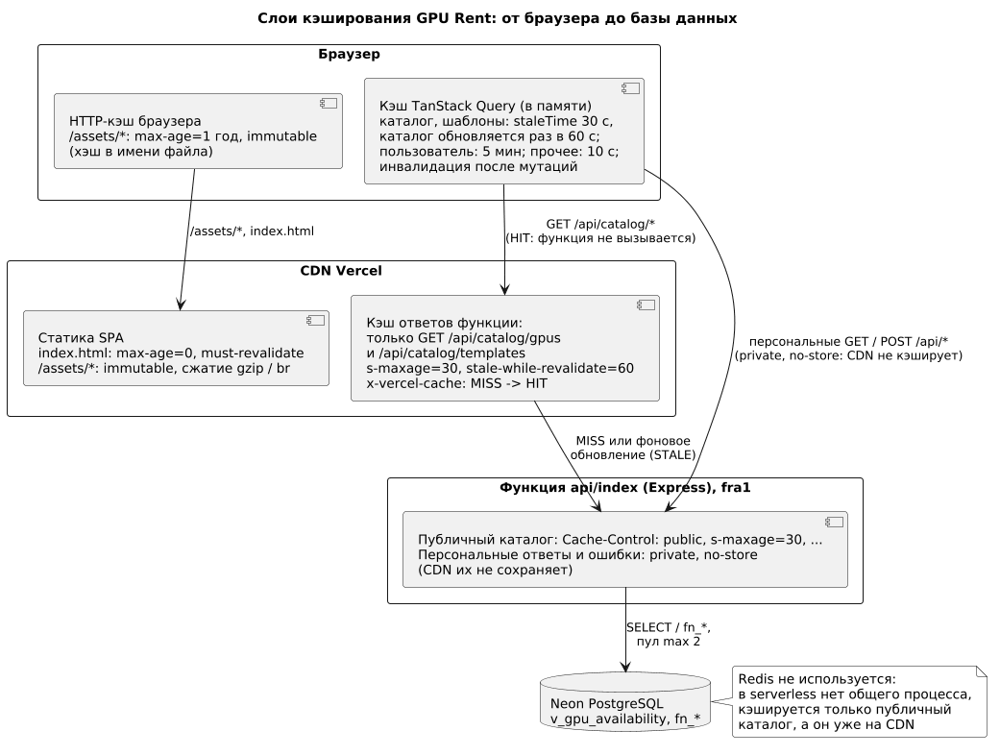
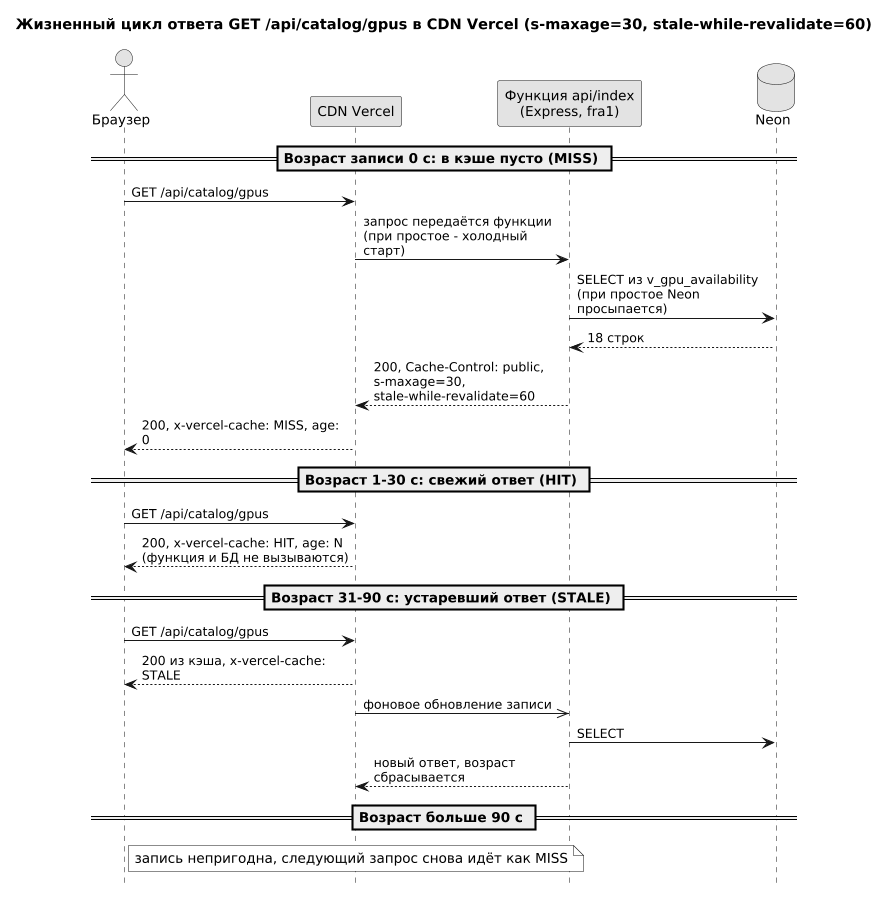
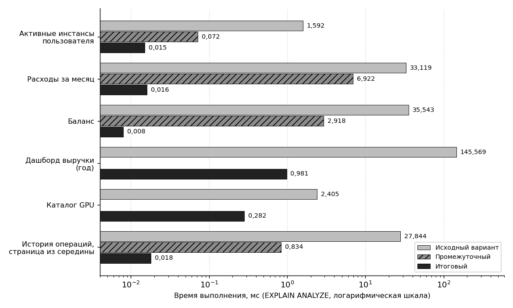

# Введение

## Цель работы

Найти узкие места GPU Rent замерами; убрать лишние обращения к базе кэшированием там, где это безопасно; ускорить запросы PostgreSQL индексами, секционированием и ограничением выборки; сократить объём данных между сервером и браузером. Эффект подтверждён числами из файлов репозитория и команд; неизмеренное помечено прямо.

## Задание

1. Проанализировать производительность, найти узкие места и медленные запросы.
2. Реализовать кэширование данных с понятными сроками действия и обновлением.
3. Оптимизировать запросы к БД и сократить объём передаваемых данных.
4. Использовать CDN и кэширование на стороне клиента.

# Ход работы

Боевой адрес — https://gpu-rent-lemon.vercel.app (Vercel Hobby, функция в `fra1`, Neon Free, PostgreSQL 18.6); локально PostgreSQL 16. План П2 предполагал VPS с Nginx и Redis, фактически сервис работает на serverless-платформе, и это определило слои кэша.

## Анализ производительности

Источников четыре.

1. **Нагрузочный прогон** `autocannon`, [server/test/load/run.mjs](../../server/test/load/run.mjs), результаты в [results/](../../server/test/load/results/). Условия: 10 соединений, 15 секунд на сценарий, собранный `dist`, пул 2 соединения, локальная БД, клиент нагрузки на той же машине (Apple M2). Это проверка поведения: требование NFR-01 (p95 меньше 300 мс при 1000 запросов в секунду) таким прогоном не проверяется.
2. **`EXPLAIN (ANALYZE, BUFFERS)`** шести запросов на сгенерированных данных: [db/bench](../../db/bench/), результаты в [db/bench/results](../../db/bench/results/). В БД 625 МБ: 1 184 157 строк в `usage_records` и 1 208 510 в `transactions` (файл `sizes.txt`).
3. **`curl`** с ноутбука к боевому сайту 25.11.2026: заголовки `x-vercel-cache`, `age`, `content-encoding` и `time_total`.
4. **Размеры сборки** — файлы `web/dist/assets` и `gzip -9`.

Таблица 1 — Нагрузочный прогон, 28.10.2026 (локально, 10 соединений)

| Адрес | Что делает | Запросов/с | p50, мс | p99, мс |
|---|---|---:|---:|---:|
| `GET /api/health` | ответ без БД | 9 256,8 | 0 | 2 |
| `GET /api/auth/me` | один запрос в БД: сессия по хэшу | 5 305,2 | 1 | 3 |
| `GET /api/catalog/gpus` | представление наличия GPU | 2 365,5 | 3 | 10 |
| `GET /api/instances` | список с начислением при обращении | 270,1 | 36 | 47 |

Ошибок и таймаутов нет. Узкие места, которые показывают замеры:

- **Список инстансов почти в 9 раз медленнее каталога и в 20 раз медленнее `/auth/me`.** Причина по коду: при чтении он вызывает `fn_bill_current_user()`, то есть чтение содержит запись (начисление). Это цена решения «биллинг при обращении» (П5); кэшем её не ускорить: ответ личный и зависит от времени. Это самый дорогой из частых запросов, хотя 36 мс приемлемы.
- **Холодный старт и пробуждение Neon.** Первый запрос к каталогу после простоя 25.11.2026 занял 4,91 с (`MISS`), тогда как обычный `MISS` на прогретой функции — 0,34–0,42 с (таблица 2). Разложить 4,5 с на запуск функции размером 782 КБ, подключение к базе и пробуждение Neon нечем: журнал функции за этот запрос не снимали. Neon, по документации, просыпается за сотни миллисекунд [12], поэтому основной вклад, вероятно, у функции; это предположение. Замер одиночный.
- **Сеть.** С ноутбука `HIT` и `MISS` на прогретой функции различаются меньше, чем колеблется сам запрос: время определяют расстояние до узла CDN и TLS. По `x-vercel-id` запрос обслуживается в `fra1`. Ускорение отклика кэшем CDN на этих замерах не заявляется: выигрыш в том, что при `HIT` не работают функция и БД.
- **Полные просмотры таблиц.** На 1,2 млн строк запросы к журналам без индекса занимают от 19 до 146 мс (раздел «Оптимизация запросов»); с ростом данных время растёт пропорционально.

## Кэширование

### Что и где кэшируется

Критерий один: данные общие для всех или личные. Общие хранит общий кэш; личные в нём держать нельзя, иначе ответ одного пользователя получит другой.



Таблица 2 — Слои кэша, сроки и обновление

| Слой | Что хранит | Срок | Как обновляется |
|---|---|---|---|
| CDN Vercel | `GET /api/catalog/gpus` и `/api/catalog/templates`: `Cache-Control: public, s-maxage=30, stale-while-revalidate=60` | 30 с свежим, затем до 60 с отдаётся устаревший | Запрос после 30 с получает старый ответ, функция обновляет запись в фоне |
| CDN и браузер, статика | `/assets/*` с хэшем в имени: `public, max-age=31536000, immutable`; `index.html`: `max-age=0, must-revalidate` | год; HTML проверяется всегда | Новая сборка — новые имена файлов, старые не нужны |
| TanStack Query в браузере | Каталог и шаблоны (`staleTime` 30 с, каталог перечитывается раз в 60 с), баланс (15 с, опрос 60 с), профиль (5 мин), остальное 10 с | `gcTime` по умолчанию 5 мин [8] | Инвалидация после изменений: запуск, остановка, удаление инстанса сбрасывают список, каталог, тома, баланс, историю |
| Функция, Neon | Ничего | — | — |

Личное — все остальные адреса — получает `Cache-Control: private, no-store` (константы `PUBLIC_CACHE` и `NO_STORE` в [http.ts](../../server/src/http.ts)). Публичный ответ не зависит от cookie и не выдаёт `Set-Cookie`: [cache.test.ts](../../server/test/integration/cache.test.ts) проверяет, что пользователь A, пользователь B и аноним получают тот же ответ байт в байт и что личный шаблон в публичный список не попадает.

### Проверка на боевом сайте

Рисунок 2 показывает жизненный цикл записи в CDN; значения `MISS`, `HIT` и `STALE` получены командой ниже и описаны в документации Vercel [4, 5, 6].



```text
$ for i in 1 2 3; do curl -s -o /dev/null -D - -H 'Accept-Encoding: br' \
    https://gpu-rent-lemon.vercel.app/api/catalog/gpus | grep -iE 'cache|^age|encoding'; sleep 2; done
cache-control: public    content-encoding: br   x-vercel-cache: MISS   age: 0
cache-control: public    content-encoding: br   x-vercel-cache: HIT    age: 3
cache-control: public    content-encoding: br   x-vercel-cache: HIT    age: 5
```

Клиент видит `cache-control: public` без `s-maxage`: срок CDN снимает сам и в ответ не передаёт. Для проверки срока использовали отдельные адреса с произвольным параметром `?probe=…`, у каждого своя запись кэша.

Таблица 3 — Замеры боевого сайта, 25.11.2026 (`curl` с ноутбука, по одному–двум запросам)

| Запрос | Ответ, с | `x-vercel-cache`, `age` |
|---|---:|---|
| Каталог, первый после простоя | 4,91 | MISS, 0 |
| Каталог, второй и третий | 0,40 и 0,38 | HIT, 3 и 5 |
| Каталог с новым параметром, прогретая функция | 0,42 и 0,34 | MISS, 0 |
| Шаблоны, первый и второй | 0,29 и 0,25 | MISS, 0, затем HIT, 1 |
| Каталог, 42 с после заполнения | 1,67 | STALE, 42 |
| Каталог, сразу после этого | 0,55 | HIT, 2 |
| Каталог, 63 с после обновления | 0,39 | STALE, 63 |
| `/api/health` (без БД), два запроса | 0,30 и 0,36 | MISS, `private, no-store` |

`STALE` и повторное заполнение подтверждены. Отклик 1,67 с на первом `STALE` — единичный выброс: устаревший ответ должен отдаваться сразу, причину не выясняли.

### Почему нет Redis и кэша в функции

Redis был в плане П1 и П2, в реализации его нет. Память одного экземпляра функции не видна другому (лимиты попыток входа по этой причине уже живут в PostgreSQL). Внешний Redis добавил бы сервис, секрет и точку отказа ради единственного общего чтения — каталога, который CDN обслуживает без кода. Личные ответы (баланс, инстансы) кэшировать нельзя: они меняются при каждом начислении, а ошибка в ключе кэша стоила бы утечки чужих данных. Поиск сессии в PostgreSQL по хэшу не узкое место: 5 305 запросов в секунду на `/auth/me`.

Цена выбора: каталог может отставать от реальности до 30 с, а при `stale-while-revalidate` — до 90 с. Решение остаётся за сервером: `fn_start_instance` сама проверяет наличие GPU и баланс, поэтому устаревшая цифра в каталоге приводит лишь к ответу 409 при запуске, а не к неверной сделке.

## Оптимизация запросов

Каждый бенчмарк — SQL-файл с вариантами «до» и «после» на одних данных (индекс удаляется внутри транзакции с откатом).

Таблица 4 — Время выполнения запросов, мс (`Execution Time`, PostgreSQL 16.15)

| Запрос | Исходный вариант | Промежуточный | Итоговый | Что изменено |
|---|---:|---:|---:|---|
| Активные инстансы пользователя | 1,592 | 0,072 (полный индекс по `user_id`) | 0,015 | Частичный индекс `WHERE status <> 'terminated'` |
| Расходы за месяц | 33,119 | 6,922 (отсечение партиций) | 0,016 | Индекс `(user_id, period_start)` на секциях по месяцам |
| Баланс | 35,543 (SUM по журналу) | 2,918 (индекс) | 0,008 | Поле `users.balance`, поддерживаемое функциями БД |
| Дашборд выручки за год | 145,569 | — | 0,981 | Материализованное представление `mv_daily_revenue` |
| Каталог GPU | 2,405 | — | 0,282 | Частичный индекс активных выделений |
| История операций, страница из середины | 27,844 (OFFSET, без индекса) | 0,834 (OFFSET, индекс) | 0,018 | Keyset-пагинация по `(created_at, id)` |



Что за этим стоит:

- **Индексы.** Частичный индекс содержит только нужные строки: у `instance_gpus` из 40 658 выделений открыты 187, индекс занимает 16 КБ, хотя GiST-индекс исключения для тех же данных — 3 320 КБ. Составной индекс `(user_id, created_at DESC, id DESC)` одновременно фильтрует и сортирует журнал.
- **Секционирование и BRIN.** `usage_records` разбита по месяцам (15 месячных секций и секция по умолчанию на момент замера). Запрос с границами месяца читает одну секцию; без отсечения — все. Индекс `BRIN (period_start)` на родителе создаётся в каждой секции автоматически [10] и поддерживает диапазонные выборки по времени, например в запросе дашборда по сырым данным; его эффект отдельно не измерялся.
- **Ограничение выборки и курсор.** Страницы ограничены `LIMIT` (по умолчанию 20, не больше 100); сервер читает `limit + 1` строку, чтобы узнать, есть ли следующая страница. Keyset читает ровно 50 строк независимо от номера страницы, а `OFFSET` — смещение плюс 50 [11]; на странице из середины истории `OFFSET` с индексом читает 4 118 строк ради 50 нужных: 0,834 против 0,018 мс.
- **Денормализация и витрина** — это обмен свежести на скорость, у каждого свои меры. `users.balance` меняется только триггером журнала (прямой `UPDATE` запрещён), равенство сумме журнала проверяет SQL-тест [02_ledger.sql](../../db/tests/02_ledger.sql). `mv_daily_revenue` обновляется командой `REFRESH MATERIALIZED VIEW CONCURRENTLY` за 556 мс (читатели не блокируются), на боевом сайте при каждом проходе биллинга, то есть раз в сутки по Vercel Cron: выручка в админском дашборде может отставать до суток.

Ограничение: бенчмарки идут на сгенерированных данных в локальной PostgreSQL 16, не на Neon; абсолютные числа там будут другими (порядок выигрыша индексов, вероятно, тот же — не проверялось).

## Объём передаваемых данных, CDN и клиентский кэш

**Только нужные поля.** Каталог — агрегат: вместо 392 отдельных GPU сервер отдаёт 18 строк (дата-центр, модель, всего, свободно, две цены). Тело ответа 3 914 байт. Список операций выбирает пять столбцов и страницу не более 100 записей; деньги идут строками, внутренние идентификаторы и лишние поля не выдаются.

**Сжатие.** Сервер ответы не сжимает: это делает CDN Vercel по `Accept-Encoding`. Каталог: 3 914 байт без сжатия, 622 байта в gzip и 599 в brotli (на `HIT`; о сжатии личных ответов `no-store` измерений нет).

**Статика.** Файлы `/assets/*` имеют хэш в имени и `immutable` на год [7]: повторный визит не делает запросов за ними. `index.html` не кэшируется, чтобы новая сборка подхватывалась сразу.

Таблица 5 — Первая загрузка (`npm run build`, КиБ)

| Файл | Назначение | Исходный | gzip |
|---|---|---:|---:|
| `react-*.js` | React, ReactDOM, React Router | 176,2 | 58,0 |
| `index-*.js` | Код приложения | 89,6 | 25,3 |
| `query-*.js` | TanStack Query | 36,3 | 10,8 |
| `index-*.css` | Стили, две темы | 41,5 | 9,1 |
| Итого | 4 файла | 343,7 | около 103 |
| Админка | 6 ленивых чанков | 15,4 | 6,7 |

Библиотеки вынесены в отдельные чанки (`manualChunks` в [vite.config.ts](../../web/vite.config.ts)): они меняются редко, и браузер хранит их между релизами; при правке кода меняются хэши только файлов приложения и стилей. Админка подключается через `React.lazy` и не входит в первую загрузку обычного пользователя. Шрифты (woff2, 99,7 КиБ) грузятся по `unicode-range` и в таблицу не входят; реальный объём на странице не измерялся.

**Клиентский кэш.** TanStack Query хранит ответы в памяти и не перезапрашивает свежие данные при повторном открытии экрана. Сроки подобраны по частоте изменений (таблица 2): профиль меняется редко (5 мин), баланс — часто (15 с), каталог совпадает со сроком CDN (30 с). Статусы инстансов опрашиваются раз в 3 с, пока есть инстанс в состоянии `pending`, иначе раз в 15 с. При входе и выходе кэш очищается, чтобы данные одного пользователя не попали в сессию другого.

## Мониторинг и оценка эффекта

Эффект оценивался сравнением одного и того же запроса или сценария до и после на одних данных: планами `EXPLAIN (ANALYZE, BUFFERS)` (хранятся в репозитории и воспроизводятся скриптами), процентилями `autocannon` и заголовками `x-vercel-cache` и `age` из `curl`, которые прямо показывают, кто ответил. Приложение пишет в журнал метод, путь, статус и длительность `ms` каждого запроса; идентификатор запроса совпадает с `x-vercel-id`, так что запрос находится и в журнале Vercel. Панели Vercel и Neon показывают вызовы и расход вычислений. Алертов нет; проверка доступности (`uptime`) подготовлена в [.github/workflows](../../.github/workflows/), но не опубликована и не запускалась.

# Ответы на контрольные вопросы

## Вопросы на оценку 2

### Какой анализ производительности был проведен, и какие результаты были получены?

Четыре вида замеров: нагрузочный прогон `autocannon` (таблица 1), `EXPLAIN ANALYZE` шести запросов (таблица 4), `curl` к боевому сайту (таблица 3) и размеры сборки (таблица 5). Результат: самые дорогие места — запросы по журналам без индекса (19–146 мс на 1,2 млн строк), список инстансов с начислением при обращении (270 запросов в секунду, p50 36 мс) и первый запрос после простоя (4,91 с).

### Какие меры кэширования и оптимизации были реализованы, и какие проблемы остались нерешенными?

Кэш CDN для каталога, `immutable`-кэш статики, кэш TanStack Query с инвалидацией; индексы, секционирование, keyset-пагинация, материализованная витрина, агрегированный каталог, отдельные чанки и ленивая админка. Не решено: холодный старт функции и пробуждение Neon (4,91 с, причина не разложена); стоимость начисления при чтении списка инстансов; нагрузка NFR-01 не проверена и против боевого сайта не прогонялась; дашборд выручки отстаёт до суток; нет алертов и проверок доступности по расписанию.

## Вопросы на оценку 3

### Какие методы кэширования данных были внедрены, и какие данные кэшируются?

Данные, одинаковые для всех: два публичных адреса каталога (CDN), статические файлы (CDN и браузер) и серверное состояние на клиенте (TanStack Query). Личные ответы и ошибки получают `private, no-store`. Redis не применяется (раздел «Почему нет Redis и кэша в функции»).

### Какие шаги были предприняты для оптимизации запросов к базе данных, и какие улучшения были достигнуты?

Для каждого запроса сняли план до и после (таблица 4, рисунок 3): расходы за месяц ускорились с 33,119 до 0,016 мс (отсечение секций и индекс), страница истории — с 27,844 до 0,018 мс (keyset), дашборд за год — со 145,569 до 0,981 мс (витрина), активные инстансы — с 1,592 до 0,015 мс (частичный индекс). Дополнительно добавлены `LIMIT`, выбор нужных столбцов и агрегирование каталога. Числа получены на сгенерированных данных в локальной PostgreSQL 16.

## Вопросы на оценку 4

### Какие стратегии сроков действия кэшей были применены, и как происходит обновление кэшированных данных?

Три стратегии (таблица 2). Каталог — срок плюс фоновое обновление: 30 с свежий, затем до 60 с устаревший с обновлением в фоне, поэтому пользователь не ждёт функцию и базу. Статика — вечный кэш с версией в имени файла. Клиент — `staleTime` по скорости изменения данных и инвалидация по событию: после запуска, остановки или удаления инстанса сбрасываются список, каталог, тома, баланс и история. Принудительный сброс CDN не используется: при редком изменении цены каталог обновится сам не позднее чем через 90 с. Следствие: после запуска инстанса браузер может получить из CDN каталог, ещё не отражающий изменения; это допустимо, так как решения принимает сервер.

### Как были оптимизированы запросы и передача данных между клиентом и сервером?

Запросы — индексами, секционированием, курсором и витриной (таблица 4). Передача: только нужные поля, каталог из 18 строк (3 914 байт, 599 в brotli), страницы не больше 100 записей, сжатие на CDN, первая загрузка около 103 КиБ gzip, админка в ленивых чанках, повторные визиты не запрашивают `immutable`-файлы.

### Какие инструменты или методы мониторинга производительности были использованы для оценки эффективности оптимизации?

`EXPLAIN (ANALYZE, BUFFERS)`, `autocannon`, `curl` с заголовками кэша и `time_total`, журнал запросов с полем `ms`, панели Vercel и Neon; сравнение — до и после на одних данных (раздел «Мониторинг и оценка эффекта»). Чего нет: измерений на настоящих пользователях (RUM, Web Vitals), трассировки, алертов и расписания проверок.

## Вопросы на оценку 5

### Можете ли вы подробно описать процесс анализа производительности и меры, принятые для оптимизации приложения?

От замера к решению. Нагрузочный прогон выявил, что список инстансов почти на порядок медленнее остальных чтений, и причина названа (начисление при обращении). `EXPLAIN` на 1,2 млн строк показал полные просмотры журналов; для каждого запроса сравнили до трёх вариантов и оставили самый дешёвый, не нарушающий целостность. Замеры боевого сайта показали, что с ноутбука `HIT` и `MISS` различаются меньше, чем колеблется сеть, а холодный старт более чем в 10 раз длиннее обычного ответа; поэтому CDN обоснован снижением обращений к базе, а не секундами. Меры — в таблицах 2, 4 и 5.

### Какие передовые методы и инструменты использовались для улучшения производительности и быстродействия приложения?

`stale-while-revalidate` [6] на CDN, `immutable` с хэшем в имени, инвалидация клиентского кэша по событию, частичные индексы, секционирование с отсечением, BRIN, keyset-пагинация, материализованная витрина с `REFRESH ... CONCURRENTLY`, вендорные чанки и `React.lazy`. Инструменты — `EXPLAIN ANALYZE`, `autocannon`, `curl`.

### Какие меры были предприняты для обеспечения высокой доступности и надежности приложения при использовании кэширования и оптимизации?

Кэш не раскрывает личные данные (публичный ответ без cookie проверен тестом, остальное `private, no-store`) и не принимает решений: наличие GPU и баланс проверяет `fn_start_instance`. Ожидание БД ограничено: соединение из пула — не дольше 5 с, затем 503 `DB_UNAVAILABLE`; `statement_timeout` роли 15 с, `maxDuration` функции 60 с. `/api/health` не обращается к БД и не будит Neon, `?deep=1` проверяет её. Без кэша (на `MISS`) ответ строится из БД. Не сделано и не проверялось: `stale-if-error` не настроен, поведение каталога при отказе базы не проверяли, отказоустойчивость самого CDN и нагрузка на пробуждающийся Neon не измерялись.

# ЗАКЛЮЧЕНИЕ

Производительность GPU Rent измерялась четырьмя способами. Главные результаты: общие данные вынесены в CDN с 30-секундным сроком и фоновым обновлением (подтверждено `MISS`, `HIT`, `STALE` на боевом сайте); запросы к журналам ускорены с десятков и сотен миллисекунд до единиц или долей миллисекунды индексами, секционированием, keyset и витриной; первая загрузка — около 103 КиБ gzip, админка и библиотеки в отдельных чанках. Redis не используется сознанно. Остаются холодный старт и пробуждение Neon (4,91 с на одиночном замере), начисление при чтении списка инстансов, отсутствие нагрузочной проверки целевых показателей и мониторинга на реальных пользователях.

## СПИСОК ИСПОЛЬЗОВАННЫХ ИСТОЧНИКОВ

1. Шнайер Б. Прикладная криптография. — Питер, 2008. — 784 с.
2. Гудро М. Тайны хакеров. Безопасность Web-приложений. — ДМК Пресс, 2019. — 480 с.
3. Митник К. Искусство обмана. Хакерские приемы и тактики. — Манн, Иванов и Фербер, 2019. — 488 с.
4. Vercel Docs. Cache-Control headers. — https://vercel.com/docs/caching/cache-control-headers
5. Vercel Docs. Response headers (x-vercel-cache). — https://vercel.com/docs/headers/response-headers
6. RFC 5861. HTTP Cache-Control Extensions for Stale Content. — https://www.rfc-editor.org/rfc/rfc5861
7. MDN Web Docs. HTTP caching. — https://developer.mozilla.org/en-US/docs/Web/HTTP/Guides/Caching
8. TanStack Query v5. Important Defaults. — https://tanstack.com/query/v5/docs/framework/react/guides/important-defaults
9. PostgreSQL 16 Documentation. EXPLAIN. — https://www.postgresql.org/docs/16/sql-explain.html
10. PostgreSQL 16 Documentation. BRIN Indexes. — https://www.postgresql.org/docs/16/brin.html
11. Winand M. Paging Through Results (no-offset). Use The Index, Luke. — https://use-the-index-luke.com/no-offset
12. Neon Docs. Scale to zero. — https://neon.com/docs/introduction/scale-to-zero

Дата обращения к электронным источникам: 25.11.2026.
