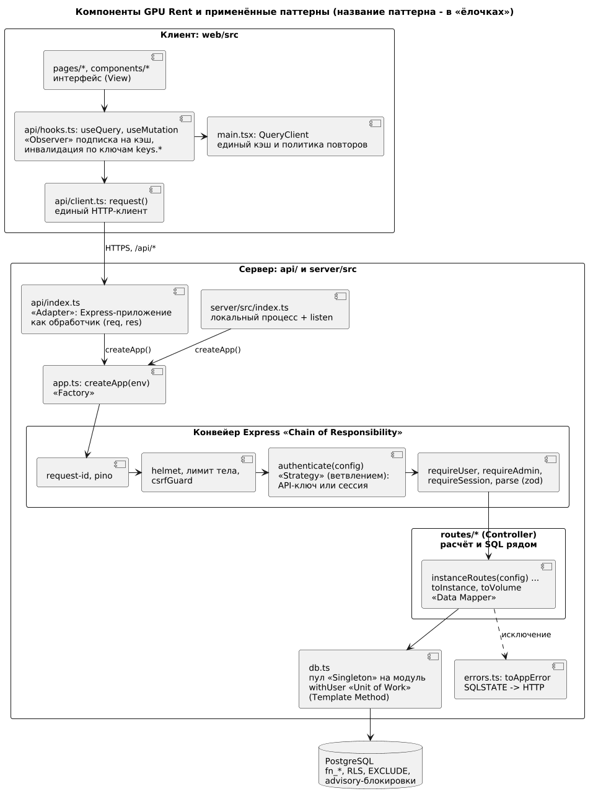
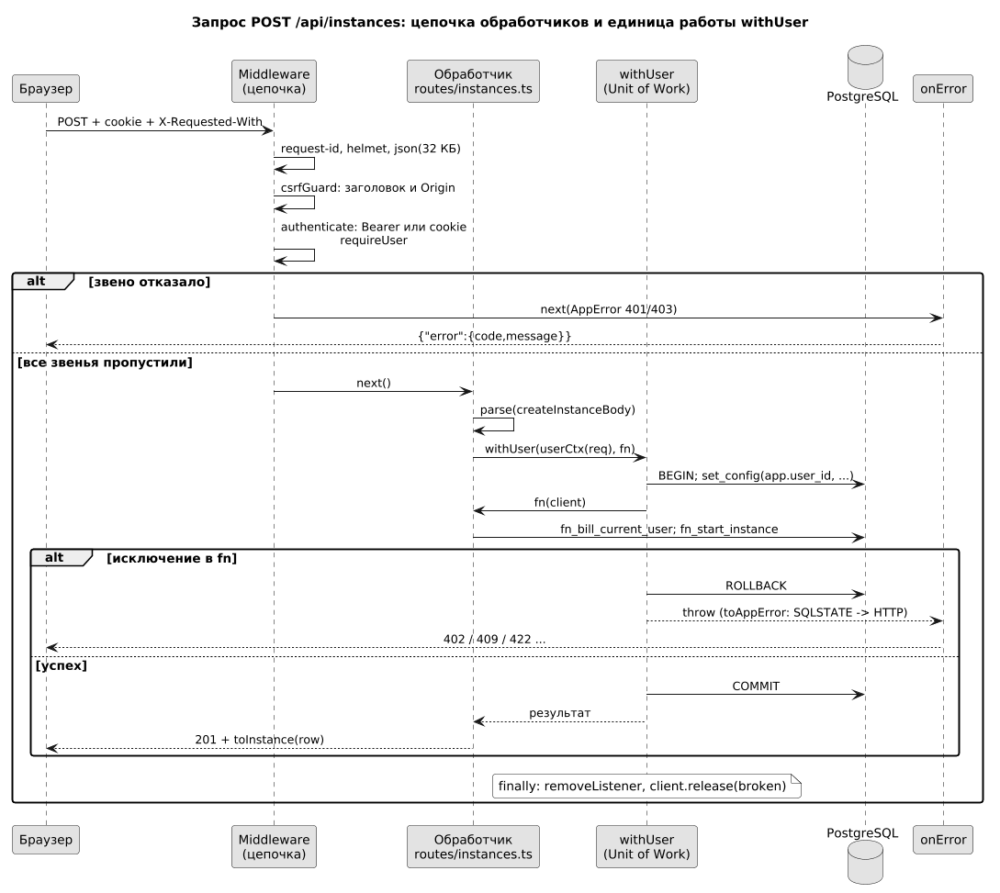
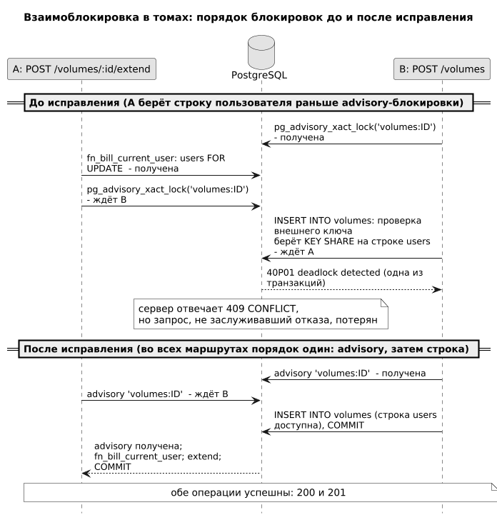

# Введение

## Цель работы

Определить, какие паттерны проектирования и практики чистого кода уже применены в GPU Rent, показать их в коде, честно оценить архитектуру по SOLID и описать, как изменения проверялись тестами и рефакторингом.

## Задание

1. Проанализировать приложение и выбрать паттерны, рассмотреть SOLID.
2. Применить паттерны, оценить их влияние на структуру и читаемость.
3. Обеспечить чистоту кода: имена, комментарии, разделение ответственности, стиль.
4. Протестировать приложение и при необходимости выполнить рефакторинг.

# Ход работы

В монолите на Express и React паттерны возникли как решения конкретных задач. Работа состояла в том, чтобы найти их в коде, назвать, проверить, что они выполняют свою роль, и отметить, где паттерна нет. Структура проекта описана в П5 и П6.

## Анализ и выбор паттернов

Таблица 1 — Паттерны, найденные в коде

| Паттерн | Где | Какую задачу решает |
|---|---|---|
| Factory | [app.ts](../../server/src/app.ts): `createApp(env)` | Один код для процесса, функции Vercel и тестов |
| Chain of Responsibility | конвейер Express, [auth/middleware.ts](../../server/src/auth/middleware.ts) | Общие проверки отделены от обработчиков |
| Unit of Work, Template Method | [db.ts](../../server/src/db.ts): `withUser` | Транзакция и контекст RLS на одном соединении |
| Adapter | [api/index.ts](../../api/index.ts) | Приложение Express как обработчик Vercel |
| Singleton (на модуль) | `db.ts`: `getPool` | Один пул на экземпляр функции |
| Strategy (упрощённая) | `authenticate`, `FUNCTION_BY_ACTION` | Способ входа и вызываемая функция БД выбираются по данным запроса |
| Observer | [web/src/api/hooks.ts](../../web/src/api/hooks.ts) | Компоненты подписаны на кэш запросов |
| Data Mapper (ручной) | `toInstance`, `toVolume`, `toAuthUser` | Строка БД превращается в DTO |
| Слои (MVC по смыслу) | `routes/`, `schemas.ts`, функции БД, `web/` | Транспорт, проверка входа, правила и интерфейс не смешаны |

Не применены: Repository (SQL лежит в обработчиках), контейнер зависимостей, ORM, MVVM: для малого монолита с правилами в PostgreSQL они добавили бы код без выгоды [1, 4].



## Применение паттернов

### Factory: одна фабрика приложения

`createApp` собирает конвейер и роутеры, читает окружение и настраивает БД, но ничего не запускает и не подключается:

```ts
// server/src/app.ts
export function createApp(env: NodeJS.ProcessEnv = process.env, prebuilt?: Config): Express {
  const config = prebuilt ?? loadConfig(env);
  configureDb(config);
  ...
  app.use('/api/auth', authRoutes(config));
```

Окружение передаётся параметром, поэтому тесты создают приложение с вымышленным окружением ([helpers.ts](../../server/test/integration/helpers.ts)), а [openapi.test.ts](../../server/test/unit/openapi.test.ts) разбирает его маршруты без БД. Конфигурация валидируется один раз при создании (zod) и не читается из `process.env` по всему коду [11]. [no-connections.test.ts](../../server/test/integration/no-connections.test.ts) фиксирует свойство фабрики: создание приложения пул не открывает. Роутеры тоже фабрики: `instanceRoutes(config)` возвращает `Router`.

### Chain of Responsibility: конвейер Express

Каждое звено (`request-id`, `helmet`, `csrfGuard`, `authenticate`, `requireUser`, zod) либо отклоняет запрос через `next(error)`, либо передаёт дальше [6]. Звенья не знают друг о друге; порядок задан в одном месте:

```ts
router.use('/instances', ...guard);   // routes/instances.ts: no-store, authenticate, requireUser
```

Админка добавляет `requireAdmin`, действия с ключами — `requireSession`: новое требование — это звено, а не условие в каждом обработчике. Цена: порядок звеньев не проверяется компилятором (`req.user!` в 34 местах опирается на то, что `requireUser` уже отработал), поэтому он закреплён тестами [csrf](../../server/test/integration/csrf.test.ts) и [security-roles](../../server/test/integration/security-roles.test.ts).



### Unit of Work и Template Method: withUser

Все 43 обращения роутеров к БД с контекстом пользователя идут через `withUser(ctx, fn)`. Функция владеет «скелетом» (соединение, `BEGIN`, `app.user_id` и `app.user_role`, `COMMIT` или `ROLLBACK`, возврат соединения), а меняющаяся часть — колбэк `fn`. Это Template Method в функциональной форме и одновременно Unit of Work [4]: изменения внутри `fn` фиксируются или откатываются вместе.

```ts
// server/src/db.ts (сокращено)
await client.query('BEGIN');
await client.query('SELECT set_config($1, $2, true), ...', ['app.user_id', ...]);
const result = await fn(client);
await client.query('COMMIT');
...
finally { client.release(broken); }   // после ROLLBACK в catch
```

Выгода: в одном месте решено то, что легко забыть, — освобождение и учёт оборванного соединения, `set_config(..., true)` до конца транзакции (контекст не «утекает» между пользователями пула). [with-user.test.ts](../../server/test/integration/with-user.test.ts) проверяет 40 одновременных транзакций двух пользователей на пуле из двух соединений.

### Adapter: точка входа Vercel

[api/index.ts](../../api/index.ts) — одна строка `export default createApp();`: приложение Express уже функция `(req, res)`, поэтому адаптер тонкий. Его смысл — в разделении точек входа: локально запускает [index.ts](../../server/src/index.ts) (`listen`, закрытие пула по сигналу), на Vercel — этот файл. Тест проверяет, что импорт подключения к БД не открывает.

### Singleton: пул соединений и его границы

```ts
// server/src/db.ts
let pool: Pool | undefined;
export function getPool(): Pool { if (!pool) { pool = new Pool({ ..., max: currentConfig.poolMax }); ... } return pool; }
```

Пул один на экземпляр функции и создаётся лениво: на serverless он переживает несколько вызовов, а соединений у бесплатного Neon мало (максимум 2). Это глобальное состояние. Вред снижают явная настройка (`configureDb(config)`), ошибка при смене `DATABASE_URL` живого пула, `closePool()` и `isPoolCreated()` для тестов. Изоляцию между тестовыми файлами обеспечивает vitest, а не код: это цена Singleton.

### Strategy: выбор способа входа

`authenticate` выбирает способ входа по заголовку: есть `Authorization: Bearer gr_…` — ищется API-ключ (`fn_find_api_key`), иначе читается cookie сессии (`fn_session_resolve`), и при Bearer cookie игнорируется. Результат один — `req.user` и `req.authVia`; дальше способ важен только `requireSession`. Это Strategy [1] без классов: ветвление в одной функции. Третий способ потребует правки функции, то есть открытость нарушена сознательно, ради простоты. Так же устроен `FUNCTION_BY_ACTION`: три маршрута (`stop`, `resume`, `terminate`) создаются циклом и различаются именем функции БД.

### Observer: кэш TanStack Query

`useQuery` создаёт наблюдателя `QueryObserver` и подписывает компонент на запись кэша (в исходниках `@tanstack/react-query` 5.105.0: `observer.subscribe(...)` внутри `useSyncExternalStore`). Мутация не обновляет экраны вручную, а объявляет, что устарело:

```ts
// web/src/api/hooks.ts
function useInvalidateAfterInstanceChange() {
  const qc = useQueryClient();
  return () => Promise.all([keys.instances, keys.catalog, keys.volumes, keys.balance, keys.transactions, keys.me]
    .map((queryKey) => qc.invalidateQueries({ queryKey })));
}
```

После запуска или остановки инстанса список, каталог (число свободных GPU), тома и баланс перерисовываются у всех подписанных компонентов; ключи кэша собраны в объект `keys` [7]. В [main.tsx](../../web/src/main.tsx) любой ответ 401 вызывает перепроверку `/auth/me`, и страницы сами уводят гостя на вход.

### Data Mapper и слои

`toInstance` в [routes/instances.ts](../../server/src/routes/instances.ts) преобразует строку БД (`dc_code`, `snake_case`) в ответ API (`datacenter.code`, `pricePerHour`) и намеренно отдаёт только имена переменных окружения, не значения. Это ручной преобразователь без ORM. Репозитория нет: SQL лежит рядом с обработчиком, что для 2,8 тыс. строк проще, но смешивает слои.

Таблица 2 — Слои и их ответственность

| Слой | Где | Что делает |
|---|---|---|
| Представление | `web/src/pages`, `components` | Экран, формы, диалоги |
| Состояние сервера | `web/src/api` | Хуки, кэш, единый клиент `request()` |
| Контроллер | `server/src/routes` | Права, разбор входа, вызов функций БД, DTO |
| Контракт входа | `schemas.ts`, `openapi.yaml` | zod-схемы, документ API |
| Модель | функции, ограничения и RLS PostgreSQL | Бизнес-правила и целостность |

## SOLID: где соблюдён и где нет

Таблица 3 — Оценка по принципам

| Принцип | Соблюдён | Нарушен или не проверяется |
|---|---|---|
| S, единственная ответственность | `errors.ts` (SQLSTATE в HTTP), `money.ts`, `cursor.ts`, `webhook.ts` — по одной задаче | [admin.ts](../../server/src/routes/admin.ts) — 496 строк, 11 маршрутов: валидация, SQL, права и ответ в одном файле |
| O, открытость | Новая ошибка БД — строка в `DB_ERRORS`; новое звено — `use(...)` | `authenticate` правится при новом способе входа; список роутеров в `createApp` правится руками |
| L, подстановка Лисков | Наследования почти нет (`AppError extends Error`) | Принцип практически не проверяется |
| I, разделение интерфейсов | `createLogger(config: Pick<Config, 'logLevel' \| 'nodeEnv'>)` берёт только нужное | Каждый роутер получает весь `Config` |
| D, инверсия зависимостей | Конфигурация внедряется в `createApp`; `Config` — тип, а не глобальная переменная | Роутеры импортируют `withUser` и `query` напрямую, SQL в обработчиках: подменить БД нельзя, тесты ходят в настоящую БД |

Разбор по Мартину [9]. Вывод: структура держится на слоях и простых функциях; зависимость от БД жёсткая намеренно: правила живут в PostgreSQL, а тесты проверяют их под боевой ролью. Для крупной команды понадобился бы слой репозиториев.

## Чистый код и соглашения о стиле

Проверено по репозиторию:

- **Типы.** В [tsconfig.json](../../server/tsconfig.json) включены `strict` [12], `noUncheckedIndexedAccess`, `noImplicitOverride`, `noFallthroughCasesInSwitch`; клиент дополнительно проверяет неиспользуемые переменные и параметры. `tsc --noEmit` на сервере 25.11.2026 прошёл без ошибок. В `server/src` и `web/src` нет `any`, `@ts-ignore` и `eslint-disable` (поиск по коду).
- **Имена и комментарии** [8]. Имена говорящие (`requireSession`, `LIMIT_REACHED`); комментарии объясняют причину: почему `set_config(..., true)`, почему блокировка берётся до начисления. Файлы сервера не длиннее 500 строк.
- **Линтера и форматтера в проекте нет.** Конфигураций ESLint, Prettier и EditorConfig в репозитории нет, в `package.json` их зависимостей и скриптов нет, шага проверки стиля в [ci.yml](../../.github/workflows/ci.yml) нет (он проверяет типы и тесты и в GitHub не публиковался). Стиль держится вручную: 135 строк сервера длиннее 160 символов. Это пробел: нужны ESLint с `typescript-eslint` и Prettier в CI. Практики безопасного кода (параметризованные запросы, токены хэшем, лимиты попыток, человеческий фактор) опираются на источники задания [2, 3, 5] и описаны в П5 и П8.

## Тестирование и рефакторинг

Фабрика сделала тесты дешёвыми: сервер проверяют 571 тест (195 модульных, 376 интеграционных; vitest и supertest) под ролью `gpu_rent_web`, как работает приложение. Для отчёта запущены `tsc --noEmit` и два модульных файла (`errors`, `middleware`: 57 тестов пройдены); остальное — результаты 07.11.2026. Покрытие не измерялось.

Примеры рефакторинга из `git log`, каждый вместе с тестом:

1. **Потолки на пользователя под advisory-блокировкой.** Коммит 275443a (29.10.2026) ограничил число томов и платежей, но проверка «посчитать и вставить» допускала гонку. Решение — консультативная блокировка `pg_advisory_xact_lock` [10] на ключ `volumes:<user>`; коммит 31189f5 (07.11.2026) распространил его на SSH-ключи, API-ключи и шаблоны. Тесты шлют 25–30 одновременных запросов и требуют ровно 20 (10) успехов, остальным — `409 LIMIT_REACHED`. Оговорка: вызов блокировки скопирован в 7 мест, общий помощник (`lockPerUser(c, scope, id)`) не выделен; это следующий рефакторинг, не выполненный.
2. **Единый порядок блокировок.** Расширение тома брало строку пользователя (`fn_bill_current_user`) раньше advisory-блокировки, создание — наоборот; параллельные запросы давали `40P01 deadlock`. Порядок «сначала advisory, потом строка» теперь един (рисунок 3); тест из трёх раундов с параллельными расширением и двумя созданиями ждёт `200, 201, 201`.
3. **Лимит при расширении тома** (ec66165): суммарный потолок, ранее только при создании, добавлен в `extend` вместе с тестом.



Общий принцип: исправление и тест попадают в один коммит, поведение API не меняется (контракт сверяет [contract.test.ts](../../server/test/integration/contract.test.ts)).

# Ответы на контрольные вопросы

## Вопросы на оценку 2

### Какие паттерны проектирования и лучшие практики были выбраны и применены в вашем приложении?

Factory (`createApp`), Chain of Responsibility (конвейер Express), Unit of Work и Template Method (`withUser`), Adapter (`api/index.ts`), Singleton на модуль (пул БД), упрощённый Strategy (`authenticate`), Observer (TanStack Query), ручной Data Mapper, слои (таблица 1). Практики: строгий TypeScript, zod на входе, комментарии «почему», тест вместе с каждым исправлением.

### Какие проблемы или недоразумения возникли при реализации паттернов и лучших практик?

Singleton-пул — глобальное состояние: понадобились `configureDb`, `closePool`, `isPoolCreated`. Порядок звеньев конвейера не проверяется компилятором. Порядок блокировок в томах дал deadlock, исправлен (рисунок 3). Линтера нет, стиль держится вручную.

## Вопросы на оценку 3

### Какие изменения были внесены в архитектуру вашего приложения с использованием паттернов проектирования?

Приложение собирается фабрикой и работает как процесс, функция Vercel и объект тестов; транзакция с контекстом идёт через `withUser`; проверки вынесены в звенья конвейера; клиент подписан на кэш. При рефакторинге изменились потолки под advisory-блокировкой и порядок блокировок.

### Какие методы и средства были использованы для обеспечения чистого кода и соблюдения соглашений по стилю?

Строгий TypeScript (`strict`, `noUncheckedIndexedAccess`), схемы zod на границе системы, говорящие имена, комментарии о причинах, небольшие модули, единый формат ошибок. Автоматического форматирования и линтинга нет: ни ESLint, ни Prettier.

## Вопросы на оценку 4

### Какие конкретные преимущества принесли примененные паттерны и лучшие практики в вашем приложении?

Factory — один код для трёх сред; `withUser` — контекст RLS не «утекает» между пользователями; цепочка — права проверяются не в каждом обработчике; Observer — после мутации обновляются все связанные экраны; strict TS — ошибки типов ловятся до запуска. Выгода количественно не измерена.

### Какие методы и подходы были использованы для тестирования и рефакторинга кода после внесенных изменений?

Модульные и интеграционные тесты под боевой ролью БД, тесты конкурентности (25–30 параллельных запросов), сверка OpenAPI с маршрутами, e2e Playwright. Рефакторинг сопровождался тестом в том же коммите: потолки под блокировкой, единый порядок блокировок.

## Вопросы на оценку 5

### Можете ли вы подробно описать, какие паттерны проектирования были применены и как они улучшили архитектуру вашего приложения?

Да: описание, код и тесты — в разделе «Применение паттернов», связи — на рисунках 1 и 2. Ядро не зависит от способа запуска и числа маршрутов: новый маршрут — фабрика роутера и zod-схема. Слабые места: SQL в обработчиках, длинный `admin.ts`, дублирование вызова блокировки (таблица 3).

### Какие передовые методы и инструменты были использованы для обеспечения высокого качества и поддерживаемости кода в вашем проекте?

Строгий TypeScript; OpenAPI, который тест сверяет с маршрутами; интеграционные тесты под ролью без обхода RLS; тесты гонок и deadlock; SQL-тесты БД (554 проверки); автоматизированное ревью кода. Не сделано: линтер и форматтер, измерение покрытия; конвейер CI подготовлен, но не запускался.

# ЗАКЛЮЧЕНИЕ

В GPU Rent найдены и описаны девять приёмов: Factory, Chain of Responsibility, Unit of Work с Template Method, Adapter, Singleton на модуль, упрощённый Strategy, Observer, Data Mapper и слои. Они решают реальные задачи: единый код для трёх сред, транзакция с контекстом RLS, подписка экранов на кэш. По SOLID структура сильна разделением модулей и внедрением конфигурации и слабее зависимостью обработчиков от БД и размером `admin.ts`. Рефакторинг (потолки под блокировкой, единый порядок блокировок) закреплён конкурентными тестами. Не сделано: ESLint и Prettier, помощник блокировки, репозитории; покрытие и выгода паттернов не измерены.

## СПИСОК ИСПОЛЬЗОВАННЫХ ИСТОЧНИКОВ

1. Gamma E., Helm R., Johnson R., Vlissides J. Design Patterns: Elements of Reusable Object-Oriented Software. — Addison-Wesley, 1994. — 395 p.
2. Шнайер Б. Прикладная криптография. — Питер, 2008. — 784 с.
3. Митник К. Искусство обмана. Хакерские приемы и тактики. — Манн, Иванов и Фербер, 2019. — 488 с.
4. Fowler M. Patterns of Enterprise Application Architecture. — Addison-Wesley, 2002. — 533 p.
5. Гудро М. Тайны хакеров. Безопасность Web-приложений. — ДМК Пресс, 2019. — 480 с.
6. Express. Using middleware. — https://expressjs.com/en/guide/using-middleware.html
7. TanStack Query. Query Invalidation. — https://tanstack.com/query/v5/docs/framework/react/guides/query-invalidation
8. Martin R. C. Clean Code: A Handbook of Agile Software Craftsmanship. — Prentice Hall, 2008. — 464 p.
9. Martin R. C. Clean Architecture. — Prentice Hall, 2017. — 432 p.
10. PostgreSQL 16. Explicit Locking (Advisory Locks). — https://www.postgresql.org/docs/16/explicit-locking.html
11. The Twelve-Factor App. III. Config. — https://12factor.net/config
12. TypeScript. TSConfig Reference: strict. — https://www.typescriptlang.org/tsconfig#strict

Дата обращения к электронным источникам: 25.11.2026.
