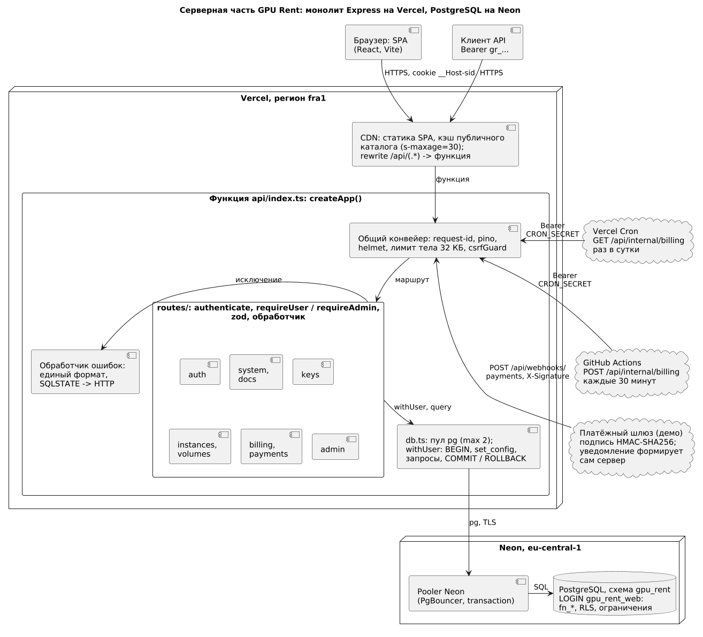
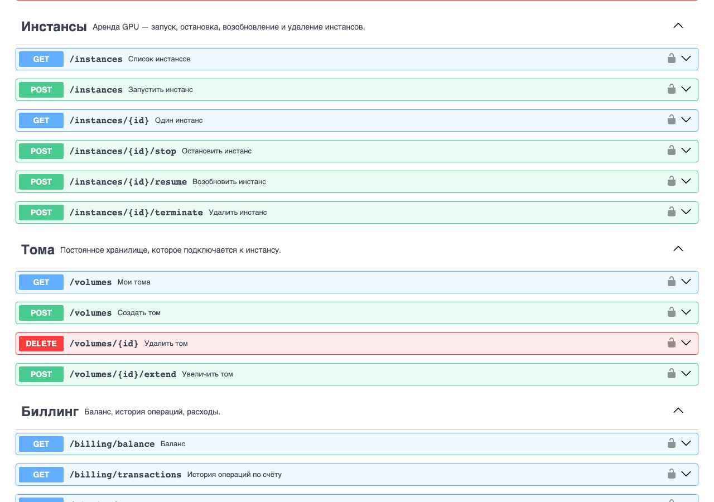
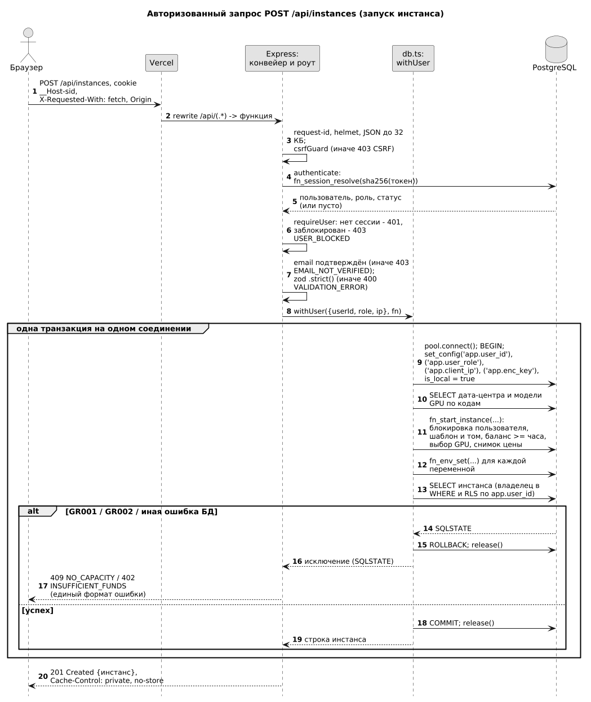

# Введение

## Цель работы

Реализовать серверную часть GPU Rent: собрать монолит на Express и TypeScript, связать его с бизнес-логикой PostgreSQL, задокументировать REST API, защитить его аутентификацией, авторизацией и мерами против типовых атак, подтвердить работу тестами.

## Задание

1. Создать сервер на выбранном стеке технологий.
2. Разработать бизнес-правила и логику, необходимые для работы приложения.
3. Создать и задокументировать REST API для фронтенда.
4. Реализовать аутентификацию и авторизацию пользователей.
5. Применить меры безопасности для защиты данных и предотвращения уязвимостей.
6. Провести модульное и интеграционное тестирование сервера.

# Ход работы

Задания №5 и №6 совпадают по тексту. Принятое разделение: П5 описывает серверную часть — архитектуру, бизнес-правила, API, аутентификацию, безопасность и тесты сервера; П6 — интерфейс, интеграцию клиента, кэширование, E2E и нагрузочные замеры; развёртывание и защита окружения — П7 и П8. Требования взяты из П2, модель и функции БД — из П3 и П4. Код не пересказывается: [server/src](../../server/src/) — ≈ 2,8 тыс. строк, тесты — ≈ 5,8 тыс.

## Стек и создание сервера

Сервер — монолит на Express 4.22.3 и TypeScript (strict): одна транзакционная БД, один деплой, небольшой код. ORM не нужен: правила уже живут в функциях PostgreSQL (П4), сервер вызывает их параметризованными запросами через `pg` 8.16.3 (транзакция на одном клиенте [5]). Асинхронные обработчики обёрнуты в `wrap`, так как Express 4 не ловит отклонённые промисы [4]. Остальное: zod 3.25.76, bcryptjs 3.0.3, helmet 8.1.0, pino 9.14.0, @vercel/functions 3.4.3; тесты — vitest 3.2.4 и supertest 7.1.4; Node.js 24.x на Vercel, 20 локально.

План П2 (VPS, Nginx, Redis) заменён решением студента: Vercel и Neon (П7). Код остаётся монолитом: `createApp()` в [app.ts](../../server/src/app.ts) собирает все роутеры, а Vercel запускает их одной функцией [api/index.ts](../../api/index.ts) (782,44 КБ, регион fra1). Импорт ничего не запускает: `createApp()` проверяет окружение, а соединение с БД открывается первым запросом, которому оно нужно. Поэтому один код работает локальным процессом ([index.ts](../../server/src/index.ts)), функцией Vercel (`export default createApp()`) и в тестах (supertest); [no-connections.test.ts](../../server/test/integration/no-connections.test.ts) проверяет, что импорт пул не создаёт. Пул живёт между вызовами функции, максимум 2 соединения: у роли `gpu_rent_web` их 20.

Таблица 1 — Модули `server/src`

| Файл | Назначение |
|---|---|
| [app.ts](../../server/src/app.ts), [index.ts](../../server/src/index.ts) | `createApp()`: конвейер, роутеры, обработчик ошибок; локальный запуск |
| [config.ts](../../server/src/config.ts), [db.ts](../../server/src/db.ts) | Окружение и лимиты; пул, `query`, `withUser` |
| [errors.ts](../../server/src/errors.ts), [http.ts](../../server/src/http.ts), [schemas.ts](../../server/src/schemas.ts) | `AppError` и SQLSTATE в HTTP; контексты БД и заголовки кэша; схемы входа |
| [auth/](../../server/src/auth/) | `authenticate`, `requireUser`, `csrfGuard`, bcrypt, токены |
| [routes/](../../server/src/routes/) | `auth`, `system`, `keys`, `instances`, `volumes`, `billing`, `payments`, `admin`, `docs` |

## Бизнес-правила

Принцип: гарантии целостности живут в функциях и ограничениях PostgreSQL, сервер отвечает за транспорт, формат, права и контекст. Так правило выполняется при любом пути записи — API, cron, SQL-тест.

Таблица 2 — Правило и место реализации

| Правило | Сервер | PostgreSQL | Тест |
|---|---|---|---|
| Запуск инстанса | Email подтверждён (иначе 403), zod, `fn_env_set` | `fn_start_instance`: проверки, цена, баланс, подбор GPU | [instances](../../server/test/integration/instances.test.ts) |
| GPU не выдаётся дважды | GR001 → 409 | `SKIP LOCKED`, повторная проверка, EXCLUDE `ex_instance_gpus_no_overlap` | гонка за GPU; `concurrency.sh` |
| Баланс не отрицателен при запуске | GR002 → 402 | `_fn_quote_instance`: баланс не меньше часа × число GPU | граница в копейку |
| Фиксация цены | — | `price_per_hour_snapshot`, биллинг по снимку | [admin](../../server/test/integration/admin.test.ts) |
| Смена цены без пересечений | `POST /api/admin/prices`: закрытие периода и новая строка в одной транзакции | EXCLUDE `ex_gpu_prices_no_overlap` | две одновременные смены |
| Идемпотентность оплаты | HMAC по сырому телу; один код для вебхука и демо-оплаты | `fn_payment_confirm`, `fn_topup` | шесть уведомлений — одно зачисление |
| Подтверждение email | Токен; ссылка в ответе при `DEMO_MAIL=1` | `email_tokens`: SHA-256, 24 ч, одноразовый | [auth](../../server/test/integration/auth.test.ts) |
| Блокировка | `requireUser`: 403 для сессии и ключа | `fn_admin_set_user_status`: только админ, не себя | auth |
| Биллинг | `fn_bill_current_user()` при чтении баланса и инстансов; `/api/internal/billing` | Начисление, автостоп; `fn_bill_usage` для cron | [billing](../../server/test/integration/billing.test.ts) |

Фонового процесса на serverless нет, поэтому биллинг «раз в минуту» (П2) заменён: начисление при обращении, GitHub Actions каждые 30 минут (`billing-cron.yml`, запуски — в П8) и Vercel Cron раз в сутки (лимит Hobby; он шлёт только `GET`, поэтому адрес принимает `GET` и `POST` [6]). Это осознанное отступление от FR-10 и FR-12: между проходами допустим небольшой минус, запуск требует суммы не меньше цены часа. Побочный эффект начисления на GET принят: он зависит только от времени и идемпотентен. Бесплатную БД защищают потолки на пользователя: 20 SSH-ключей, 10 API-ключей, 20 шаблонов, 10 томов, 10 неоплаченных платежей за сутки.

## REST API и документация

API — REST поверх JSON, GraphQL не использовался. Описание — [openapi.yaml](../../server/openapi.yaml) (OpenAPI 3.1 [7], 2382 строки): 45 путей и 51 операция, число проверено разбором файла.

Таблица 3 — Группы операций API

| Группа | Операций | Состав |
|---|---:|---|
| Аутентификация | 7 | вход, регистрация, `me`, пароль, подтверждение email |
| Каталог | 2 | GPU и шаблоны (публичные, кэш CDN) |
| Ключи и шаблоны | 9 | SSH-ключи, API-ключи, `/templates/mine` |
| Инстансы | 6 | список, карточка, запуск, `stop`, `resume`, `terminate` |
| Тома | 4 | список, создание, увеличение, удаление |
| Биллинг | 3 | баланс, история с курсором, расходы |
| Платежи | 3 | создание, демо-оплата, вебхук |
| Администрирование | 12 | дашборд, цены, инфраструктура, пользователи, аудит |
| Служебные | 5 | `health`, биллинг по расписанию, документация |

Деньги передаются строками (`"1234.5600"`), время — ISO 8601, тело не больше 32 КБ, лишние поля отвергаются. Ошибка всегда имеет вид `{"error":{"code","message"}}` с русским текстом и без сообщений PostgreSQL: в них бывают имена таблиц. Коды БД переводит [errors.ts](../../server/src/errors.ts) [8]. История и аудит листаются курсором (keyset) от `(created_at, id)`; подделанный курсор даёт 400, а не 500.

Таблица 4 — Перевод ошибок в HTTP

| Источник | HTTP и код |
|---|---|
| GR001, GR002 | 409 `NO_CAPACITY`, 402 `INSUFFICIENT_FUNDS` |
| GR003, GR004, GR005, GR006 | 409 `INVALID_STATE`, 404 `NOT_FOUND`, 422 `CONSISTENCY`, 500 `CONFIG` |
| 23505, 23P01, 40001, 40P01 / 23503, 23514 | 409 `CONFLICT` / 422 `VALIDATION` |
| 42501 / 57014, 55P03 / обрыв соединения | 403 `FORBIDDEN` / 503 `TIMEOUT` / 503 `DB_UNAVAILABLE` |
| Приложение | 400 `VALIDATION_ERROR` с `details`, 413 `PAYLOAD_TOO_LARGE`, 429 `TOO_MANY_REQUESTS` с `Retry-After` |

Интерактивная документация открыта на `/api/docs` (Swagger UI 5.17.14 с CDN jsDelivr под SRI-хэшами, собственная CSP; рисунок 2), сама спецификация — на `/api/openapi.yaml`. [openapi.test.ts](../../server/test/unit/openapi.test.ts) требует, чтобы каждый маршрут был описан, а каждая операция реализована; [contract.test.ts](../../server/test/integration/contract.test.ts) сверяет ответы с типами клиента.

## Аутентификация и авторизация

Таблица 5 — Способы подтвердить личность

| Способ | Кто использует | Устройство |
|---|---|---|
| Cookie сессии | Браузер | Токен 256 бит, в БД SHA-256 [1]; `__Host-sid`, HttpOnly, Secure, SameSite=Lax; 7 дней, продление не чаще раза в 10 минут |
| API-ключ | Скрипты | `Bearer gr_…`, в БД SHA-256, показывается один раз; выпуск и отзыв только из сессии |
| Подпись вебхука | Платёжный шлюз | HMAC-SHA256 от сырого тела, сравнение за постоянное время [10] |
| Секрет планировщика | Cron, GitHub Actions | `Bearer CRON_SECRET`, сравнение за постоянное время |

Если передан `Authorization`, cookie игнорируется целиком: неверный ключ не «подхватит» чужую сессию. Ролей две: клиент и администратор. Маршрут проверяет `requireUser` (заблокированному 403), `requireAdmin` и `requireSession`: смена пароля, выпуск ключей и изменяющие админские операции по API-ключу недоступны. Владелец указан в запросе явно: RLS пускает администратора ко всем строкам. Чужой ресурс отвечает 404; роль, статус и баланс от клиента не принимаются. Последний рубеж — RLS и проверки в функциях БД [9].

Контекст передаёт `withUser` ([db.ts](../../server/src/db.ts)): один клиент пула на транзакцию — `BEGIN`, `set_config('app.user_id'…, true)`, запросы только через этого клиента, `COMMIT` или `ROLLBACK`, освобождение в `finally`. Значение с `is_local = true` живёт до конца транзакции, поэтому вернувшееся в пул соединение не уносит чужого пользователя. Приложение работает ролью `gpu_rent_web` без права владельца и `BYPASSRLS`, иначе политики не действовали бы. [with-user.test.ts](../../server/test/integration/with-user.test.ts) проверяет 40 одновременных транзакций двух пользователей на пуле из двух соединений, исключение посреди транзакции и обрыв соединения.

Пароль — от 8 символов и не более 72 байт (bcrypt видит только 72, длинный пароль отвергается, а не обрезается), bcrypt cost 12 [11]. Хэш недоступен роли приложения напрямую; для несуществующего email пароль сравнивается с заглушкой, чтобы время ответа не выдавало адрес. Смена пароля завершает остальные сессии и отзывает API-ключи. Проверки по базам утёкших паролей, CAPTCHA и двухфакторного входа нет.

## Серверные меры безопасности

Меры выбраны по типовым угрозам веб-приложений [2] и OWASP API Security Top 10 [14]; человеческий фактор учтён так: API-ключ нельзя восстановить, ссылки подтверждения одноразовы [3]. Рекомендации Express выполнены [12].

Таблица 6 — Угроза, мера и тест

| Угроза | Мера | Тест |
|---|---|---|
| CSRF, login-CSRF [13] | SameSite=Lax; для небезопасных методов с cookie нужны `X-Requested-With: fetch` и свой `Origin` | [csrf](../../server/test/integration/csrf.test.ts) |
| Перебор паролей и блокировка владельца чужими попытками | Лимиты в БД за 15 минут: пара email+IP 5, email 20, IP 60; успешный вход обнуляет счётчики | auth |
| IDOR | Владелец в `WHERE`, RLS, 404 вместо 403 | [isolation](../../server/test/integration/isolation.test.ts) |
| Повышение привилегий | `.strict()`, UPDATE на `users` отозван, админ-операции по сессии и роли | [security-roles](../../server/test/integration/security-roles.test.ts) |
| XSS, встраивание | CSP `default-src 'none'`, `nosniff`, HSTS, HttpOnly; CSP клиента — в `vercel.json` | [system](../../server/test/integration/system.test.ts) |
| Утечка через кэш CDN | Публичный кэш только у двух адресов каталога, остальное `private, no-store` | [cache](../../server/test/integration/cache.test.ts) |
| SQL-инъекции | Параметризованные запросы, id проверяет zod | security-roles, [robustness](../../server/test/integration/robustness.test.ts) |
| Подделка вебхука | HMAC, сумма сверяется с платежом, пользователь берётся из платежа | [payments](../../server/test/integration/payments.test.ts) |
| Утечка секретов | Секреты в окружении, логи без тел и cookie, 500 без стектрейса | system, [config](../../server/test/unit/config.test.ts) |
| DoS по размеру | Тело 32 КБ (413), потолки на пользователя, `statement_timeout` роли 15 с | system, [keys](../../server/test/integration/keys.test.ts) |

Лимиты попыток считаются в PostgreSQL (`fn_auth_throttle_hit`): на serverless память процесса бесполезна, так как каждый запрос может попасть в новый экземпляр функции. Адрес клиента — последний элемент `X-Forwarded-For`, подделанные левые адреса лимит не обходят. Компромисс: бюджет подбора ≈ 20 неудач за 15 минут на аккаунт. `npm audit --omit=dev` показывает одну уязвимость высокой серьёзности — расход памяти zod на огромных коллекциях (GHSA-mrhx-c7xc-m3w5); риск принят: тело ограничено 32 КБ, переход на zod 4 ломающий. Шлюза и почты нет, поэтому в production включены `DEMO_PAYMENTS` и `DEMO_MAIL`: деньги не движутся.

## Тестирование сервера

Таблица 7 — Состав тестов

| Уровень | Файлов | Проверок | Что проверяет |
|---|---:|---:|---|
| Модульные (vitest) | 10 | 195 | Схемы, деньги, курсор, ошибки, подпись, пароли, `csrfGuard`, соответствие OpenAPI коду |
| Интеграционные (vitest, supertest) | 20 | 376 | Приложение под ролью `gpu_rent_web`: вход, права, изоляция, биллинг, платежи, кэш, CSRF, конкурентность |
| SQL-тесты БД | 14 и конкурентный | 554 | Ограничения, функции, RLS, шифрование, веб-слой (П4) |

Интеграционные тесты подключаются так же, как приложение, — LOGIN-ролью без обхода RLS; данные готовит суперпользователь. `globalSetup` пересоздаёт БД `gpu_rent_test` скриптом [test_server_db.sh](../../db/scripts/test_server_db.sh): миграции, компактный сид, роль. Отдельно проверены локальный процесс с SIGTERM, недоступная БД (503), гонка за последние GPU и параллельные уведомления шлюза.

Запуск: `npm test` в корне (то же, что `npm test --prefix server`); `npm run test:unit --prefix server` — без БД; `bash db/scripts/test.sh` — SQL-тесты; `npm run typecheck`. Нужен локальный PostgreSQL с суперпользователем. Результат на 07.11.2026 (PostgreSQL 16): vitest — 30 файлов, 571 тест, все пройдены, около 34 с; `tsc --noEmit` без ошибок; SQL — «PASS: 15 файлов, 554 проверки». На PostgreSQL 18.6 (Neon) в отдельной базе проходят 14 SQL-файлов, конкурентный тест там не запускался. Покрытие кода не измерялось; нагрузка и E2E — в П6.

# Ответы на контрольные вопросы

## Вопросы на оценку 2

### Какой стек технологий был использован при разработке серверной логики?

Node.js и TypeScript, Express 4.22.3, `pg` для PostgreSQL, zod, bcryptjs, helmet, pino; тесты — vitest и supertest (раздел «Стек и создание сервера»). Бизнес-логика находится в функциях PostgreSQL, ORM нет. Развёртывание — одна функция Vercel и PostgreSQL на Neon.

### Какие бизнес-правила и функциональность были реализованы на сервере?

Регистрация с подтверждением email, вход, жизненный цикл инстансов и томов, баланс и пополнение, расходы, администрирование цен, инфраструктуры и пользователей, аудит. Критичные правила — выдача GPU без двойной аллокации, баланс не меньше цены часа, фиксация цены, идемпотентная оплата, блокировка — исполняет PostgreSQL; сервер проверяет формат, права и передаёт контекст (таблица 2).

### Смогли ли вы успешно создать и задокументировать RESTful или GraphQL API?

Да, создан REST API: 45 путей, 51 операция (таблица 3), единый формат ошибок. Он описан в OpenAPI 3.1 и открыт в Swagger UI на `/api/docs` (рисунок 2); тесты сверяют документ с маршрутами, а ответы — с типами клиента. GraphQL не применялся; странице документации нужен доступ к CDN jsDelivr.

## Вопросы на оценку 3

### Какие элементы пользовательского интерфейса были разработаны?

Клиент на React 18 и Vite со своим CSS: вход и регистрация, подтверждение email, каталог, инстансы, тома, баланс, настройки (ключи, пароль); админка — дашборд, цены, инфраструктура, пользователи, аудит; диалоги, уведомления, график. Подробности и снимки экранов — П6.

### Какие клиентские логические операции вы выполнили для взаимодействия с сервером?

Все запросы идут через единый клиент `request()`: он добавляет `X-Requested-With: fetch`, передаёт cookie и превращает ошибки сервера в `ApiError` с кодом. Данные кэширует TanStack Query: инстансы опрашиваются раз в 15 секунд, в переходном состоянии — раз в 3, повтор только при сетевых сбоях и 5xx. Формы проверяются до отправки; цену запуска фиксирует сервер.

### Как была реализована интеграция между фронтендом и бекендом через API?

В production SPA и API на одном домене: Vercel отдаёт статику, а `/api/(.*)` перенаправляет в функцию, поэтому cookie и проверка `Origin` работают без CORS. В разработке прокси Vite направляет `/api` на локальный сервер. Контракт один — OpenAPI и типы `web/src/api/types.ts`; [contract.test.ts](../../server/test/integration/contract.test.ts) проверяет ответы сервера.

## Вопросы на оценку 4

### Какие методы аутентификации и авторизации были использованы для обеспечения безопасности приложения?

Cookie-сессия для браузера и API-ключ для скриптов, подпись HMAC для вебхука и секрет для планировщика (таблица 5). Токены хранятся как SHA-256, пароли — как bcrypt cost 12. Авторизация: роли клиента и администратора, явная проверка владельца, RLS по контексту `withUser` и проверки в функциях БД.

### Какие меры безопасности были предприняты для защиты данных и обеспечения безопасности пользователей?

Защита от CSRF, лимиты попыток входа в БД, заголовки helmet и CSP, `private, no-store` для персональных ответов, параметризованные запросы, подпись вебхука, лимит тела, шифрование переменных окружения инстансов, аудит, логи без секретов. Таблица 6 связывает каждую угрозу с мерой и тестом.

### Какие механизмы оптимизации производительности были внедрены, и какие результаты они дали?

Публичный каталог кэшируется CDN (`s-maxage=30`, `stale-while-revalidate=60`): на production первый запрос дал `x-vercel-cache: MISS`, следующий — `HIT`. `/api/health` не обращается к БД, `fn_bill_current_user` в большинстве обращений завершается без блокировок, пул переживает вызовы функции, история листается курсором, индексы и витрина — из П4. Локальный прогон (10 соединений, 15 с, БД на localhost): каталог 2365 запр/с, `/api/auth/me` 5305, список инстансов с начислением 270 запр/с (p97,5 = 40 мс), ошибок нет. Это не проверка NFR-01 (p95 < 300 мс при 1000 запр/с); замеры на сервисе — П6.

## Вопросы на оценку 5

### Можете ли вы описать структуру и функциональность вашего серверного приложения с большой детализацией?

Запрос проходит общий конвейер (request-id, helmet, лимит тела, `csrfGuard`), затем роутер своей группы: `authenticate`, `requireUser` или `requireAdmin`, zod-схема, обработчик. Обработчик открывает `withUser`, вызывает функции БД и возвращает DTO; исключение превращается в единый формат ошибки (рисунки 1 и 3, таблицы 1 и 4). Состояния пользователей в памяти нет: сессии, счётчики попыток и журнал биллинга лежат в PostgreSQL.

### Какие передовые методы и технологии вы использовали при реализации фронтенд-логики?

TanStack Query 5 кэширует ответы и управляет опросом, React Router 7, страницы администратора вынесены в ленивые чанки (0,5–1,6 КБ gzip), первая загрузка — 92,7 КБ gzip. Клиент работает под строгой CSP без inline-скриптов; ключевые сценарии проверены Playwright (21 сценарий). Измерения — П6.

### Какие дополнительные меры безопасности и оптимизации производительности были применены, и какие результаты они дали?

Безопасность: `__Host-` cookie, выравнивание времени входа, отзыв API-ключей при смене пароля, выпуск ключей только из сессии, потолки на пользователя, отдельная CSP документации, `statement_timeout` роли. Сторонняя проверка спецификации до реализации нашла 12 существенных замечаний (среди них утечку приватных шаблонов через кэш CDN), автоматическая проверка при коммитах — ещё два; всё исправлено и закреплено тестами. Оптимизация: ранний выход начисления, малый пул, курсор вместо `OFFSET`. Результат — 571 тест без ошибок и числа из ответа на вопрос 9; остаются риск zod и непроверенный NFR-01.

# ЗАКЛЮЧЕНИЕ

Серверная часть GPU Rent реализована монолитом на Express и TypeScript, который работает локально, функцией Vercel и в тестах. Критичные правила исполняет PostgreSQL, сервер отвечает за проверку входа, права и контекст `withUser`. REST API (45 путей, 51 операция) описан в OpenAPI 3.1, аутентификация построена на сессиях и API-ключах, угрозы закрыты мерами с тестами. На 07.11.2026 пройдены 571 тест сервера и 554 SQL-проверки. Не проверены NFR-01 и NFR-02, реальные платежи и почта; демо-режимы включены осознанно. Клиент и замеры — П6, развёртывание — П7, защита окружения — П8.

## СПИСОК ИСПОЛЬЗОВАННЫХ ИСТОЧНИКОВ

1. Шнайер Б. Прикладная криптография. — Питер, 2008. — 784 с.
2. Гудро М. Тайны хакеров. Безопасность Web-приложений. — ДМК Пресс, 2019. — 480 с.
3. Митник К. Искусство обмана. Хакерские приемы и тактики. — Манн, Иванов и Фербер, 2019. — 488 с.
4. Express. Error handling. — https://expressjs.com/en/guide/error-handling.html
5. node-postgres. Transactions. — https://node-postgres.com/features/transactions
6. Vercel. Cron Jobs. — https://vercel.com/docs/cron-jobs
7. OpenAPI Specification v3.1.0. — https://spec.openapis.org/oas/v3.1.0
8. PostgreSQL 16. PostgreSQL Error Codes. — https://www.postgresql.org/docs/16/errcodes-appendix.html
9. PostgreSQL 16. Row Security Policies. — https://www.postgresql.org/docs/16/ddl-rowsecurity.html
10. RFC 2104. HMAC: Keyed-Hashing for Message Authentication. — https://www.rfc-editor.org/rfc/rfc2104
11. OWASP Cheat Sheet Series. Password Storage. — https://cheatsheetseries.owasp.org/cheatsheets/Password_Storage_Cheat_Sheet.html
12. Express. Production best practices: security. — https://expressjs.com/en/advanced/best-practice-security.html
13. OWASP Cheat Sheet Series. Cross-Site Request Forgery Prevention. — https://cheatsheetseries.owasp.org/cheatsheets/Cross-Site_Request_Forgery_Prevention_Cheat_Sheet.html
14. OWASP API Security Top 10 2023. — https://owasp.org/API-Security/editions/2023/en/0x11-t10/

Дата обращения к электронным источникам: 28.10.2026.
