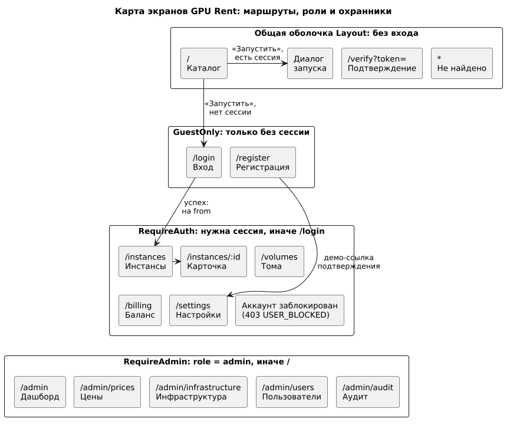
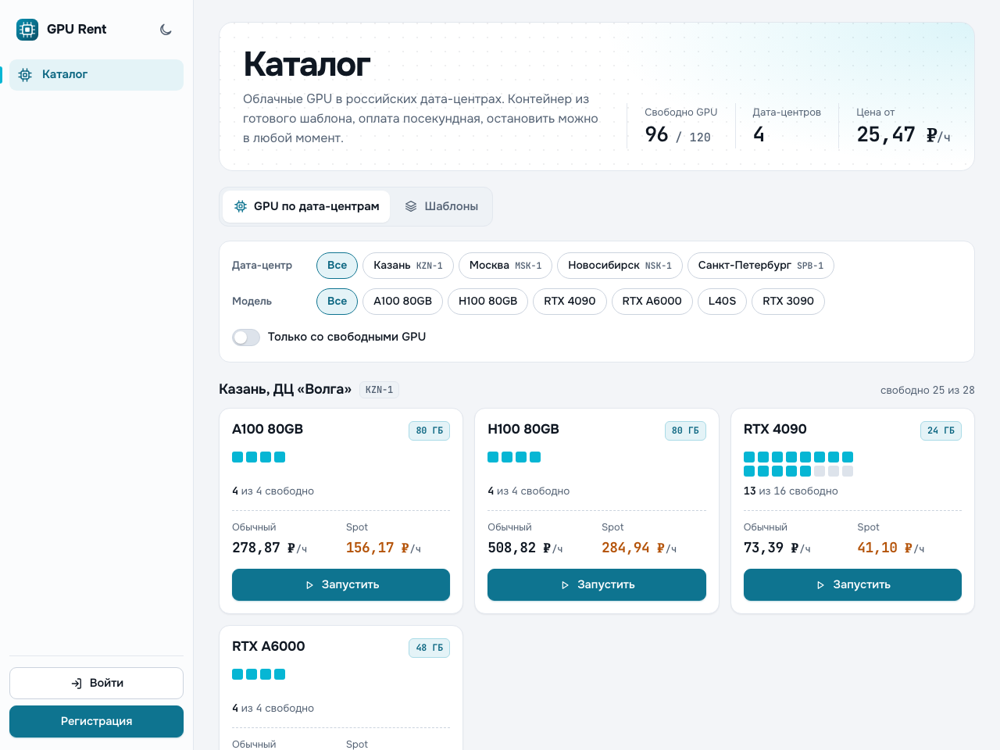
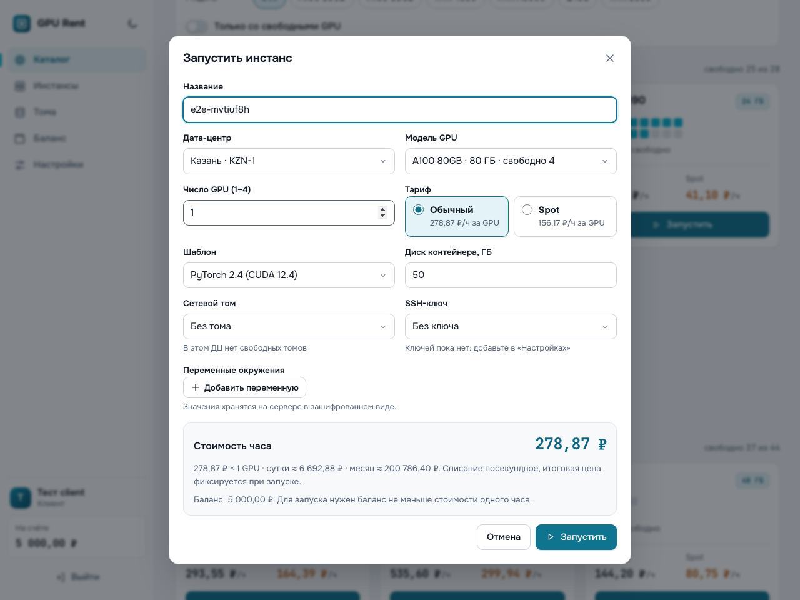
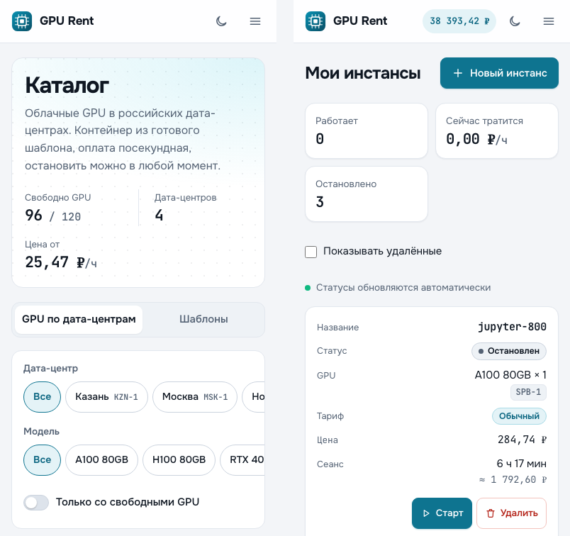
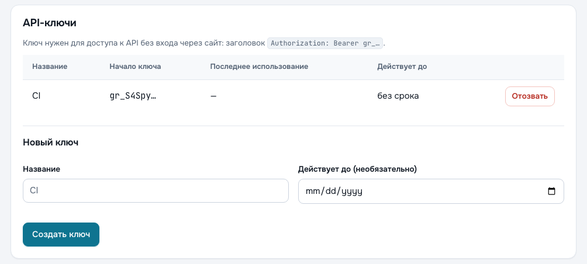
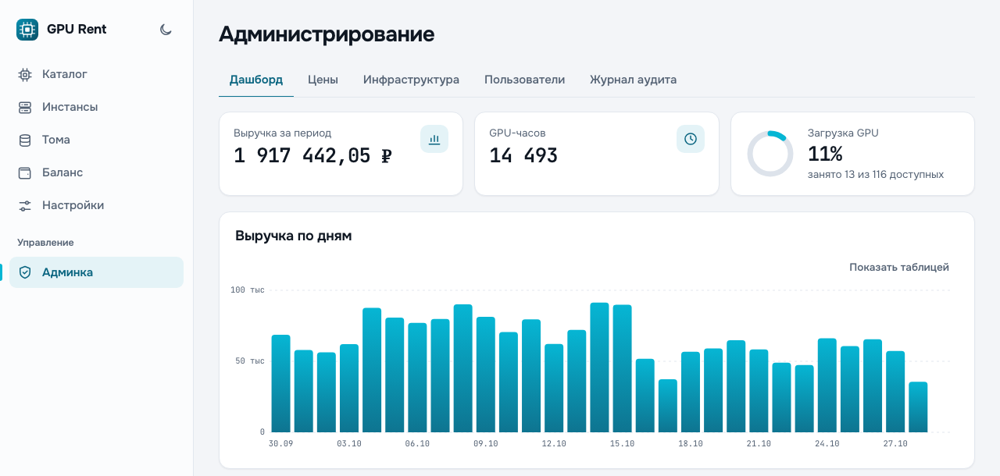
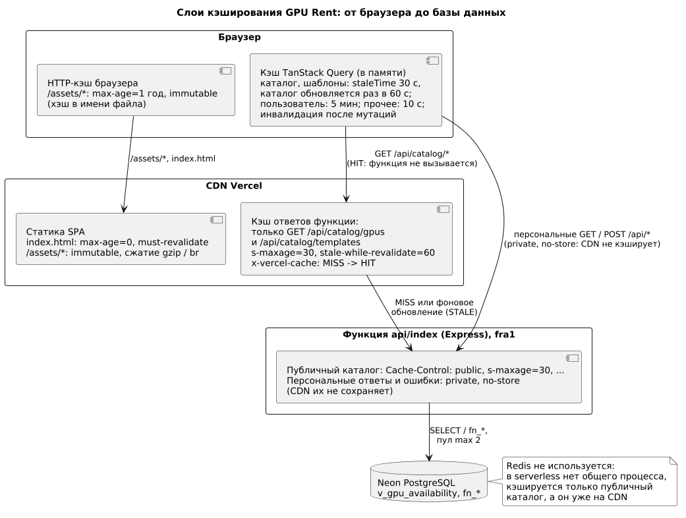

# Введение

## Цель работы

Реализовать клиентскую часть GPU Rent на React, связать её с REST API монолита, настроить кэширование и подтвердить результат сквозными и нагрузочными проверками.

## Задание

1. Создать пользовательский интерфейс с учётом требований проекта.
2. Разработать клиентскую логику обработки действий и обмена с сервером через API.
3. Интегрировать клиент с серверной логикой и разобрать найденные расхождения.
4. Обеспечить безопасность клиента, внедрить кэширование и оптимизацию.
5. Провести тестирование, собрать и развернуть клиент.

# Ход работы

Задания №5 и №6 совпадают по тексту. Принятое разделение: П5 описывает серверную часть (монолит Express, бизнес-правила, REST API и OpenAPI, аутентификацию, серверные тесты); П6 — клиент, интеграцию, кэширование и оптимизацию, сквозные и нагрузочные проверки. Деплой подробно разобран в П7, безопасность окружения и мониторинг — в П8. Решения по безопасности опираются на общие положения [1–3] и документацию платформ.

Описано состояние клиента в коммитах `main` на 07.11.2026 (последнее изменение клиента — `bb50546`). Клиент — одностраничное приложение: React 18, TypeScript в строгом режиме, Vite, React Router 7, TanStack Query 5 и собственный CSS без UI-библиотек (кроме шрифтов `@fontsource-variable`). В [web/src](../../web/src/) около 7,7 тыс. строк (из них 2,7 тыс. CSS), в [web/e2e](../../web/e2e/) около 0,4 тыс. Статику раздаёт CDN Vercel, запросы `/api/*` обслуживает функция того же домена, поэтому cookie сессии работает без CORS. Боевой сайт 07.11.2026 обновлён до `bb50546`; замеры по нему датированы.

## Интерфейс и маршруты

Страницы разделены охранниками маршрутов (рисунок 1): без входа открыт каталог, `GuestOnly` закрывает вход и регистрацию от вошедших, `RequireAuth` — кабинет, `RequireAdmin` — админку, которая грузится отдельными ленивыми чанками [4]. Страниц 14, плюс экраны блокировки и «не найдено».

Таблица 1 — Экраны и используемые эндпоинты

| Экран | Что делает пользователь | Эндпоинты |
|---|---|---|
| Каталог `/` и диалог запуска | Фильтрует GPU, смотрит наличие и цены, запускает инстанс | `GET /catalog/gpus`, `/catalog/templates`, `/templates/mine`, `POST /instances` |
| Инстансы `/instances[/:id]` | Видит статус и время работы, останавливает, запускает, удаляет | `GET /instances`, `POST /instances/:id/stop\|resume\|terminate` |
| Тома `/volumes` | Создаёт, расширяет, удаляет тома | `/volumes`, `POST /volumes/:id/extend` |
| Баланс `/billing[?payment=<id>]` | Пополняет (демо-оплата, в том числе по ссылке на платёж), смотрит расходы и историю | `GET /billing/balance\|spend\|transactions`, `POST /payments`, `/payments/:id/demo-pay` |
| Настройки `/settings` | Подтверждает email, ведёт SSH- и API-ключи, меняет пароль | `/auth/verify`, `/ssh-keys`, `/api-keys`, `POST /auth/password` |
| Вход, регистрация | Создаёт аккаунт, входит, выходит | `POST /auth/register\|login\|logout`, `GET /auth/me` |
| Админка `/admin/*` | Дашборд, цены, инфраструктура, пользователи, аудит | `GET /admin/dashboard\|infrastructure\|users\|audit`, `/admin/prices`, `POST /admin/users/:id/block\|unblock` |

Снимки сделаны сценариями Playwright (`SCREENSHOTS=1`) на локальной БД с демо-данными. Каталог (рисунок 2): шапка с тремя числами, фильтры-чипы по дата-центру и модели, карточки GPU по дата-центрам; свободные карты показаны «кристаллом» (ячейка на карту). Шаблоны — карточки с чипом образа и чипами портов. «Запустить» открывает диалог (рисунок 3), где стоимость часа — лишь подсказка, итоговую цену фиксирует сервер; на снимке нет поздних подсказок про число GPU и баланс.

Каркас страниц ([Layout.tsx](../../web/src/components/Layout.tsx)): на десктопе слева боковая навигация с карточкой пользователя, балансом и выходом; до 1080 px вместо неё верхняя панель и выезжающее меню. На экране 390 px (рисунок 4, фрагменты `09-catalog-mobile.png` и `03-instances-mobile.png`) таблицы становятся карточками: у ячеек есть `data-label`, раскладка переключается медиазапросом при ширине до 800 px.

В настройках (рисунок 5, фрагмент `06-settings-keys.png`) API-ключ показан только началом `gr_…`. Дашборд администратора (рисунок 6, фрагмент `07-admin-dashboard.png`) рисует выручку собственной SVG-диаграммой с переключением «Показать таблицей». Платёж открывается по ссылке `/billing?payment=<id>` (как `confirmationUrl` сервера): сумма и кнопка демо-оплаты; период расходов считается по московским суткам.

**Темы и шрифты.** Тема начинается с `prefers-color-scheme`; выбор по кнопке хранится в `localStorage` ([ThemeToggle.tsx](../../web/src/components/ThemeToggle.tsx), `try/catch`) и применяется из `main.tsx` до рендера, так как встроенный скрипт запретила бы CSP. Тёмная тема — на снимках `11-catalog-dark.png` и `16-instances-dark.png`. Контраст AA в обеих темах рассчитан вручную по ключевым парам цветов, автоматического аудита не было. Шрифты Onest и JetBrains Mono — пакеты `@fontsource-variable`: четыре woff2 (латиница, кириллица) отдаются из `/assets/` своего домена, поэтому в [vercel.json](../../vercel.json) осталась `font-src 'self'` и CSP не ослаблена.

## Клиентская логика

**Единый API-клиент.** Все запросы идут через `request()` в [client.ts](../../web/src/api/client.ts): префикс `/api`, `credentials: 'include'`, заголовок `X-Requested-With: fetch`, JSON-тело. `fetch` не отклоняет промис на ответах 4xx и 5xx [5], поэтому статус проверяется вручную, а тело `{error:{code,message}}` становится `ApiError(status, code, message)`. Для не-JSON ответа (например, 502 платформы) есть запасной русский текст, обрыв сети даёт код `NETWORK`.

**TanStack Query.** Данные сервера лежат в кэше, ключи собраны в объекте `keys` ([hooks.ts](../../web/src/api/hooks.ts)). Мутация в `onSuccess` инвалидирует связанные ключи [6]: запуск, остановка и удаление инстанса обновляют список, каталог (свободные GPU), тома, баланс, историю и профиль; смена цены — цены, каталог и аудит. Список инстансов опрашивается раз в 15 с, баланс и каталог — раз в минуту; ускоренный опрос при `pending` пока не срабатывает: сервер запускает инстанс мгновенно (миграция 0008) и не выдаёт этот статус. Чтение повторяется до двух раз и только после сетевых сбоев и 5xx. Вход и выход очищают кэш целиком, чтобы данные прежнего пользователя не попали к следующему.

**Формы.** [validation.ts](../../web/src/lib/validation.ts) проверяет email, пароль (8–72 символа), имена, имя переменной окружения, префикс SSH-ключа и сумму пополнения (10–100 000 ₽); пароль считается в байтах UTF-8, имя не короче 2 символов. Форма запуска ограничивает диск 10–2000 ГБ и число GPU свободными на одной ноде, «Не хватает N ₽» считает по правилу сервера (час нового инстанса плюс работающих); том — до 5000 ГБ на аккаунт. Это быстрая обратная связь: сервер проверяет всё повторно, `ErrorNote` показывает его русское сообщение и первую причину из `details`. Регистрация не открывает сессию, поэтому после `201` клиент входит теми же данными.

**Оценка сеанса.** «≈ N ₽» в списке и карточке инстанса (`SessionCost` в [Runtime.tsx](../../web/src/components/Runtime.tsx)) — цена часа × длительность, у работающего раз в секунду; точные списания — в истории операций.

Таблица 2 — Реакция клиента на ответы сервера

| Ответ | Реакция |
|---|---|
| 401 | Профиль перепроверяется; без сессии `RequireAuth` ведёт на `/login` и после входа возвращает на прежний адрес |
| 402 `INSUFFICIENT_FUNDS` | Текст ошибки и ссылка «Пополнить баланс»; в диалоге заранее показано «Не хватает N ₽» |
| 403 `USER_BLOCKED` | Экран «Аккаунт заблокирован» с кнопкой «Выйти» |
| 403 `EMAIL_NOT_VERIFIED` | Ссылка «Подтвердить email», баннер над страницей |
| 404 | У карточки инстанса — экран «Инстанс не найден», без повторов |
| 409 `NO_CAPACITY`, `INVALID_STATE` | Сообщение сервера в окне; актуальное состояние подтягивает опрос |
| 429, 5xx, сеть | Русский текст (серверный или запасной), у списков кнопка «Повторить» |

Загрузка и ошибка выводятся единообразно (`QueryState`), пустой список подсказывает следующий шаг (`Empty`), диалоги построены на системном `<dialog>` (фокус внутри окна, Esc закрывает).

## Интеграция с сервером

Контракт образуют [openapi.yaml](../../server/openapi.yaml) (45 путей, документация на `/api/docs`), типы клиента [types.ts](../../web/src/api/types.ts) и контрактный тест [contract.test.ts](../../server/test/integration/contract.test.ts): он читает `types.ts` и проверяет, что в настоящих ответах сервера есть все обязательные поля нужного типа. Если сервер изменит форму ответа, упадёт тест, а не страница. Деньги приходят строками (`"1234.5600"`) и становятся числом только для показа.

Таблица 3 — Расхождения клиента и сервера

| Расхождение | Причина | Исправление |
|---|---|---|
| В разработке все POST из браузера получали 403 `CSRF` | Прокси Vite подменял `Host`, а сервер сравнивает хост из `Origin` с `Host` ([middleware.ts](../../server/src/auth/middleware.ts)) | `changeOrigin: false` в [vite.config.ts](../../web/vite.config.ts); на Vercel `Host` совпадает с доменом |
| Подсказка «Не короче 8 символов» входила в имя поля «Пароль» | Подсказка и ошибка стояли внутри `<label>` | Вынесены за `<label>` (`Field` в [ui.tsx](../../web/src/components/ui.tsx)) |
| 403 `USER_BLOCKED` на любой запрос, включая `/auth/me`, не укладывался в схему «401 → вход» | Заблокированного сервер не разлогинивает, а отказывает на каждом запросе | Ветка в `RequireAuth` и экран с кнопкой «Выйти»; проверяется сценарием админа |
| Поиск пользователей по загруженному списку был бы неполным | Сервер отдаёт не более 200 записей (`limit` ≤ 200) | Поиск на сервере: параметр `q` (ILIKE по email и имени), задержка ввода 300 мс, `keepPreviousData` |
| Уведомление о смене пароля умалчивало об API-ключах | Сервер при смене пароля отзывает все ключи, список в кэше устаревал | Уведомление называет число отозванных ключей, ключ `apiKeys` инвалидируется |
| Форма принимала значения, которые сервер отклонял: пополнение до 1 000 000 ₽ (у сервера 100 000), том 10 000 ГБ (5000), пароль в символах, а не байтах | Пределы клиента и [schemas.ts](../../server/src/schemas.ts) разошлись | Пределы выровнены, GPU ограничены узлом, «сегодня» — по Москве (`f457c12`–`bb50546`) |

Первые четыре расхождения найдены при первом сквозном запуске клиента с сервером, пятое — позже, после изменения серверной логики паролей (коммит `be66ea2`), шестое устранено после визуального обновления.

## Безопасность клиента

Таблица 4 — Угрозы и меры клиентской части

| Угроза | Мера | Проверка |
|---|---|---|
| Кража сессии через XSS | Токен только в cookie `__Host-sid` с `HttpOnly`, `Secure`, `SameSite=Lax`; токен и данные пользователя не кладутся в хранилища браузера [7]; единственное обращение к `localStorage` — выбор темы | `git grep` по `web/src`, `web/index.html`, `web/e2e` на `localStorage`, `sessionStorage`, `indexedDB`, `document.cookie`: 2 вхождения, оба в `ThemeToggle.tsx` |
| XSS через разметку | React экранирует вывод; `dangerouslySetInnerHTML`, `innerHTML`, `eval`, `document.write` не используются | `git grep` по закоммитованному клиенту: 0 вхождений каждого |
| Внедрение скриптов и стилей | Строгая CSP из [vercel.json](../../vercel.json): `default-src 'self'; script-src 'self'; style-src 'self'`, без `unsafe-inline` [8]; HSTS на 2 года, `X-Frame-Options: DENY` | В `dist/index.html` нет встроенных `<script>` и `<style>`, в коде нет атрибутов `style`; CSP не менялась. Боевой сайт 07.11.2026 (Chromium, Playwright: каталог, вход, редирект с `/billing?payment=1`, неизвестный адрес): 0 встроенных `<script>`, `<style>` и атрибутов `style`, нарушений CSP нет, в консоли лишь 401. Экраны после входа и e2e под CSP не проверялись |
| CSRF | `X-Requested-With: fetch` и `Origin` вместе с `SameSite=Lax` [9]; серверная проверка — в П5 | Боевой сайт 07.11.2026: POST без заголовков → 403 |
| Утечка API-ключа | Ключ показан один раз в блоке «Скопируйте ключ сейчас», живёт только в состоянии компонента, после «Я сохранил ключ» исчезает | e2e «ключи» |
| Доступ к чужим разделам | `RequireAuth` и `RequireAdmin` скрывают интерфейс, решение принимает сервер | e2e: `/admin` клиенту недоступен; боевой сайт (29.10.2026): demo → `/api/admin/*` → 403 |

Разрушительные действия (остановка, удаление, отзыв ключа, блокировка) подтверждаются диалогом: часть рисков лежит на человеке, а не на коде [3]. Единственные ошибки в консоли гостя — ответы 401 на `/auth/me`: клиент считает их штатным состоянием «не вошёл».

## Оптимизация и кэширование

Слои кэша показаны на рисунке 7. Redis из плана П1/П2 не используется: функция Vercel не хранит состояние между вызовами, а внешний Redis добавил бы сервис, секрет и точку отказа ради одного публичного чтения — каталога, который уже кэшируется на CDN без кода. Персональные данные кэшировать нельзя, сессии ищутся в PostgreSQL по хэшу токена.

Таблица 5 — Слои кэша и их проверка

| Слой | Настройка | Проверка |
|---|---|---|
| CDN, каталог (`/api/catalog/gpus`, `/catalog/templates`) | `public, s-maxage=30, stale-while-revalidate=60`; персональные ответы и ошибки — `private, no-store` [10] | `curl` 07.11.2026: у `/api/catalog/gpus` и `/catalog/templates` `x-vercel-cache: MISS`, затем `HIT` [11]; клиенту уходит `cache-control: public` |
| CDN, статика | `/assets/*` с хэшем: `max-age=31536000, immutable`; `index.html`: `public, max-age=0, must-revalidate` (умолчание Vercel; Vite советует не кэшировать HTML [12]) | `curl` 07.11.2026: четыре файла первой загрузки `HIT`, `content-encoding` `br` или `gzip` по `Accept-Encoding` |
| Браузер, TanStack Query | `staleTime`: каталог и шаблоны 30 с, баланс 15 с, профиль 5 мин, прочее 10 с; `gcTime` по умолчанию 5 мин [13] | e2e: баланс обновляется без перезагрузки |

Изоляцию публичного кэша проверяет [cache.test.ts](../../server/test/integration/cache.test.ts): A прогревает адрес, B и аноним получают тот же ответ, личный шаблон в публичный список не попадает. С ноутбука 07.11.2026 каталог через CDN отвечал за 0,14–0,28 с (`MISS` 0,24 с), `/api/health` — за 0,15–0,19 с: разница в пределах сети, ускорение по времени не заявляется. Эффект CDN в другом: при `HIT` функция и БД не вызываются.

Таблица 6 — Размер сборки `npm run build` (КиБ, 1 КиБ = 1024 байта)

| Файл | Назначение | Исходный | gzip |
|---|---|---:|---:|
| `react-*.js` | React, ReactDOM, React Router | 176,2 | 58,0 |
| `index-*.js` | Код приложения | 89,6 | 25,3 |
| `query-*.js` | TanStack Query | 36,3 | 10,8 |
| `index-*.css` | Стили, две темы | 41,5 | 9,1 |
| Первая загрузка | 4 файла | 343,7 | 103,1; brotli 90,6 |
| Админка | 6 ленивых чанков | 15,4 | 6,6 |

Сборка `bb50546` в копии каталога (117 модулей) даёт 105 583 байта gzip, то есть 103,1 КиБ: на 890 байт больше, чем `ea694a5` (102,2), и на 10,3 КиБ больше, чем до визуального обновления (92,8). Шрифты в цифру не входят (`sizes.mjs` считает js, css, html, svg): woff2 весят 99,7 КиБ и грузятся по `unicode-range`, реальный объём на странице не измерялся. Библиотеки (68,7 КиБ gzip) в отдельных чанках меняются редко: при правке кода обновятся хэши чанков приложения и стилей. Ленивая админка — 6,4 % первой загрузки. С сети 07.11.2026 (имена файлов те же, что в копии) CDN отдал четыре файла в gzip 107 134 байта (104,6 КиБ), brotli на лету — 111 659 байт (109,0 КиБ), тогда как расчётные 90,6 КиБ brotli — не размер передачи.

## Тестирование

Клиент проверяется 21 сценарием Playwright ([web/e2e](../../web/e2e/), Chromium) и контрактным тестом сервера; локаторы пользовательские (`getByRole`, `getByLabel`) [14]. Модульных тестов клиентского кода нет: логика невелика, а риск лежит в связке с сервером.

Таблица 7 — Сценарии Playwright

| Файл | Число | Что проверяют |
|---|---:|---|
| `smoke.spec.ts` | 8 | Здоровье API; каталог и шаблоны без входа; редирект защищённых страниц; нет горизонтальной прокрутки на 360 px; Swagger UI; неверный пароль; вход demo, обход разделов, выход |
| `flow.spec.ts` | 10 | Регистрация с валидацией, подтверждение email, отказ 402, демо-пополнение, запуск, остановка, карточка, SSH- и API-ключ, история, удаление |
| `admin.spec.ts` | 3 | Дашборд, инфраструктура, аудит; смена цены (в таблице и в каталоге, затем возврат); блокировка пользователя и запись аудита |

Все 21 сценарий прошли 07.11.2026 на dev-сервере Vite с локальной БД, то есть без CSP-заголовков [vercel.json](../../vercel.json); под боевой CSP клиент `bb50546` не прогонялся. Серверных тестов — 571 (П5). Режим `E2E_READONLY=1` оставляет сценарии без изменения данных для боевого сайта. Публичную часть smoke я повторил 07.11.2026 против https://gpu-rent-lemon.vercel.app (клиент `bb50546`): 6 сценариев пройдено за 11,9 с, 15 пропущено (вход и изменение данных).

Таблица 8 — Нагрузка autocannon (локально, 10 соединений, 15 с, собранный `dist`, БД на localhost, пул 2)

| Маршрут | Запр/с | p97,5, мс | Ошибок |
|---|---:|---:|---:|
| `GET /api/catalog/gpus` (без CDN) | 2 365 | 5 | 0 |
| `GET /api/health` | 9 257 | 1 | 0 |
| `GET /api/auth/me` | 5 305 | 3 | 0 |
| `GET /api/instances` (с начислением) | 270 | 40 | 0 |

Это проверка работоспособности на одной машине ([результаты](../../server/test/load/results/local-2026-10-28T1425.txt)), а не проверка NFR-01 (p95 < 300 мс при 1000 запр/с). Нагрузка на боевой сайт не подавалась, холодные старты функции и Neon не измерялись. Мобильная вёрстка проверена автоматически только на отсутствие горизонтальной прокрутки при 360 px и снимками 390 px; не подтверждены Firefox, Safari, реальные телефоны, экранный диктор и автоматический аудит контраста.

## Сборка и развёртывание клиента

`npm run build` выполняет `tsc --noEmit`, `vite build` и вывод размеров; результат — `web/dist`. Vercel раздаёт его как статику, `/api/(.*)` направляет в функцию, прочие пути (кроме `/assets`) — в `index.html`, заголовки задаёт [vercel.json](../../vercel.json). Моя сборка в копии каталога (`npm ci`, `npm run build`) побайтно совпала с `web/dist` (`diff -rq`); имена файлов с хэшами совпали с `index.html` боевого сайта (07.11.2026), побайтно не сравнивались. Подробности деплоя — П7; превью-деплои не выполнялись.

Не реализованы `ErrorBoundary` и обработка `vite:preloadError` [12] (открытая вкладка после нового деплоя может не загрузить ленивый чанк админки; не проверялось), полный разбор `details` валидации (показана первая причина), модульные тесты клиента и запуск e2e в CI (для клиента в `ci.yml` заданы проверка типов и сборка; workflow подготовлен, но не запускался: репозиторий ещё не отправлен на GitHub).

# Ответы на контрольные вопросы

### Какой стек технологий был использован при разработке серверной логики?

Монолит на Node.js 24 и Express 4 с TypeScript, pg, zod, bcryptjs, helmet и pino; на Vercel он работает одной функцией, данные хранятся в PostgreSQL на Neon (подробно — П5). Клиент обращается к нему по REST через единый `request()`; клиентский стек — React 18, Vite, TypeScript, React Router 7, TanStack Query 5.

### Какие бизнес-правила и функциональность были реализованы на сервере?

Правила (баланс не меньше стоимости часа, выбор свободных GPU, снимок цены, идемпотентное пополнение, подтверждение email, блокировка) выполняют функции PostgreSQL, сервер проверяет доступ и формат (П5). Клиент их не дублирует, а показывает последствия: «Не хватает N ₽», баннер email, экран блокировки (таблица 2).

### Смогли ли вы успешно создать и задокументировать RESTful или GraphQL API?

Да, REST: OpenAPI 3.1 описывает 45 путей и 51 операцию, Swagger UI открыт на `/api/docs`, файл — на `/api/openapi.yaml`. Swagger UI открылся на боевом сайте в моём прогоне smoke 07.11.2026.

### Какие элементы пользовательского интерфейса были разработаны?

Четырнадцать страниц (каталог, вход, регистрация, подтверждение email, инстансы, карточка, тома, баланс, настройки, пять страниц админки), боковая навигация, тёмная и светлая темы, карточки GPU и шаблонов, диалоги запуска и подтверждения, формы с проверкой полей, таблицы с карточным видом на телефоне, SVG-диаграмма, уведомления, баннеры, пустые состояния (таблица 1, рисунки 2–6).

### Какие клиентские логические операции вы выполнили для взаимодействия с сервером?

Единый `request()` с разбором ошибок; запросы и мутации TanStack Query с инвалидацией; опрос статусов; оценка стоимости сеанса; подгрузка истории по курсору; отмена по `AbortSignal`; перепроверка сессии при 401; ограниченные повторы; проверка форм; очистка кэша при входе и выходе.

### Как была реализована интеграция между фронтендом и бекендом через API?

Через один origin: статика и `/api/*` на одном домене (на Vercel — rewrite, в разработке — прокси Vite с сохранением `Host`), поэтому cookie `__Host-sid` работает без CORS. Контракт держат OpenAPI, `types.ts` и контрактный тест; расхождения разобраны в таблице 3.

### Какие методы аутентификации и авторизации были использованы для обеспечения безопасности приложения?

Для браузера — сессия с непрозрачным токеном в `HttpOnly`-cookie (в БД хранится SHA-256 токена), для скриптов — API-ключ `gr_…` в заголовке Bearer; роли `client` и `admin`. Клиент скрывает разделы по роли, но доступ решает сервер: клиентская роль на `/api/admin/*` получает 403 (проверено 29.10.2026 на боевом сайте под demo-пользователем).

### Какие меры безопасности были предприняты для защиты данных и обеспечения безопасности пользователей?

На клиенте: `HttpOnly`-cookie, CSRF-заголовок и `Origin`, строгая CSP без встроенного кода, отсутствие опасных DOM-функций, однократный показ API-ключа, подтверждение разрушительных действий, очистка кэша при смене пользователя (таблица 4). Серверные меры — в П5 и П8.

### Какие механизмы оптимизации производительности были внедрены, и какие результаты они дали?

CDN-кэш каталога (`MISS` → `HIT`, 30 с плюс 60 с обновления в фоне), годовой `immutable`-кэш хэшированных файлов, кэш TanStack Query, отдельные чанки библиотек и ленивые чанки админки. Результат: первая загрузка 103,1 КиБ gzip (до визуального обновления 92,8).

### Можете ли вы описать структуру и функциональность вашего серверного приложения с большой детализацией?

Подробное описание — в П5. Монолит `createApp()` с модулями `auth`, `system`, `keys`, `instances`, `volumes`, `billing`, `payments`, `admin`, `docs`; конвейер запроса: request-id, helmet, лимит тела 32 КБ, CSRF, аутентификация, zod. Контракт: единый формат ошибки, деньги строками, пагинация курсором, `Cache-Control: public` только у каталога.

### Какие передовые методы и технологии вы использовали при реализации фронтенд-логики?

TypeScript strict с общим контрактом типов и тестом на сервере; TanStack Query как кэш серверного состояния (инвалидация, опрос, `useInfiniteQuery`, `keepPreviousData`); `React.lazy` и `Suspense`; ручное разделение vendor-чанков; системный `<dialog>`; доступная разметка (`role="alert"`, `aria-live`, skip-link); SVG-диаграмма без библиотек; e2e на Playwright.

### Какие дополнительные меры безопасности и оптимизации производительности были применены, и какие результаты они дали?

Безопасность: CSP без `unsafe-inline`, HSTS на два года, `X-Frame-Options: DENY`, `Permissions-Policy`, разделение публичного (CDN) и личного (`private, no-store`) кэша, проверенное тестом. Оптимизация: вынос библиотек из часто меняющегося кода, локальный нагрузочный прогон без ошибок (таблица 8). Ограничения: NFR-01 на реальной нагрузке не проверен, `ErrorBoundary` нет.

# ЗАКЛЮЧЕНИЕ

Клиент GPU Rent реализован как SPA на React: 14 страниц, единый API-клиент, кэш TanStack Query, проверка форм, охранники маршрутов, тёмная и светлая темы. Интеграция подтверждена контрактным тестом и 21 сценарием Playwright, найденные расхождения исправлены. Первая загрузка — 103,1 КиБ gzip, публичный каталог кэшируется на CDN, Redis в текущей архитектуре не используется. Боевой сайт 07.11.2026 на `bb50546`. Не проверены NFR-01 на боевом стенде, Firefox и Safari, автоматический аудит контраста, холодные старты и отказ ленивого чанка после нового деплоя.

## СПИСОК ИСПОЛЬЗОВАННЫХ ИСТОЧНИКОВ

1. Шнайер Б. Прикладная криптография. — Питер, 2008. — 784 с.
2. Гудро М. Тайны хакеров. Безопасность Web-приложений. — ДМК Пресс, 2019. — 480 с.
3. Митник К. Искусство обмана. Хакерские приемы и тактики. — Манн, Иванов и Фербер, 2019. — 488 с.
4. React. lazy. — https://react.dev/reference/react/lazy
5. MDN Web Docs. Window: fetch() method. — https://developer.mozilla.org/en-US/docs/Web/API/Window/fetch
6. TanStack Query v5. Invalidations from Mutations. — https://tanstack.com/query/v5/docs/framework/react/guides/invalidations-from-mutations
7. MDN Web Docs. Set-Cookie header. — https://developer.mozilla.org/en-US/docs/Web/HTTP/Reference/Headers/Set-Cookie
8. MDN Web Docs. Content Security Policy (CSP). — https://developer.mozilla.org/en-US/docs/Web/HTTP/CSP
9. OWASP. Cross-Site Request Forgery Prevention Cheat Sheet. — https://cheatsheetseries.owasp.org/cheatsheets/Cross-Site_Request_Forgery_Prevention_Cheat_Sheet.html
10. Vercel Docs. Cache-Control headers. — https://vercel.com/docs/caching/cache-control-headers
11. Vercel Docs. Response headers: x-vercel-cache. — https://vercel.com/docs/headers/response-headers
12. Vite. Building for Production. — https://vite.dev/guide/build.html
13. TanStack Query v5. Important Defaults. — https://tanstack.com/query/v5/docs/framework/react/guides/important-defaults
14. Playwright. Best Practices. — https://playwright.dev/docs/best-practices

Дата обращения к электронным источникам: 29.10.2026.
