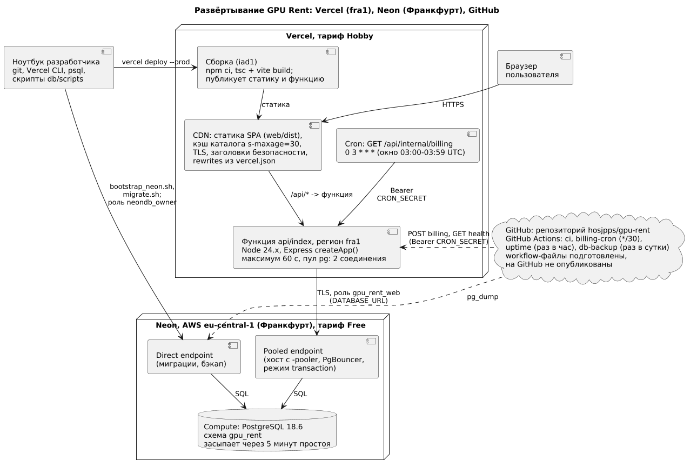
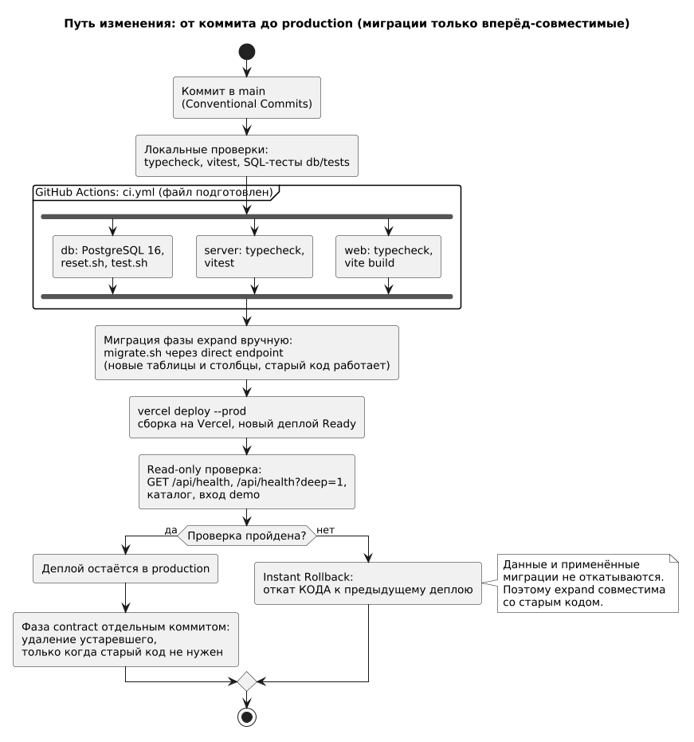

# Введение

## Цель работы

Выбрать инфраструктуру для GPU Rent, развернуть приложение в сети, проверить его работу и честно описать трудности и ограничения.

## Задание

Выбрать платформу и серверное окружение; настроить ОС, зависимости, пользователя и права; загрузить приложение и настроить его запуск; применить меры безопасности и мониторинг.

# Ход работы

Задания №7 и №8 совпадают по тексту. Принятое разделение: П7 описывает выбор платформы, настройку окружения, деплой, проверку и трудности; П8 — безопасность, мониторинг, CI/CD в эксплуатации, надёжность и отказоустойчивость, и на него даны ссылки. Развёртывание выполнено 28.10.2026, повторные проверки боевого адреса и чтение журналов — 29.10.2026, обновление стенда и повторные проверки — 07.11.2026; время московское (UTC+3), если не указано иное. Секреты в отчёт не включены. Конфигурация и скрипты — по ссылкам: [vercel.json](../../vercel.json), [db/scripts](../../db/scripts/), [инструкция по Neon](../deploy/neon.md).

## Выбор серверной инфраструктуры

Условия проекта: бюджет нулевой, исполнитель один (по П2 — 8–10 часов в неделю), приложение хранит балансы и пароли, поэтому безопасность среды и доступов — отдельный критерий [1–3]. Остальные критерии: администрирование, масштабирование, лимиты бесплатных планов, привязка к вендору и постоянные процессы (план П2 предполагал планировщик раз в минуту и Redis). Сравнение качественное: прайсы провайдеров не запрашивались, лимиты выбранной связки взяты из документации.

Таблица 1 — Сравнение вариантов инфраструктуры

| Критерий | VPS + Compose + Nginx (план П2) | Контейнерная платформа | PaaS с постоянным процессом | Vercel + Neon (выбрано) |
|---|---|---|---|---|
| Стоимость | Платная ВМ, оплата и при простое | По ресурсам | Бесплатные планы обычно усечены | Бесплатно: Hobby и Free |
| Администрирование, ОС | Максимум: ОС, Nginx, сертификаты, копии | Образ наш, узлы провайдера | Низкое, среда провайдера | ОС, TLS, сеть у платформы; наши — заголовки, секреты, роли БД |
| Масштабирование | Вручную: реплики, PgBouncer | По правилам | Вертикальное | Автоматическое, до 30 000 вызовов [4] |
| Риски | Непропатченная ОС, открытые порты, единая точка отказа | Сложно для одного человека | Засыпание, привязка | Нет постоянных процессов, холодные старты, лимиты, привязка |

Выбрана связка Vercel (Hobby) и Neon (Free): ради нулевой стоимости и отсутствия администрирования ОС. Цена — ограничения платформ: функция живёт только на время запроса и не держит планировщик, лимитер или кэш в памяти; Hobby даёт один регион функций [5] и cron не чаще раза в сутки с разбросом запуска до часа [6]. Neon Free по документации на 29.10.2026: 1 ГБ на проект, 100 CU-часов в месяц, 5 ГБ исходящего трафика, окно восстановления 6 часов, засыпание через 5 минут простоя без возможности отключить [7]. Демо-база занимает 31 МБ; лимиты в консолях не сверялись.

Таблица 2 — Что меняет выбор относительно плана П2

| Компонент плана П2 | Факт | Последствие |
|---|---|---|
| Nginx: TLS, статика, прокси | CDN Vercel, rewrites и заголовки в `vercel.json` | Сертификаты выдаёт платформа |
| Redis: сессии; Nginx: ограничение частоты | Сессии и счётчики попыток входа в PostgreSQL | Память функции не переживает вызов; сессия читается из БД на каждом запросе с cookie |
| Redis: кэш каталога | `Cache-Control: public, s-maxage=30, stale-while-revalidate=60` [8], кэш TanStack Query | Каталог устаревает до 30 с, ещё 60 с отдаётся прежний ответ |
| Планировщик раз в минуту | Начисление при обращении, GitHub Actions каждые 30 минут, Vercel Cron раз в сутки | Осознанное изменение FR-10 и FR-12: допустим отрицательный баланс между проходами |
| Compose, две реплики | Одна функция, экземпляры создаёт платформа; пул `pg` — 2 соединения | Соединения ограничивает Neon, а не число реплик |

Пунктиром показаны потоки GitHub Actions: workflow подготовлены, но на GitHub не опубликованы, поэтому в работе их нет.

## Настройка окружения

Шаги «установить ОС, создать пользователя, настроить права» на платформе выполняет провайдер: доступа к ОС, брандмауэру и обновлениям ядра у нас нет, и выдавать их за выполненные нельзя. Вместо них настроено то, что принадлежит нам (разделение ответственности — в П8).

Таблица 3 — Шаги настройки сервера: VPS и фактическое развёртывание

| Шаг задания | На VPS | Что сделано здесь |
|---|---|---|
| ОС, обновления, запуск | Дистрибутив, `apt upgrade`, systemd | У провайдера; выбрана версия среды Node.js 24.x; функция запускается по запросу |
| Зависимости, конфигурация | Установка на сервер, `.env` | `npm ci` при сборке, версии в lock-файлах; переменные окружения проекта (таблица 7) [9][10] |
| Пользователь и права | Пользователь, sudo, SSH | Доступ через аккаунты разработчика; в БД — роль `gpu_rent_web` (таблица 4) |
| Брандмауэр | `ufw`, закрытые порты | Не настраивается: функция принимает HTTPS от платформы, Neon — только TLS |

Таблица 4 — Роли базы данных на Neon

| Роль | Атрибуты | Назначение |
|---|---|---|
| `neondb_owner` | Владелец проекта; CREATEROLE, BYPASSRLS, не суперпользователь [11] | Только миграции через direct endpoint |
| `gpu_rent_owner`, `_app`, `_analyst` | NOLOGIN | Владелец схемы, права приложения, маскированное чтение |
| `gpu_rent_web` | LOGIN, член `gpu_rent_app`; нет SUPERUSER, BYPASSRLS, CREATEDB, CREATEROLE; `statement_timeout` 15 с, `idle_in_transaction_session_timeout` 30 с | Единственная роль приложения; RLS действует, потому что это не владелец |

Отличия Neon (полный список — в [инструкции](../deploy/neon.md)). Суперпользователя нет, а миграция 0001 выполняет `SET LOCAL ROLE gpu_rent_owner`, поэтому [bootstrap_neon.sh](../../db/scripts/bootstrap_neon.sh) выдаёт мигратору `GRANT … WITH INHERIT TRUE, SET TRUE` [12]. Адресов два: direct для миграций и `pg_dump`, pooled (PgBouncer, режим transaction) для приложения; в нём `SET` на уровне сессии не работает [13], поэтому контекст пользователя ставится `set_config(…, true)` внутри транзакции. Роли из консоли Neon получают `neon_superuser`, созданные SQL — нет [11], поэтому `gpu_rent_web` создаётся только SQL.

Версия PostgreSQL. Разработка шла на 16.15; Neon при установке через Marketplace выдал 18.6, версию там выбрать нельзя. Совместимость проверена 28.10: 13 миграций применились без ошибок; сценарий «вход, запуск инстанса с зашифрованной переменной окружения, оплата, stop, resume, terminate» выполнен через pooler (баланс 38 424,1786 стал 38 924,1786, повторная «демо-оплата» его не изменила); 14 SQL-файлов тестов БД пройдены во временной базе внутри проекта Neon. Тест конкурентного доступа на 18.6 не запускался.

## Деплой приложения

Деплой выполнен Vercel CLI из рабочей копии: в API Vercel источник — `cli`. Деплой 28.10 — коммит `5be588c`; повторный `vercel deploy --prod` 07.11 — коммит `bb50546`, его возвращает `GET /api/health`. Репозиторий GitHub к проекту Vercel не подключён.

Таблица 5 — Хронология развёртывания 28.10.2026 (МСК)

| № | Шаг | Команда или способ (без секретов) | Результат |
|---|---|---|---|
| 1 | Проект, 21:27 | Привязка каталога к проекту `gpu-rent` (`.vercel/project.json`, в `.gitignore`) | Личная команда, Node.js 24.x |
| 2 | База, 21:28 | `vercel integration add neon` [14] | `gpu-rent-db`, Free, eu-central-1, PostgreSQL 18.6; 16 переменных `NEON_*`, только Production |
| 3 | Секреты | Случайные значения (`secrets.token_urlsafe`), файл с правами 600 вне репозитория | В git нет |
| 4 | Роли и миграции | `bootstrap_neon.sh`, затем `migrate.sh` (только отсутствующие миграции, адрес `-pooler` отвергается) через `DATABASE_URL_DIRECT` | С первой попытки; 13 миграций; опасение про `REVOKE ALL ON SCHEMA public` не подтвердилось |
| 5 | LOGIN-роль, данные | `create_login_role.sh` (пароль из переменной окружения); [seed_demo.sql](../../db/seed/seed_demo.sql) через `psql` | Роль создана SQL; БД 31 МБ: 52 пользователя, 33 999 записей потребления, 800 инстансов |
| 6 | Проверка через pooler | Локальный сервер с `DATABASE_URL` на pooled-адрес Neon | Сценарий из раздела о версии пройден, ошибок уровня error нет |
| 7 | Переменные, 21:34 | `vercel env add` для семи переменных таблицы 7 (кроме `APP_URL` и `NEON_*`); `APP_URL` добавлен в 21:35:51, после деплоя | Созданы за 15 с, первые четыре — sensitive; `APP_URL` см. таблицу 9 |
| 8 | Деплой, 21:34:38 | `vercel deploy --prod` | Готов 21:35:03; `λ api/index (782.44KB) [fra1]`; https://gpu-rent-lemon.vercel.app |

Сборка идёт на стороне Vercel в регионе iad1, функция исполняется в fra1: это разные настройки. По журналу: зависимости сервера установлены за 3 с, клиент собран за 1,7 с (первая загрузка ≈ 93 КБ gzip; на 07.11 — 103,1 КБ), деплой готов через 25 с после создания; вся команда CLI с загрузкой 286 файлов — около 33 с. Размер функции по выводу Vercel — 782,44 КБ при лимите 250 МБ [4]. 07.11: `migrate.sh` через `DATABASE_URL_DIRECT` под `neondb_owner` применил [0014_quote_running_cost.sql](../../db/migrations/0014_quote_running_cost.sql); в `schema_migrations` 14 записей. Затем повторный `vercel deploy --prod`.

Таблица 6 — Разбор `vercel.json` [15]

| Ключ | Значение | Зачем |
|---|---|---|
| `installCommand`, `buildCommand`, `outputDirectory` | `npm ci --prefix server`; `npm run build`; `web/dist` | Зависимости сервера нужны функции; клиент собирается проверкой типов и Vite |
| `regions` | `["fra1"]` | Рядом с Neon eu-central-1; в настройках проекта по умолчанию `iad1`, поэтому регион задан в файле; Hobby допускает один регион [5] |
| `functions` | `api/index.ts`: `maxDuration` 60, `includeFiles` `server/openapi.yaml` | Транзакции прохода биллинга ограничены 50 с; спецификацию код читает при работе |
| `rewrites` | `/api/(.*)` на `/api`; `/((?!api/\|assets/).*)` на `/index.html` | API — в одну функцию, остальное — запасной путь SPA. Существующие файлы отдаются до rewrites, исключение `/assets` даёт 404 вместо HTML |
| `headers` | Страницы: CSP `default-src 'self'` и далее, HSTS на 2 года, `X-Frame-Options: DENY`, `nosniff`. `/assets`: `public, max-age=31536000, immutable` [8] | Заголовки статики — из конфигурации, API — из helmet; в именах ресурсов хэш |
| `crons` | `GET /api/internal/billing`, `0 3 * * *` | Раз в сутки, окно 03:00–03:59 UTC; Vercel сам подставляет `CRON_SECRET` в `Authorization` [6][16] |

Таблица 7 — Переменные окружения проекта (Production; значения не раскрываются)

| Имя | Назначение | Тип |
|---|---|---|
| `DATABASE_URL` | Pooled-адрес Neon, роль `gpu_rent_web` | sensitive: после сохранения не читается [9] |
| `ENC_KEY` | Ключ шифрования переменных окружения инстансов; в БД не хранится [1] | sensitive |
| `WEBHOOK_SECRET`, `CRON_SECRET` | Подпись HMAC-SHA256 уведомлений шлюза; Bearer-секрет `/api/internal/billing` | sensitive |
| `DEMO_MAIL`, `DEMO_PAYMENTS` | `1`: ссылка подтверждения и «демо-оплата» вместо почты и шлюза; деньги не движутся | обычные |
| `DB_POOL_MAX`, `APP_URL` | Пул `pg` на экземпляр (2); адрес сайта для ссылок и Origin | обычные |
| `NEON_*` (16) | Параметры интеграции, включая роль-владельца; приложение их не читает | обычные |

Секреты хранятся вне репозитория и разделены по окружениям [9][10]; локально — в `server/.env` (в `.gitignore`), пример — [`.env.example`](../../.env.example). `NODE_ENV` в списке нет, но cookie `__Host-sid` по коду выбирается только в production, и она выдаётся при входе: платформа задаёт `NODE_ENV=production` сама.

## Проверка работоспособности

Проверки выполнены `curl` по боевому адресу; ответы 28.10 повторены 29.10.2026 там, где это отмечено. Изменяющие сценарии против production не запускались.

Таблица 8 — Проверки боевого сайта

| Запрос | Ответ |
|---|---|
| `GET /`, `/catalog`, `/instances`; `/assets/nope.js` | 200 `text/html`, CSP, HSTS, `X-Frame-Options: DENY`; 404 `text/plain` (повтор 29.10) |
| `GET /api/health`; `?deep=1` | 07.11: 200, `"status":"ok"`, версия `bb50546`, `private, no-store`, без БД, 0,21 с; 200, `"db":"ok"`, `lastBillingAt` `2026-11-07T03:43:37Z`. 29.10 (версия `5be588c`): 0,26 и 0,30 с, `lastBillingAt` `2026-10-29T03:43:37Z` |
| `GET /api/catalog/gpus` дважды | 28.10: `x-vercel-cache` MISS, затем HIT. 29.10: HIT, `age` 25–26 с, 0,22–0,54 с. 07.11, три запроса подряд: HIT, `age` 17–18 с, 0,20–0,27 с. `/api/catalog/templates` (29.10) через ≈ 82 с после предыдущего запроса — STALE: устаревший ответ отдан, обновление в фоне [8] |
| `GET /api/auth/me` без входа; `/api/internal/billing` без токена; `POST /api/auth/login` без `X-Requested-With` | 401; 401; 403, код `CSRF` (повтор 29.10) |
| Вход `demo`, затем `/api/admin/*`; вход `admin`, `/api/admin/dashboard` | Cookie `__Host-sid`; 403; 200 (28.10). Вход ≈ 1,0 с (bcrypt cost 12 и БД), список инстансов ≈ 0,23 с |

`lastBillingAt` 29.10 и 07.11 (около 03:43 UTC) совпадает по времени с окном запуска Vercel Cron 03:00–03:59 UTC; это время последнего прохода биллинга, источник запуска по ответу не определить, а журнал Hobby хранит записи около часа. Запрос к каталогу, при котором, судя по предупреждению `pg` в журнале, стартовал новый экземпляр функции, занял 1229 мс; вклад запуска функции и пробуждения БД не разделить, поэтому цифры холодного старта не приводятся. Клиент под боевой CSP проверен e2e на собранной сборке локально (21 сценарий, 29.10). Тесты 07.11: сервер 571 (30 файлов); SQL-тесты 15 файлов, 554 проверки (PostgreSQL 16 локально); e2e 21 сценарий зелёный локально на dev-сервере; против боевого сайта с `E2E_READONLY=1` 6 пройдено, 15 пропущено по замыслу. Не проверялись: NFR-01 и NFR-02 на production, холодный старт Neon, Firefox и Safari, реальные ЮKassa и почта, восстановление боевой БД, отказ региона.

## Проблемы, возникшие при выполнении, и решения

Таблица 9 — Трудности развёртывания

| Проблема | Решение или статус |
|---|---|
| Первый запуск автоматизированной подготовки оборвался ошибкой авторизации | Запуск повторён; на развёртывание не повлиял: деплой 28.10 был единственным |
| Neon выдал PostgreSQL 18.6, а не 16 | Совместимость проверена (раздел о версии); CI и локальные тесты остаются на 16 |
| Интеграция Neon по умолчанию подставила бы в `DATABASE_URL` строку роли-владельца: у неё BYPASSRLS, RLS не действовала бы [11][14] | Интеграция подключена только к Production с префиксом `NEON_`, `DATABASE_URL` создан под `gpu_rent_web`. Остаточный риск: строки владельца есть в окружении функции, приложение их не читает |
| Токен GitHub CLI имеет права `repo`, `gist`, `read:org`, но не `workflow` | Workflow не опубликованы: `main` на GitHub остаётся на `3c598b8` (29.10; 07.11 подтверждено `git ls-remote`), каталога `.github` нет, секретов Actions нет (29.10). Нужен токен с правом `workflow` |
| `APP_URL` задан после деплоя; изменения переменных действуют только на новые деплои [9] | Обнаружено при подготовке отчёта. Приложение берёт адрес из заголовка `Host`, работа не нарушена. Повторный деплой 07.11 выполнен после добавления переменной, она доступна новому деплою; действие на ссылки не проверялось |
| Дрейф схемы: `fn_web_set_password` на Neon создана по прежнему тексту 0013 (без отзыва API-ключей при смене пароля), в репозитории текст другой. Найдено 07.11 | Функция пересоздана `CREATE OR REPLACE` по актуальному тексту. По истории git файл 0013 правили (коммит be66ea2) уже после первого коммита с миграциями; по журналу Neon она применена 28.10 в 21:32, а точная причина расхождения не установлена. Вывод: применённые миграции не править, исправлять новой миграцией |
| В журналах: предупреждение `pg` о смене трактовки `sslmode=require` в версии 9; `npm ci` сообщает о 8 уязвимостях (5 moderate, 1 high, 2 critical) | Первое: перед обновлением `pg` указать `sslmode=verify-full`. Второе: в основном зависимости разработки; `npm audit --omit=dev` оставляет `zod`, тело запроса ограничено 32 КБ (П8) |

## Подготовка CI/CD

Подготовлены четыре workflow-файла; их YAML разобран парсером, запусков не было, поэтому результатов нет. Деплой остаётся ручным.

Файлы: [ci.yml](../../.github/workflows/ci.yml) (БД на PostgreSQL 16, сервер, клиент: типы, тесты, сборка), [billing-cron.yml](../../.github/workflows/billing-cron.yml) (`POST /api/internal/billing` каждые 30 минут, секрет через конфиг curl на stdin), [uptime.yml](../../.github/workflows/uptime.yml) (раз в час `/api/health` и `?deep=1`, контроль свежести `lastBillingAt`), [db-backup.yml](../../.github/workflows/db-backup.yml) (раз в сутки `pg_dump` с проверочным восстановлением и шифрованием дампа).

Было найдено расхождение: `db-backup.yml` рассчитан на сервер 16 и ставит клиент 16, а `pg_dump` отказывается снимать копию с сервера более новой мажорной версии, чем он сам [17]. Коммитом от 02.11 файл переведён на клиент 18 и кластер `postgres:18`; не запускался.

Откат лишь переключает домены на прежний деплой: БД и переменные окружения остаются в текущем состоянии, на Hobby доступен только предыдущий деплой [18], а сейчас деплоев два: откат возможен на деплой 28.10, но не выполнялся. Поэтому миграции двухшаговые: расширяющая (expand), совместимая со старым кодом, применяется до деплоя; удаляющая (contract) идёт отдельным коммитом, когда старый код не нужен. Изменяющие e2e выполняются локально или в отдельной БД, не против production.

# Ответы на контрольные вопросы

### Какие факторы нужно учитывать при выборе серверной инфраструктуры для развертывания веб-приложения?

Стоимость, объём администрирования, контроль над ОС и безопасностью, масштабирование, лимиты, привязку к вендору и постоянные процессы. Для GPU Rent решили нулевой бюджет и один исполнитель (таблица 1); последствия для П2 — в таблице 2.

### Какие базовые шаги нужно предпринять при настройке сервера и его операционной системы?

Выбрать и обновить ОС, создать пользователя с минимальными правами, установить зависимости, закрыть порты, настроить TLS, окружение и перезапуск. На PaaS ОС, брандмауэр и сертификаты ведёт провайдер; нами выбрана версия среды, настроены роли БД и переменные окружения (таблицы 3, 4 и 7).

### Смогли ли вы успешно загрузить веб-приложение на сервер и запустить его?

Да. Приложение доступно по адресу https://gpu-rent-lemon.vercel.app, деплой в статусе Ready, версия `bb50546` (07.11). Запросы таблицы 8 подтвердили работу страниц, API, БД через pooler, кэша, прав и защиты от CSRF. Демо-режимы почты и оплаты включены, реальных платежей нет.

### Какие дополнительные меры безопасности вы применили при настройке сервера и операционной системы?

ОС настраивает провайдер, поэтому меры перенесены на уровень приложения и БД: заголовки CSP, HSTS и `X-Frame-Options`; роль `gpu_rent_web` без привилегий, при которой действует RLS; секреты только в окружении Vercel, четыре из них sensitive; endpoint биллинга закрыт Bearer-секретом; тело запроса ограничено 32 КБ. Разбор — в П8.

### Какие шаги были предприняты для обеспечения мониторинга сервера и приложения?

Реализованы `GET /api/health` без обращения к БД и `?deep=1` с проверкой БД и временем последнего биллинга; приложение пишет JSON-журнал (pino) с идентификатором запроса Vercel, доступный в панели и через `vercel logs`. Почасовая проверка `uptime.yml` подготовлена, но не запущена; оповещения в Vercel и Neon не настраивались.

### Какие основные этапы деплоя и настройки сервера были выполнены, и какие проблемы возникли?

Проект Vercel, база Neon, секреты, роли и 13 миграций, LOGIN-роль и демо-данные, проверка через pooler, переменные окружения, деплой и проверки (таблица 5). Трудности (таблица 9): версия 18.6, роль-владелец в переменных интеграции, права токена GitHub, `APP_URL` после деплоя, `db-backup.yml` под версию 16, дрейф схемы.

### Какие инструменты и методы вы использовали для обеспечения безопасности сервера и приложения?

Роли БД с минимальными правами и RLS, `SECURITY DEFINER`-функции с фиксированным `search_path`, хэши паролей и токенов, шифрование секретов инстансов, cookie `__Host-sid`, CSRF-защита заголовком и Origin, подпись вебхука HMAC-SHA256, CSP и HSTS, `npm audit`. Конфигурация вынесена в окружение по принципу двенадцатифакторного приложения [10]; переменные окружения видны всем процессам и могут попасть в журналы [19], поэтому секреты имеют тип sensitive. Защита аккаунтов и человеческий фактор [3] — предмет П8.

### Какие средства мониторинга и управления сервером были настроены и как они обеспечивают работоспособность приложения?

Управление: Vercel CLI и панель (деплой, переменные, журналы, откат), панель Neon, скрипты `db/scripts`. Мониторинг: эндпоинты health, журналы функций, `lastBillingAt` как признак живого биллинга. Они выявляют недоступность БД (503, `db: down`) или остановку биллинга, но автоматического оповещения нет.

### Какие дополнительные настройки и оптимизации были выполнены для обеспечения высокой производительности серверного окружения?

Функция в `fra1` рядом с Neon eu-central-1; пул `pg` на уровне модуля (2 соединения, простой 10 с, ожидание 5 с) с `attachDatabasePool` [20] и PgBouncer; каталог кэшируется CDN на 30 с, хэшированная статика — на год; первая загрузка клиента 103,1 КБ gzip (07.11); `/api/health` не будит БД. Локальный прогон (10 соединений, 15 с, БД на localhost) дал 2365 запросов/с на каталоге; это не проверка NFR-01 и не характеристика боевого стенда.

### Можете ли вы подробно описать процесс выбора и настройки серверной инфраструктуры для вашего веб-приложения?

Сформулированы критерии, сравнены четыре варианта (таблица 1), выбрана связка Vercel и Neon, выписаны её последствия для П2 (таблица 2). Настройка шла от БД к приложению: интеграция Neon, роли и миграции через direct endpoint, LOGIN-роль, демо-данные, проверка через pooler, переменные окружения, деплой и проверка адреса (таблицы 4–8); трудности разобраны в таблице 9.

### Какие передовые методы и инструменты вы использовали для обеспечения безопасности и мониторинга сервера?

В БД: минимальные права, RLS, роль без BYPASSRLS, `SECURITY DEFINER` с фиксированным `search_path`, неизменяемый аудит. В приложении: sensitive-секреты, разделение direct и pooled подключений, сравнение секрета за постоянное время, идемпотентный биллинг, устойчивый к повторным и пропущенным запускам cron [16]. Для мониторинга — health-эндпоинты с глубокой проверкой, структурные журналы, контроль свежести биллинга; автоматические проверки в Actions не включены (П8).

### Какие решения и меры были предложены для обеспечения высокой надежности и отказоустойчивости серверного окружения?

Принято: запуск функции по запросу с избыточностью по зонам доступности [5], ограничения и идемпотентные функции в БД, двухшаговые миграции, откат деплоя (только код) [18], окно восстановления Neon 6 часов [7]. Предложена независимая копия: суточный `pg_dump` с проверочным восстановлением (подготовлен и переведён на версию 18, не запускался). Не обеспечены отказ региона (Hobby — один регион [5]), реплика БД и оповещения: это ограничения учебного стенда, а не достигнутые гарантии.

# Заключение

Приложение развёрнуто на Vercel и Neon: функция в `fra1`, PostgreSQL 18.6 во Франкфурте, применены 14 миграций, работа идёт под ролью `gpu_rent_web`. Выбор объяснён сравнением вариантов и описанным отступлением от плана П2: без VPS, Nginx и Redis, с изменённой схемой биллинга. Проверки боевого адреса подтвердили страницы, API, кэш, права и защиту от CSRF. Открыты публикация CI на GitHub, проверка резервной копии, оповещения, проверка нагрузки и холодного старта. Шаги ОС и брандмауэра выполняет провайдер.

# Список использованных источников

1. Шнайер Б. Прикладная криптография. — СПб.: Питер, 2008. — 784 с.
2. Гудро М. Тайны хакеров. Безопасность Web-приложений. — ДМК Пресс, 2019. — 480 с.
3. Митник К. Искусство обмана. Хакерские приёмы и тактики. — М.: Манн, Иванов и Фербер, 2019. — 488 с.
4. Vercel Docs. Vercel Functions Limits. — https://vercel.com/docs/functions/limitations
5. Vercel Docs. Configuring regions for Vercel Functions. — https://vercel.com/docs/functions/configuring-functions/region
6. Vercel Docs. Usage & Pricing for Cron Jobs. — https://vercel.com/docs/cron-jobs/usage-and-pricing
7. Neon Docs. Plans. — https://neon.com/docs/introduction/plans
8. MDN Web Docs. Cache-Control. — https://developer.mozilla.org/en-US/docs/Web/HTTP/Reference/Headers/Cache-Control
9. Vercel Docs. Environment variables. — https://vercel.com/docs/environment-variables
10. The Twelve-Factor App. III. Config. — https://12factor.net/config
11. Neon Docs. Manage roles. — https://neon.com/docs/manage/roles
12. PostgreSQL 16 Documentation. GRANT. — https://www.postgresql.org/docs/16/sql-grant.html
13. Neon Docs. Connection pooling. — https://neon.com/docs/connect/connection-pooling
14. Neon Docs. Neon Native Integration with Vercel. — https://neon.com/docs/guides/vercel-native-integration
15. Vercel Docs. Static Configuration with vercel.json. — https://vercel.com/docs/project-configuration/vercel-json
16. Vercel Docs. Managing Cron Jobs. — https://vercel.com/docs/cron-jobs/manage-cron-jobs
17. PostgreSQL 16 Documentation. pg_dump. — https://www.postgresql.org/docs/16/app-pgdump.html
18. Vercel Docs. Instant Rollback. — https://vercel.com/docs/instant-rollback
19. OWASP Cheat Sheet Series. Secrets Management Cheat Sheet. — https://cheatsheetseries.owasp.org/cheatsheets/Secrets_Management_Cheat_Sheet.html
20. Vercel Docs. @vercel/functions API Reference. — https://vercel.com/docs/functions/functions-api-reference/vercel-functions-package

Дата обращения к электронным источникам: 29.10.2026.
