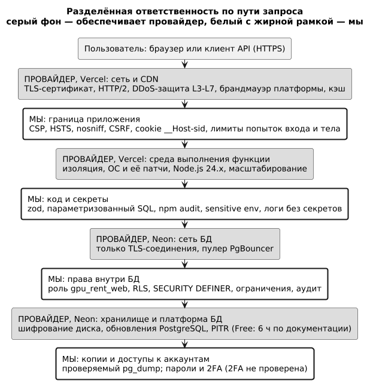
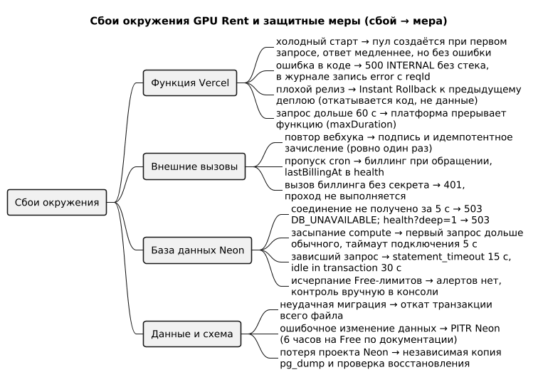

# Введение

## Цель работы

Определить, что в защите и надёжности окружения GPU Rent обеспечивают Vercel и Neon, а что остаётся за проектом; проверить собственные меры командами и тестами; описать наблюдаемость и восстановление после сбоев; честно перечислить непроверенное.

## Задание

Задание П8 совпадает по тексту с П7: выбрать инфраструктуру, настроить сервер и пользователя, выполнить деплой, применить меры безопасности (брандмауэр, обновления, SSL) и настроить мониторинг. Шкала 4–5 добавляет производительность, надёжность и отказоустойчивость.

# Ход работы

Задания №7 и №8 совпадают по тексту. Принятое разделение: П7 — выбор инфраструктуры, настройка окружения и развёртывание (Vercel Hobby, функции в `fra1`, Node.js 24.x; Neon Free, PostgreSQL 18.6, Франкфурт); П8 — защита, наблюдаемость и надёжность, на П7 даны только ссылки. Проверки выполнены 29.10.2026 (07.11 повторены; деплой `bb50546`): боевой сайт https://gpu-rent-lemon.vercel.app — `curl`, локальная БД PostgreSQL 16.15 — `psql`, код — `vitest`. ОС, пользователя ОС и брандмауэра у проекта нет: на PaaS их ведёт провайдер; проект отвечает за заголовки, секреты, права БД, зависимости и аккаунты. Пределы тарифов сверены с документацией, а не с консолями («проверить в консоли»).

## Разделённая ответственность

Провайдер отвечает за инфраструктуру (вычисления, хранилище, сеть), клиент — за данные, приложение, доступы и шифрование серверных данных [4]. Строки провайдеров в таблице 1 взяты из документации и заслугой проекта не являются.

Таблица 1 — Уровни защиты и ответственные

| Уровень | Отвечает | Меры и проверка |
|---|---|---|
| ОС и патчи | Vercel, Neon | Обновление инфраструктуры и среды выполнения — Vercel [4]; Neon сканирует окружения на непропатченное ПО [13]. Проект выбирает Node.js (`engines: 24.x`) |
| Сеть и брандмауэр | Vercel, Neon | Брандмауэры платформы и DDoS L3–L7 на всех тарифах — Vercel [4, 5]; Neon принимает только TLS [13]. Своих правил WAF и IP-ограничений нет |
| TLS-сертификат | Vercel | `curl -v`: TLS 1.3, HTTP/2, `CN=*.vercel.app`, Google Trust Services WR1, срок 29.08.2026 — 27.11.2026; выпуск и замену ведёт Vercel |
| Шифрование хранилища | Neon, проект | Диски шифрует Neon (AES-256) [13]; проект шифрует секреты окружения инстансов (`pgp_sym_encrypt`, ключ `ENC_KEY` вне БД, П4) |
| Приложение, секреты, права БД | Проект | Разделы ниже |
| Аккаунты Vercel, Neon, GitHub | Проект | Пароли и 2FA не проверялись, 2FA включённой не считаем; захват аккаунта обходит остальные меры [3] |

## Заголовки и граница приложения

Заголовки задают [vercel.json](../../vercel.json) (статика) и `helmet` в [app.ts](../../server/src/app.ts) (API). Таблица 2 — вывод `curl -I` боевого сайта.

Таблица 2 — Заголовки ответов, 29.10.2026 (07.11 без изменений)

| Заголовок | `GET /` (SPA) | `GET /api/health` (API) |
|---|---|---|
| Content-Security-Policy | `default-src 'self'; script-src 'self'; … frame-ancestors 'none'` | `default-src 'none'; frame-ancestors 'none'; script-src 'self'; …` |
| Strict-Transport-Security | `max-age=63072000; includeSubDomains` | то же |
| X-Content-Type-Options | `nosniff` | `nosniff` |
| X-Frame-Options | `DENY` | `SAMEORIGIN` |
| Referrer-Policy | `strict-origin-when-cross-origin` | `no-referrer` |
| Cache-Control | `public, max-age=0, must-revalidate` | `private, no-store` |

Значения соответствуют OWASP [19], кроме `preload` у HSTS (домен в список не подавался). `SAMEORIGIN` у API — умолчание `helmet`; встраивание запрещает `frame-ancestors 'none'`. Без учётных данных сайт отвечает ожидаемо: 401 на `/api/auth/me`, `/api/admin/dashboard`, `/api/internal/billing` и вебхук без подписи; 403 на `POST /api/auth/login` без `X-Requested-With`. Cookie `__Host-sid` — `HttpOnly`, `Secure`, `SameSite=Lax` ([auth.test.ts](../../server/test/integration/auth.test.ts)); изменяющие запросы по cookie требуют `X-Requested-With` и свой `Origin` ([csrf.test.ts](../../server/test/integration/csrf.test.ts)). Счётчики попыток входа хранятся в PostgreSQL: память serverless-функции для них бесполезна. Классы атак — [2], HMAC и хранение ключей — [1].

## Секреты и доступы

Таблица 3 построена по ответу API Vercel (тип и окружение; значения не запрашивались).

Таблица 3 — Переменные окружения на Vercel

| Переменные | Тип | Комментарий |
|---|---|---|
| `DATABASE_URL` (роль `gpu_rent_web`), `ENC_KEY`, `WEBHOOK_SECRET`, `CRON_SECRET` | sensitive, только Production | Значение после сохранения не показывается [7] |
| `APP_URL`, `DB_POOL_MAX`, `DEMO_MAIL`, `DEMO_PAYMENTS` | encrypted | Не секреты |
| 16 переменных `NEON_*` от интеграции | encrypted | Читаемы участникам проекта, среди них пароль владельца БД; приложение их не использует (в `server/src` и `api` совпадений нет) |

В git секретов нет: отслеживается только `.env.example`, в истории других `.env` не было, `git grep` по строкам подключения с паролем, ключам `gr_…` и закрытым ключам нашёл лишь плейсхолдеры, пример в `openapi.yaml` и заглушки тестов. Простые пароли для локальной разработки и тестов лежат в репозитории намеренно. Что боевые секреты и пароли `admin` и `demo` иные и случайны, известно по пакету фактов от 28.10.2026 (файл с правами 600 вне репозитория); вход тестовыми паролями на боевом сайте не проверялся. Локальный `server/.env` вне git имеет права 644.

## Минимальные права в БД

Приложение подключается ролью `gpu_rent_web`, созданной SQL-командой, а не консолью Neon (там роли получают `neon_superuser`). RLS не действует на суперпользователей, роли с `BYPASSRLS` и, как правило, на владельцев таблиц [17], поэтому у роли приложения их нет. На Neon атрибуты проверены 28.10; таблица 4 — повторная проверка на локальной БД теми же скриптами.

Таблица 4 — Проверка роли `gpu_rent_web`, PostgreSQL 16.15, 29.10.2026

| Проверка | Результат |
|---|---|
| Атрибуты и членство | LOGIN; SUPERUSER, BYPASSRLS, CREATEDB, CREATEROLE, REPLICATION — нет; CONNECTION LIMIT 20; член только `gpu_rent_app` |
| Настройки роли | `search_path = gpu_rent, pg_catalog`; `statement_timeout = 15s`; `idle_in_transaction_session_timeout = 30s` |
| `SELECT password_hash FROM users`; `UPDATE users SET role = 'admin'`; `DELETE FROM transactions`; `CREATE TABLE`; `SET ROLE gpu_rent_owner` | permission denied |
| `SELECT count(*) FROM users` без контекста пользователя | 0 строк (RLS) |
| `SELECT pg_sleep(20)` | отмена по таймауту через 15,1 с |

В схеме 39 таблиц; RLS включена на 11 (15 политик); у всех 35 функций `SECURITY DEFINER` задан `search_path`. Отрицательные тесты под этой ролью — [security-roles.test.ts](../../server/test/integration/security-roles.test.ts) и [isolation.test.ts](../../server/test/integration/isolation.test.ts) («присвоить себе admin», чужие ресурсы дают 404). Аудит пишет смену роли и статуса, цены, статус инстанса, действия с ключами и платежами.

## Зависимости и обновления

Версии сервера зафиксированы, lock-файлы в git, сборка и CI идут через `npm ci`. `npm audit --omit=dev` 29.10.2026 (07.11 для сервера то же): сервер — одна уязвимость high, `zod` 3.25.76 (GHSA-mrhx-c7xc-m3w5, расход памяти на огромных коллекциях); клиент — 0. Риск принят: тело запроса ограничено 32 КБ, единственная коллекция — словарь переменных окружения; переход на zod 4 ломает совместимость и отложен. Уязвимость `qs` устранена обновлением `express` 4.22.1 → 4.22.3 (`npm ls qs`: 6.16.2). Ещё семь замечаний полного аудита — в инструментах разработки (`vitest`, `autocannon`, `yaml` и их зависимости), в `server/src` и `api` они не импортируются. Политика ручная: `npm audit` в CI и Dependabot отсутствуют [18].

## Мониторинг и наблюдаемость

Таблица 5 — Что есть и чего нет

| Средство | Что даёт | Факт и ограничение |
|---|---|---|
| `GET /api/health` | Живость без обращения к БД | 200, в журнале функции 1 мс |
| `GET /api/health?deep=1` | `SELECT 1`, `lastBillingAt`; при отказе БД 503 | 29.10 12:06 UTC: `db: ok`, `lastBillingAt` 03:43 UTC; 07.11: `db: ok`, `bb50546`, 03:43 UTC; будит Neon, звать не чаще раза в час |
| Журнал pino (JSON) | Строка на запрос: `reqId` (= `x-vercel-id`), метод, путь, статус, мс; ошибки 5xx с причиной | Пароли, токены, `Authorization`, `Cookie` скрыты, тела не пишутся; хранится 1 час на Hobby [8] |
| `audit_log`, `billing_runs` | Постоянные записи действий и проходов биллинга | В БД |
| [uptime.yml](../../.github/workflows/uptime.yml) | Раз в час `/api/health` (лимит 3 с) и `?deep=1` (10 с); предупреждение, если биллинг старше 3 часов | В GitHub не запушен (07.11 `gh api repos/hosjpps/gpu-rent/actions/workflows`: `total_count 0`), запусков нет |
| Панели Vercel и Neon | Вызовы, трафик, CU-часы, размер хранилища | Алерты не настраивались |

`lastBillingAt` соответствует суточному Vercel Cron (`0 3 * * *`, на Hobby запуск в пределах часа [9]), но источник запуска подтвердить нельзя: журнал хранится час. Результатов `ci.yml`, `billing-cron.yml`, `db-backup.yml` нет: репозиторий с ними не запушен, в облаке не запускались. Не настроены оповещения и трассировка (`traceId` пуст).

## Надёжность и отказоустойчивость

Таблица 6 — Сбой, поведение системы, восстановление

| Сбой | Что происходит | Восстановление |
|---|---|---|
| Холодный старт | `createApp()` не открывает соединений, пул создаётся при первом запросе ([no-connections.test.ts](../../server/test/integration/no-connections.test.ts)); функция 782,44 КБ | Не нужно; задержка не измерена |
| Ошибка в коде | 500 без стека и имён таблиц; запись `error` с `reqId` | Исправление и деплой |
| Плохой релиз | Production указывает на новый деплой | Instant Rollback к предыдущему деплою: возвращает код, но не данные, миграции и переменные; затем `vercel promote` [6]. Миграции вперёд-совместимы |
| Нет соединения с БД, засыпание Neon | Ожидание 5 с, затем 503 `DB_UNAVAILABLE`; умершее соединение пул отбрасывает ([with-user.test.ts](../../server/test/integration/with-user.test.ts)); `/api/health` 200, `?deep=1` 503 | Compute просыпается за сотни миллисекунд [15]; повтор запроса |
| Зависший запрос | `statement_timeout` 15 с, `idle_in_transaction` 30 с, `maxDuration` 60 с | Блокировки снимаются |
| Лимиты Free | По документации 1 ГБ, 100 CU-часов, 5 ГБ трафика в месяц [10]; БД занимает 31 МБ; реакция на превышение не проверялась | Контроль вручную |
| Неудачная миграция | Файл и запись версии — одна транзакция, частичных изменений нет | Исправить, повторить `migrate.sh` (есть `--dry-run`) |
| Повтор вебхука | Подпись и идемпотентное зачисление | Не требуется |
| Пропуск cron | Hobby: раз в сутки, в пределах часа | Биллинг при обращении, `lastBillingAt`, предупреждение uptime |
| Порча данных | PITR Neon, независимая копия | Следующий раздел |

После 29.10 автоматическое ревью дало исправления с тестами: биллинг при обращении перед проверкой баланса при запуске и возобновлении; SSH-ключ только владельца (чужой — 404); потолки на ключи и шаблоны под advisory-lock; порядок блокировок в томах; 400 вместо 500 на NUL, битый gzip и границы периодов в `/billing/spend` и `/admin/dashboard`; порт 1–65535 и образ без схемы в шаблонах; миграция 0014 (баланс покрывает час нового и всех работающих инстансов). Журнал `billing-cron.yml` не печатает итоги (репозиторий публичный). Раундов было несколько; двух подряд чистых нет, остановлено решением владельца работы.

Идемпотентность и транзакционность проверены тестами: шесть одновременных уведомлений по одному платежу зачисляют сумму один раз ([payments.test.ts](../../server/test/integration/payments.test.ts)); повторный проход биллинга ничего не начисляет ([system.test.ts](../../server/test/integration/system.test.ts)); 40 одновременных транзакций двух пользователей на пуле из двух соединений не смешивают контекст (with-user.test.ts); из 12 запусков на 4 GPU успешны 4 ([concurrency.sh](../../db/tests/concurrency.sh)).

## Резервные копии и восстановление

Instant restore Neon возвращает ветку к моменту из окна истории и перезаписывает данные и схему всех БД ветки; прежнее состояние сохраняется в новой ветке [11]. Окно для Free в документации расходится: 6 часов [10] и «от 1 до 30 суток по тарифам» [12]; проверить в консоли, принято меньшее. PITR на практике не выполнялась. Независимая копия — [db-backup.yml](../../.github/workflows/db-backup.yml): раз в сутки `pg_dump` через direct endpoint, проверка восстановления, шифрование gpg (репозиторий публичный), хранение 7 суток. Workflow не запушен, копий на GitHub нет; рассчитан на `pg_dump` 18 (клиент 16 не снимает дамп с сервера 18). Скрипт [backup_restore_check.sh](../deploy/backup_restore_check.sh) прогнан локально: источник — `gpu_rent_dev`, приёмник — временная БД.

Таблица 7 — Число строк при проверке восстановления, 29.10.2026

| Таблица | До дампа | После дампа | В копии |
|---|---:|---:|---:|
| `users` | 85 | 85 | 85 |
| `instances` | 819 | 819 | 819 |
| `transactions` | 34 365 | 34 365 | 34 365 |
| `usage_records` | 34 173 | 34 173 | 34 173 |

Статус `OK`, дамп 1,2 МБ, прогон около 2 с. Дополнительная сверка выявила три ограничения. Совпали число таблиц (39), политик (15), функций (322), индексов (157), сумма балансов и md5 содержимого `transactions` — но только после `SET timezone = 'UTC'`: без `--create` `pg_dump` не переносит настройки БД, а роли в дамп не входят [16]. Права не переносятся (`--no-privileges`): у `gpu_rent_app` пропал `SELECT` на таблицы, а `gpu_rent_analyst` получил `EXECUTE` на `fn_topup`, потому что `REVOKE FROM PUBLIC` не повторён. После восстановления права и параметры применяют заново; скрипт сверяет лишь число строк. Восстановление на Neon и на боевых данных не проверялось.

## Производительность окружения

Таблица 8 — Замеры боевого сайта, 29.10.2026 12:06 UTC (`curl` с ноутбука, 3–5 запросов)

| Адрес | Клиент, с | Журнал функции, мс | Кэш |
|---|---|---|---|
| `/api/health` | 0,23–0,32 | 1 | нет |
| `/api/health?deep=1` | 0,27–0,32 | 35, затем 10 и 10 | нет |
| `/api/catalog/gpus`, первый | 0,24 | 9 | MISS |
| `/api/catalog/gpus`, второй и третий | 0,18 и 0,27 | функция не вызывалась | HIT |

Время на клиенте на два порядка больше времени функции: его определяют сеть и граничный узел (по `x-vercel-id` запрос принят в `arn1`, функция работает в `fra1`); замер с одного ноутбука не характеризует других пользователей. По пакету фактов от 28.10: вход около 1,0 с (bcrypt cost 12 и БД), список инстансов около 0,23 с.

Настройки: функции и Neon в одном регионе (Франкфурт); пул `pg` — максимум 2 соединения, простой 10 с, ожидание 5 с, `attachDatabasePool`; пулер Neon в режиме transaction [14], поэтому контекст RLS задаётся внутри транзакции; `CONNECTION LIMIT 20` у роли при `max_connections` 112; каталог кэшируется (`s-maxage=30, stale-while-revalidate=60`); первая загрузка 92,7 КБ gzip. Локальная нагрузка (autocannon, 10 соединений, 15 с): каталог 2 365 запр/с (p97,5 = 5 мс), `/api/instances` с начислением 270 запр/с (p97,5 = 40 мс), ошибок нет. Это проверка работоспособности: NFR-01 (p95 менее 300 мс при 1000 запр/с) и NFR-02 (99,5 %) не проверены, холодный старт Neon и функции не измерены. `vitest` 07.11.2026: 30 файлов, 571 тест (195 unit, 376 интеграционных), все пройдены; SQL-тесты — 15 файлов, 554 проверки (PostgreSQL 16); e2e — 21 сценарий, 07.11 не запускались.

## Непроверенное и план улучшений

Таблица 9 — Что сделать

| Пробел | Мера |
|---|---|
| Алертов нет, workflow не запушены | Запушить репозиторий (токен со scope `workflow`), задать `APP_URL`, `CRON_SECRET`; включить уведомления |
| Логи хранятся час; нет WAF, CAPTCHA, проверки утёкших паролей (до 20 неудач за 15 минут на аккаунт) | Log Drain; правила Vercel Firewall, CAPTCHA, список утёкших паролей |
| 2FA не проверена | Включить на Vercel, Neon, GitHub |
| Читаемые `NEON_*`, права `server/.env` 644 | Удалить неиспользуемые, сменить пароль владельца [7]; `chmod 600` |
| `zod` 3 (high); нет `npm audit` в CI | Переход на zod 4; `npm audit`, Dependabot |
| Копия теряет права и часовой пояс; PITR не проверена | Применять права и `timezone`, сверять содержимое; проверить PITR на ветке Neon |
| Дрейф схемы: `fn_web_set_password` на Neon создана по старому тексту 0013, 07.11 пересоздана | Применённую миграцию не править, а исправлять новой |
| Один регион | Не планируется на учебных тарифах |

# Ответы на контрольные вопросы

### Какие факторы нужно учитывать при выборе серверной инфраструктуры для развертывания веб-приложения?

Стоимость, объём администрирования, модель выполнения (процесс или serverless), фоновые задачи, расположение рядом с БД, лимиты тарифа, восстановление, распределение ответственности (таблица 1). Для GPU Rent решили нулевой бюджет и отсутствие администрирования ОС; платой стали ограничения Hobby.

### Какие базовые шаги нужно предпринять при настройке сервера и его операционной системы?

На виртуальной машине: обновить ОС, создать непривилегированного пользователя, закрыть лишние порты, установить TLS-сертификат, включить автообновления, журналы и копии. На PaaS это делает провайдер (таблица 1); проект настраивает роли БД, переменные окружения и заголовки (П7, таблицы 2–3).

### Смогли ли вы успешно загрузить веб-приложение на сервер и запустить его?

Да: https://gpu-rent-lemon.vercel.app работает. `/` и `/api/health` отвечают 200, `?deep=1` подтверждает БД, закрытые адреса дают 401 и 403 (07.11); каталог из CDN — по замерам 29.10 (таблица 8). Поле `version` — `bb50546`.

### Какие дополнительные меры безопасности вы применили при настройке сервера и операционной системы?

ОС и брандмауэр у провайдера, поэтому меры перенесены на уровень приложения и БД: CSP, HSTS, `nosniff`, cookie `__Host-sid`, проверка CSRF, ограничение попыток входа, лимит тела 32 КБ, ошибки без стека, подпись вебхука, sensitive-секреты, роль БД без привилегий и RLS (таблицы 2–4).

### Какие шаги были предприняты для обеспечения мониторинга сервера и приложения?

Реализованы `/api/health` и `?deep=1` с `lastBillingAt`, JSON-журнал pino с `reqId` без секретов, аудит и `billing_runs`; написан `uptime.yml`. Работает всё, кроме `uptime.yml` (не запушен); алерты и трассировка не настроены (таблица 5).

### Какие основные этапы деплоя и настройки сервера были выполнены, и какие проблемы возникли?

По П7: проект Vercel, ресурс Neon, роли, 13 миграций (позже добавлена 0014), демо-сид, переменные окружения, деплой за 33 с, проверка. Проблемы: у Neon нет суперпользователя (решено `bootstrap_neon.sh`); интеграция подставила бы строку владельца в `DATABASE_URL` (переменные подключены с префиксом `NEON_`); Vercel Cron шлёт GET и работает раз в сутки (добавлены GET-обработчик и GitHub Actions); Neon выдал PostgreSQL 18.6 вместо 16 (миграции и тесты проверены на нём). В П8 найдены незапушенные workflow (токен без scope `workflow`), читаемые `NEON_*`, потеря прав при восстановлении, дрейф схемы Neon.

### Какие инструменты и методы вы использовали для обеспечения безопасности сервера и приложения?

`helmet`, `zod`, `bcryptjs`, `pgcrypto`, HMAC-SHA256, RLS, `SECURITY DEFINER`, `npm audit`, `vitest`, `curl`, `psql`, `git grep`. Методы: минимальные права, несколько рубежей защиты в БД (П4), отрицательные тесты под боевой ролью, сверка заголовков с [19], внешнее ревью брифа (12 существенных замечаний), автоматическое ревью кода в несколько раундов. Ревью людьми нет.

### Какие средства мониторинга и управления сервером были настроены и как они обеспечивают работоспособность приложения?

Управление: панели Vercel (деплои, Instant Rollback, переменные, логи) и Neon (метрики, ветки, восстановление), `vercel` CLI, скрипты [db/scripts](../../db/scripts/). Мониторинг: `/api/health` показывает падение функции, `?deep=1` — недоступность БД и остановку биллинга, журнал даёт `reqId` для разбора. Оповещений нет: сбой замечается только при просмотре.

### Какие дополнительные настройки и оптимизации были выполнены для обеспечения высокой производительности серверного окружения?

Функции и БД в одном регионе, пул из двух соединений поверх пулера Neon, таймауты запросов, CDN-кэш каталога, первая загрузка 92,7 КБ gzip, `/api/health` без БД. Функция тратит 1–35 мс против 180–320 мс на клиенте (таблица 8). NFR-01 нагрузкой не проверен.

### Можете ли вы подробно описать процесс выбора и настройки серверной инфраструктуры для вашего веб-приложения?

План П2 — VPS, Docker Compose, Nginx и Redis. Решение студента — Vercel и Neon: бесплатно и без администрирования ОС. Следствия: монолит — одна функция `api/index.ts`, клиент — статика на CDN, Redis заменён HTTP-кэшем, сессии и счётчики попыток в PostgreSQL, биллинг — при обращении и по расписаниям. Настройка (П7): миграции через direct endpoint, приложение — через pooled endpoint ролью `gpu_rent_web`.

### Какие передовые методы и инструменты вы использовали для обеспечения безопасности и мониторинга сервера?

Сильнее всего уровень БД: роль без привилегий, RLS, узкие функции `SECURITY DEFINER` с фиксированным `search_path`, отрицательные тесты под боевой ролью, хэши токенов, подпись и идемпотентность платежей, проверяемая копия. В мониторинге — быстрая и глубокая проверки и структурные логи; WAF, алертов и трассировки нет (таблица 9).

### Какие решения и меры были предложены для обеспечения высокой надежности и отказоустойчивости серверного окружения?

Таблица 6: таймауты, 503 вместо зависания, `/api/health` без БД, идемпотентные платежи и биллинг, Instant Rollback и вперёд-совместимые миграции, PITR Neon и копия `pg_dump` с проверкой (таблица 7). Ограничения: один регион, бесплатные тарифы без проверенных гарантий, PITR и восстановление на Neon не опробованы, доступность 99,5 % не измерена.

# Заключение

Разделена ответственность между провайдерами и проектом, проверены заголовки, секреты, права роли БД и зависимости, описаны наблюдаемость, сбои и восстановление, прогнана проверка копии. Заголовки соответствуют OWASP, кроме `preload`; роль приложения не имеет лишних прав; 571 тест проходит; копия восстанавливается. Найдены недочёты: читаемые `NEON_*`, права `server/.env`, потеря прав и часового пояса при восстановлении, незапушенные workflow, дрейф схемы Neon. Алерты, WAF, 2FA, PITR на Neon, NFR-01 и холодный старт не проверены и вынесены в план.

# Список использованных источников

1. Шнайер Б. Прикладная криптография. — Питер, 2008. — 784 с.
2. Гудро М. Тайны хакеров. Безопасность Web-приложений. — ДМК Пресс, 2019. — 480 с.
3. Митник К. Искусство обмана. Хакерские приемы и тактики. — Манн, Иванов и Фербер, 2019. — 488 с.
4. Vercel Docs: Shared Responsibility Model. — URL: https://vercel.com/docs/security/shared-responsibility.
5. Vercel Docs: DDoS Mitigation. — URL: https://vercel.com/docs/vercel-firewall/ddos-mitigation.
6. Vercel Docs: Instant Rollback. — URL: https://vercel.com/docs/instant-rollback.
7. Vercel Docs: Config and Secret environment variables. — URL: https://vercel.com/docs/environment-variables/sensitive-environment-variables.
8. Vercel Docs: Runtime Logs. — URL: https://vercel.com/docs/logs/runtime.
9. Vercel Docs: Usage and Pricing for Cron Jobs. — URL: https://vercel.com/docs/cron-jobs/usage-and-pricing.
10. Neon Docs: Plans. — URL: https://neon.com/docs/introduction/plans.
11. Neon Docs: Instant restore. — URL: https://neon.com/docs/introduction/branch-restore.
12. Neon Docs: Backups. — URL: https://neon.com/docs/manage/backups.
13. Neon Docs: Security overview. — URL: https://neon.com/docs/security/security-overview.
14. Neon Docs: Connection pooling. — URL: https://neon.com/docs/connect/connection-pooling.
15. Neon Docs: Scale to zero. — URL: https://neon.com/docs/introduction/scale-to-zero.
16. PostgreSQL 16 Documentation: pg_dump. — URL: https://www.postgresql.org/docs/16/app-pgdump.html.
17. PostgreSQL 16 Documentation: Row Security Policies. — URL: https://www.postgresql.org/docs/16/ddl-rowsecurity.html.
18. Express: Production best practices: Security. — URL: https://expressjs.com/en/advanced/best-practice-security.html.
19. OWASP Cheat Sheet Series: HTTP Headers. — URL: https://cheatsheetseries.owasp.org/cheatsheets/HTTP_Headers_Cheat_Sheet.html.

Дата обращения к электронным источникам: 29.10.2026.
